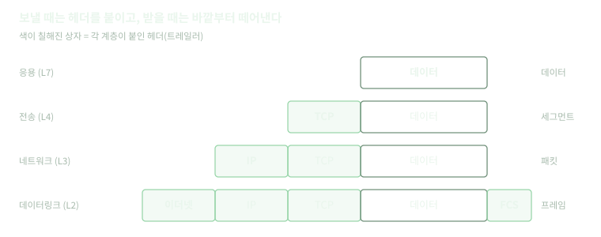
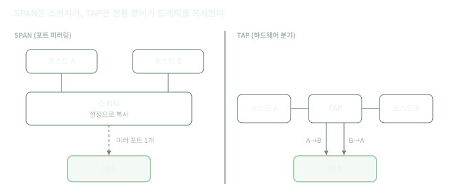
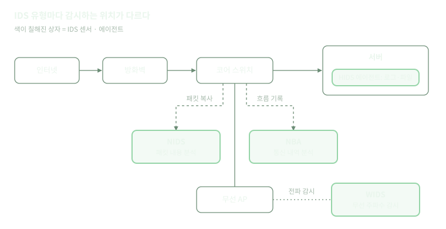
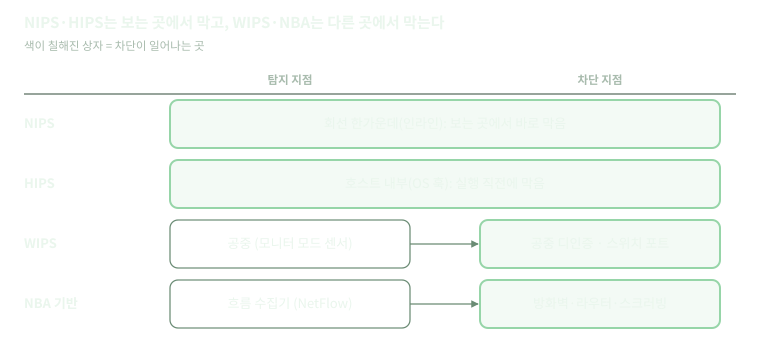
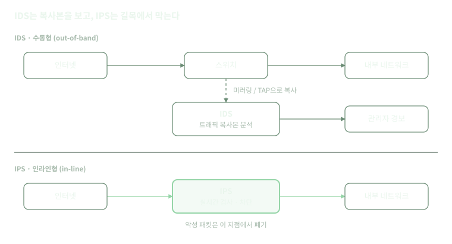

## 들어가며

방화벽만으로는 허용된 포트 안에 숨은 공격을 막을 수 없다. 웹 서버를 위해 80/443 포트를 열어 두면, 그 포트로 들어오는 SQL 인젝션도 방화벽에게는 정상 통신이다.

이 빈틈을 메우는 것이 침입 탐지 시스템(IDS)과 침입 방지 시스템(IPS)이다. 둘 다 통신의 **내용과 행위**를 들여다보고 공격을 찾아낸다. IDS는 찾아서 알리고, IPS는 찾아서 막는다.

이 글에서는 IDS와 IPS의 동작 원리, 유형, 활용 방법, 장단점, 차이점을 차례로 정리한다.

## 기본 개념

### OSI 7계층

**L7** 응용 계층 (Application)\
HTTP, DNS, FTP

**L6** 표현 계층 (Presentation)\
데이터 인코딩, 압축, 암호화

**L5** 세션 계층 (Session)\
통신 세션 관리

**L4** 전송 계층 (Transport)\
TCP, UDP, 포트 번호

**L3** 네트워크 계층 (Network)\
IP 주소, 라우팅

**L2** 데이터 링크 계층 (Data Link)\
MAC 주소, Ethernet

**L1** 물리 계층 (Physical)\
전기 신호, 케이블, 무선 신호

### 패킷 구조와 캡슐화

네트워크로 보내는 데이터는 작은 조각으로 나뉘어 전송되고, 이 조각이 패킷이다. 각 조각은 헤더와 페이로드로 이루어진다.

- **헤더**(header): 택배 송장처럼 누가, 누구에게, 어떤 방식으로 보내는지 적힌 제어 정보
- **페이로드**(payload): 실제로 전달하려는 내용물

데이터를 보낼 때는 위 계층부터 아래로 내려가며 각 계층이 자기 헤더를 앞에 붙인다. 이것을 **캡슐화**(encapsulation)라고 한다. 받는 쪽은 반대로 바깥 헤더부터 하나씩 떼어내며 읽는데(역캡슐화), IDS의 디코딩이 바로 이 과정을 흉내 낸다.



각 계층의 헤더에는 **다음에 올 프로토콜**을 알려주는 필드가 있다. 디코더는 이 필드를 따라가며 한 겹씩 해석한다.

| 계층 | 헤더 크기 | 주요 필드 | 다음 계층을 알려주는 필드 |
| --- | --- | --- | --- |
| 이더넷 (L2) | 14바이트 | 목적지·출발지 MAC | EtherType (0x0800 → IPv4, 0x86DD → IPv6) |
| IPv4 (L3) | 20\~60바이트 | 출발지·목적지 IP, TTL, 전체 길이, 단편화 정보 | Protocol (6 → TCP, 17 → UDP, 1 → ICMP) |
| TCP (L4) | 20\~60바이트 | 출발지·목적지 포트, 시퀀스 번호, 플래그 | 목적지 포트 (80 → HTTP로 추정) |
| UDP (L4) | 8바이트 | 출발지·목적지 포트, 길이 | 목적지 포트 (53 → DNS로 추정) |

예를 들어 브라우저가 example.com에 보낸 HTTP 요청 프레임(91바이트)은 다음과 같다.

```
0000  00 1a 2b 3c 4d 5e 00 11 22 33 44 55 08 00 45 00  ..+<M^.."3DU..E.
0010  00 4d 1c 46 40 00 40 06 26 d8 c0 a8 01 0a 5d b8  .M.F@.@.&.....].
0020  d8 22 c9 3a 00 50 1a 2b 3c 4d 5e 6f 70 81 50 18  .".:.P.+<M^op.P.
0030  fa f0 85 90 00 00 47 45 54 20 2f 20 48 54 54 50  ......GET / HTTP
0040  2f 31 2e 31 0d 0a 48 6f 73 74 3a 20 65 78 61 6d  /1.1..Host: exam
0050  70 6c 65 2e 63 6f 6d 0d 0a 0d 0a                 ple.com....
```

- **0x00\~0x0d (이더넷)**: 목적지·출발지 MAC 뒤의 `08 00`이 다음은 IPv4라고 알려준다.
- **0x0e\~0x21 (IP)**: `45`는 IPv4와 헤더 길이 20바이트, `06`은 다음이 TCP라는 뜻이다. `c0 a8 01 0a`는 출발지 192.168.1.10이다.
- **0x22\~0x35 (TCP)**: `00 50`은 목적지 포트 80, `18`은 PSH+ACK 플래그다.
- **0x36\~ (페이로드)**: ASCII로 `GET / HTTP/1.1`으로 시작하는 HTTP 요청이다.

### TCP·UDP와 포트

L4(전송 계층)의 대표 프로토콜은 TCP와 UDP다. 둘 다 **포트 번호**로 같은 컴퓨터 안의 어느 프로그램에게 보낼지 구분한다.

| 구분 | TCP | UDP |
| --- | --- | --- |
| 연결 | 연결을 맺고 통신 (3-way handshake) | 연결 없이 바로 전송 |
| 신뢰성 | 순서 보장, 손실 시 재전송 | 보장하지 않음 |
| 헤더 크기 | 20\~60바이트 | 8바이트 |
| 속도·부담 | 상대적으로 느리고 무거움 | 빠르고 가벼움 |
| 주로 쓰는 곳 | 웹(HTTP·HTTPS), 메일, SSH, 파일 전송 | DNS, DHCP, 스트리밍, 게임, QUIC(HTTP/3) |

TCP는 데이터를 보내기 전에 **3-way handshake**로 연결을 맺는다. 클라이언트가 SYN을 보내고, 서버가 SYN+ACK로 답하고, 클라이언트가 ACK를 보내면 연결이 성립한다. 이때 쓰는 SYN, ACK, FIN, RST 같은 플래그는 TCP 헤더에 담긴다. IDS는 규격에 맞지 않는 플래그 조합(예: SYN과 FIN을 동시에 켠 패킷)을 스캔이나 회피 시도로 보고, IPS가 연결을 끊을 때 보내는 TCP RST도 이 플래그 중 하나다.

포트 번호는 0\~65535 범위이며 용도에 따라 나뉜다.

- **잘 알려진 포트**(0\~1023): 표준 서비스용
- **등록된 포트**(1024\~49151): 특정 애플리케이션용
- **동적 포트**(49152\~65535): 클라이언트가 연결할 때 임시로 쓰는 포트

| 포트 | 프로토콜 | 서비스 |
| --- | --- | --- |
| 22 | TCP | SSH |
| 25 | TCP | SMTP (메일 전송) |
| 53 | UDP·TCP | DNS |
| 80 | TCP | HTTP |
| 443 | TCP (HTTP/3은 UDP) | HTTPS |
| 3389 | TCP | RDP (윈도우 원격 데스크톱) |

출발지 IP, 출발지 포트, 목적지 IP, 목적지 포트, 프로토콜의 다섯 값을 묶어 **5-tuple**이라고 한다. 하나의 통신(세션·흐름)을 구분하는 기준으로, IDS 룰의 헤더와 NBA의 흐름 기록이 모두 이 값을 쓴다.

다만 포트는 약속일 뿐 강제가 아니다. 80번 포트로 HTTP가 아닌 통신을 하거나 8080번 포트로 HTTP를 쓸 수도 있다. 그래서 IDS는 포트만 믿지 않고 페이로드 내용으로 프로토콜을 다시 확인한다.

### 인라인 vs 수동형

보안 장비가 트래픽을 얻는 방식은 크게 두 가지다. 이 차이가 IDS와 IPS를 가르는 출발점이다.

- **수동형**(passive, out-of-band): 원래 통신 경로 밖에서 **복사본**을 받는다. 복사본은 SPAN이나 TAP으로 얻는다. 장비가 무엇을 하든 원래 통신에는 영향이 없지만, 원본은 이미 지나갔으므로 막을 수 없다. IDS가 이 방식이다.
- **인라인**(in-line): 통신 경로 한가운데에 놓여 **원본**이 장비를 거쳐 가게 한다. 패킷을 붙잡아 판정한 뒤 통과시키거나 버릴 수 있다. 대신 장비가 느려지거나 멈추면 통신 전체가 영향을 받는다. IPS가 이 방식이다.

| 구분 | 수동형 | 인라인 |
| --- | --- | --- |
| 받는 것 | 복사본 | 원본 |
| 트래픽을 얻는 방법 | SPAN, TAP | 회선 중간에 장비 설치 |
| 차단 | 불가 (경보만) | 가능 |
| 통신 지연 | 없음 | 생김 |
| 장비 장애 시 | 감시만 멈춤 | 통신이 끊길 수 있음 (fail-open·fail-close로 대비) |
| 대표 장비 | IDS | IPS, 방화벽 |

비유하자면 수동형은 도로 옆의 CCTV, 인라인은 도로 위의 검문소다. 이어지는 SPAN과 TAP은 수동형 장비가 복사본을 얻는 두 가지 방법이다.

### SPAN (Port Mirroring)

Cisco에서 쓰는 이름이다. 일반적으로는 **포트 미러링(port mirroring)**이라고 부른다. 스위치 설정으로 특정 포트(또는 VLAN)를 오가는 트래픽을 복사해, 지정한 **목적지 포트**로 내보낸다. IDS는 그 목적지 포트에 연결한다.

#### SPAN의 종류

- **Local SPAN**: 소스 포트와 목적지 포트가 같은 스위치에 있다.
- **RSPAN (Remote SPAN)**: 복사한 트래픽을 전용 VLAN에 실어 다른 스위치로 보낸다. 여러 스위치의 트래픽을 한 곳의 IDS로 모을 수 있다.
- **ERSPAN (Encapsulated RSPAN)**: 복사한 트래픽을 GRE로 캡슐화해 L3(라우팅) 네트워크 너머로 보낸다. 원격지나 다른 건물의 트래픽도 받을 수 있다.

대부분의 관리형 스위치에 이미 있는 기능이라 장비를 추가로 살 필요가 없어서 비용이 없으며  명령어 몇 줄로 감시 대상을 바꿀 수 있고, 원격에서도 설정할 수 있는 등 유연하다.

### TAP (Network TAP)

TAP은 감시할 회선 중간에 **물리적으로 끼워 넣는 전용 장비**이다. 호스트 A와 B 사이를 흐르는 신호를 그대로 둘로 나눠서 하나는 원래 목적지로 보내고 하나는 모니터링 포트로 내보낸다. 스위치의 판단이나 설정이 개입하지 않는다.

#### 동작 방식

- **광 TAP (패시브)**: 프리즘이나 광 분배기로 빛 자체를 나눈다. 전원이 필요 없어서 TAP이 고장 나도 원래 회선은 그대로 연결된다. 다만 빛을 나누는 만큼 원래 회선의 신호 세기가 약해진다. 그래서 **분배 비율**(50:50, 70:30 등)과 광 손실 예산을 고려해야 한다.
- **구리(UTP) TAP (액티브)**: 전기 신호를 받아 다시 만들어 내보내므로 전원이 필요하다. 그래서 전원이 끊기면 릴레이가 회선을 직결해 주는 **fail-safe** 기능이 있는지 확인해야 한다.

#### TAP의 종류

- **Breakout TAP**: 방향별로 두 포트로 내보내는 기본형이다. 손실이 없다.
- **Aggregation TAP**: 두 방향을 하나의 포트로 합쳐 준다. IDS 포트가 하나여도 되지만, 합친 양이 포트 속도를 넘으면 SPAN처럼 손실이 생길 수 있어 버퍼 크기가 중요하다.
- **Regeneration TAP**: 같은 복사본을 여러 개 만들어 IDS, 패킷 저장 장비, 성능 분석 장비 등에 동시에 보낸다.
- **Bypass TAP**: 인라인 **IPS**용이다. 트래픽을 IPS로 통과시키면서 하트비트 패킷으로 IPS 상태를 확인한다. IPS가 멈추면 트래픽을 IPS 없이 바로 넘겨 네트워크가 끊기지 않게 한다. 뒤에서 볼 IPS의 fail-open을 장비 밖에서 구현하는 방법이다.

회선에 흐르는 모든 것을 받기 때문에 완전하게 복사가 된다. IP나 MAC 주소가 없어 네트워크에서 공격 대상이 되지 않는다.

| 구분 | SPAN | TAP |
| --- | --- | --- |
| 복사 주체 | 스위치 (소프트웨어 설정) | 전용 하드웨어 (물리적 분기) |
| 추가 비용 | 없음 | 장비 구매 필요 |
| 설치 | 설정만, 중단 없음 | 회선을 한 번 끊고 설치 |
| 패킷 손실 | 부하·초과 구독 시 발생 | 없음 (Aggregation TAP 제외) |
| 오류 프레임 | 복사 안 됨 | 복사됨 |
| 타이밍 정확도 | 왜곡 가능 | 보존 |
| 감시 범위 변경 | 명령어로 즉시 | 장비 재배치 필요 |
| 보안성 | 설정 변경·악용 위험 | 수동·단방향, 네트워크에 보이지 않음 |
| 적합한 용도 | 임시 점검, 저트래픽 구간, 다수 구간 감시 | 상시 보안 감시, 포렌식, 핵심 고속 회선, IPS 바이패스 |



### 프로미스큐어스 모드와 모니터 모드

SPAN이나 TAP으로 복사본을 보내도, 받는 쪽 NIC가 이를 버리면 소용없다. 그래서 감시 장비의 NIC는 남의 트래픽도 받아들이도록 특별한 모드로 설정한다.

**프로미스큐어스 모드**(promiscuous mode, 유선)

- 보통 NIC는 목적지 MAC이 자기 주소(또는 브로드캐스트·멀티캐스트)인 프레임만 받고, 나머지는 하드웨어 단계에서 버린다.
- 프로미스큐어스 모드에서는 목적지와 상관없이 들어온 프레임을 모두 운영체제로 넘긴다.
- 스위치는 프레임을 목적지 포트로만 보내므로, 일반 포트에서 이 모드를 켜도 남의 통신은 거의 보이지 않는다. 남의 트래픽이 그 포트로 오게 만드는 것이 SPAN과 TAP이고, 그것을 버리지 않고 받는 것이 프로미스큐어스 모드다. 둘이 함께 있어야 NIDS가 동작한다.
- tcpdump나 Wireshark 같은 캡처 도구는 기본적으로 이 모드를 켜고 캡처한다.

**모니터 모드**(monitor mode, 무선)

- 무선 NIC는 보통 AP에 접속한 뒤, 그 네트워크의 데이터만 주고받는다.
- 모니터 모드에서는 어떤 AP에도 접속하지 않고, 해당 채널의 공중에 오가는 모든 802.11 프레임을 그대로 받는다. 비컨·디인증 같은 관리 프레임, 제어 프레임, 다른 네트워크의 프레임까지 포함된다.
- 프레임마다 신호 세기(RSSI)와 채널 정보가 함께 붙어, 위치 추적에도 쓸 수 있다.
- 무선 칩셋과 드라이버가 지원해야 쓸 수 있고, 한 번에 한 채널만 들을 수 있다. WIDS·WIPS 센서가 이 모드를 쓴다.

| 구분 | 프로미스큐어스 모드 | 모니터 모드 |
| --- | --- | --- |
| 대상 | 유선 (이더넷) | 무선 (802.11) |
| 네트워크 접속 | 접속한 상태에서 동작 | 어떤 AP에도 접속하지 않음 |
| 받는 것 | 그 포트에 들어온 모든 프레임 | 그 채널 공중의 모든 프레임 |
| 함께 필요한 것 | SPAN 또는 TAP | 센서 배치, 채널 스캐닝 |
| 쓰는 곳 | NIDS 센서 | WIDS·WIPS 센서 |

## 1. IDS란?

IDS(Intrusion Detection System)는 네트워크나 시스템 활동을 감시해 공격·정책 위반을 탐지하고 경보를 보내는 시스템이다. 따로 직접적으로 막는 시스템은 아니다.

IDS 개념의 출발점은 1980년 James Anderson의 보고서와 1987년 Dorothy Denning의 침입 탐지 모델 논문이다.

IDS를 쓰는 목적

- **조기 경보**: 공격이 진행 중이거나 막 성공한 시점에 알아차린다.
- **가시성 확보**: 네트워크에서 실제로 무슨 일이 일어나는지 파악한다.
- **사후 분석(포렌식)**: 사고가 나면 언제, 어떻게, 어디까지 침투했는지 추적하는 근거가 된다.
- **컴플라이언스**: PCI-DSS, ISMS-P 같은 인증·규제가 침입 탐지 체계를 요구하는 경우가 많다.

## 2. 탐지 방식

IDS의 탐지 방식은 크게 세 가지이다.

- **시그니처 기반 탐지 (오용 탐지)**

알려진 공격의 패턴을 룰로 작성해 두고 일치 여부를 확인한다. 룰은 헤더와 옵션으로 이루어져 있다. 룰은 직접 쓰기보다 Emerging Threats, Snort Talos 같은 룰셋을 받아 쓰는 경우가 많다. 정확도가 높고 어떤 공격인지 바로 알 수 있지만 시그니처가 없는 제로데이 공격은 탐지하지 못한다.

- **이상 행위 기반 탐지**

정상 상태의 기준선(baseline)을 만들고 여기서 크게 벗어나는 활동을 의심한다.

**통계적 방법**: 트래픽량, 접속 횟수 등의 평균·표준편차로 임계값을 정한다.

**명세 기반**: "이 서버는 DB 서버와만 통신한다"처럼 정상 행위를 명시한다.

**머신러닝**: 클러스터링, 오토인코더 등으로 정상 패턴을 학습한다. 암호화 트래픽도 TLS 핸드셰이크 지문(JA3/JA4) 같은 메타데이터로 분석한다.

새로운 공격을 탐지할 수 있지만 오탐이 많다.

- **상태 기반 프로토콜 분석**

프로토콜 표준(RFC)에 정의된 정상 동작과 비교한다. 로그인 전에 오는 파일 전송 명령, 비정상적으로 긴 헤더 값, 80번 포트의 비HTTP 트래픽 등을 찾는다. 세션 상태를 추적하므로 자원 소모가 크다.

| 방식 | 강점 | 약점 |
| --- | --- | --- |
| 시그니처 기반 | 높은 정확도, 명확한 경보 | 제로데이·변형 공격 미탐, 룰 갱신 필요 |
| 이상 행위 기반 | 미지의 공격 탐지 | 오탐 많음, 학습 기간 필요 |
| 상태 기반 프로토콜 분석 | 프로토콜 오용 탐지 | 자원 소모 큼 |

## 3. IDS의 유형

IDS는 무엇을 감시하느냐에 따라 네 가지로 나뉘게 된다.



NIDS는 복사한 패킷의 내용을, NBA는 장비가 내보낸 통신 내역을, HIDS는 서버 내부를, WIDS는 공중의 전파를 본다.

| 유형 | 감시 대상 | 탐지 예시 | 강점 | 약점 | 대표 도구 |
| --- | --- | --- | --- | --- | --- |
| NIDS (네트워크 기반) | 네트워크 구간의 패킷 | 웹 공격, 스캐닝, 익스플로잇 | 넓은 범위를 한 번에 감시 | 암호화 트래픽 내용 확인 어려움 | Snort, Suricata, Zeek |
| HIDS (호스트 기반) | 서버·PC 내부의 로그, 파일, 프로세스 | 웹셸 업로드, 시스템 파일 변조, 루트킷 | 복호화된 데이터와 공격 성공 여부 확인 | 호스트마다 에이전트 설치·관리 | Wazuh, OSSEC, AIDE |
| WIDS (무선) | 무선 랜 주파수와 AP | 비인가 AP, 위장 AP(Evil Twin) | 유선 장비가 못 보는 무선 위협 탐지 | 무선 구간만 담당 | 상용 WIPS |
| NBA (네트워크 행위 분석) | NetFlow 같은 흐름 정보 | DDoS, 웜 확산, 내부 스캐닝 | 암호화와 무관하게 흐름 이상 탐지 | 패킷 내용은 보지 않음 | NDR 제품군 |

### NIDS(Network-based IDS)의 동작 원리

NIDS는 네트워크 구간에 센서를 두고, SPAN이나 TAP으로 복사한 패킷을 분석한다. 헤더부터 페이로드까지 패킷 전체를 보므로, 센서 하나로 구간 전체를 감시할 수 있다. NIDS는 보통 아래와 같은 파이프라인으로 패킷을 처리한다.


1. **패킷 수집 (Capture)**

   NIC를 프로미스큐어스 모드(promiscuous mode)로 두면 자기에게 오지 않은 패킷까지 모두 받아들인다. 이렇게 libpcap, AF\_PACKET 같은 캡처 라이브러리로 트래픽을 가져온다. 고속 환경에서는 PF\_RING, DPDK처럼 커널을 우회하는 기술로 패킷 손실을 줄인다. SPAN과 TAP은 둘 다 IDS가 트래픽 복사본을 얻는 방법이다.
2. **디코딩 (Decode)**

   수집한 패킷은 이더넷 → IP → TCP/UDP → 애플리케이션 프로토콜 순으로 해석한다. 헤더 길이가 맞지 않거나 플래그 조합이 비정상인 패킷은 이 단계에서 이미 이상으로 표시될 수 있다.
3. **전처리 (Preprocessing)**

   탐지 정확도를 좌우하는 가장 중요한 단계다.
   - **IP 단편 재조립**: 조각난 패킷을 원래대로 합친다. 공격 문자열을 여러 조각으로 나누면 조각 하나하나만 봐서는 탐지할 수 없기 때문이다.
   - **TCP 스트림 재조립**: 여러 세그먼트에 흩어진 데이터를 하나의 연속된 스트림으로 복원한다.
   - **정규화**: URL 인코딩(`%2e%2e%2f` → `../`), 유니코드 변형, 대소문자 차이처럼 같은 의미의 다른 표현을 하나의 형태로 통일한다.
   - **프로토콜 분석**: HTTP라면 메서드, URI, 헤더, 바디를 분리해 이후 룰이 특정 필드만 검사할 수 있게 한다.
4. **탐지 엔진 (Detection)**

   전처리된 데이터를 룰이나 행위 모델과 비교한다. 수천\~수만 개의 룰을 패킷마다 하나씩 비교하면 너무 느리다. 그래서 Aho-Corasick 같은 다중 패턴 매칭 알고리즘으로 여러 문자열을 한 번에 검색하고, 후보가 걸린 룰만 세부 조건을 검사한다.
5. **출력 (Output)**

   경보를 로그 파일, syslog, JSON(Suricata의 EVE 로그 등)으로 남기고 SIEM으로 전송한다. 필요하면 해당 세션의 패킷(pcap)도 함께 저장해 나중에 분석할 수 있게 한다.

- **잘 잡는 것**: 원격 익스플로잇, 웹 공격(SQL 인젝션, 경로 조작), 포트 스캔, 악성코드의 C2 통신, 프로토콜 규격 위반
- **못 보는 것**: 암호화된 내용, 호스트 안에서 일어난 일(공격이 실제로 성공했는지), 센서가 없는 구간의 통신
- **주의할 점**: 같은 스위치에 물린 서버끼리의 통신은 스위치 안에서 끝난다. 그래서 센서 위치에 따라 아예 보이지 않을 수 있다.

### HIDS (Host-based IDS)의 동작 원리

HIDS는 서버나 PC에 **에이전트**를 설치해 그 시스템 내부를 감시한다. 에이전트가 모은 이벤트는 중앙 관리 서버(매니저)로 보내 한곳에서 분석한다. HIDS는 보통 아래와 같은 과정으로 이벤트를 처리한다.


1. **데이터 수집 (Collection)**: NIDS가 패킷을 모은다면, HIDS는 시스템이 남기는 기록과 상태 변화를 모은다.
   - 로그: 리눅스 syslog·journald, 윈도우 이벤트 로그, 웹 서버 접근 로그
   - 파일 시스템: 중요 파일의 해시와 권한을 주기적으로 검사하거나, inotify 같은 기능으로 변경을 실시간 감지
   - 프로세스·네트워크 연결: 어떤 프로그램이 실행되고 어디로 연결하는지
   - 커널 감사: 리눅스 auditd, 윈도우 Sysmon처럼 시스템 호출 수준의 활동 기록
   - 윈도우 레지스트리: 자동 실행 항목 등의 변경
2. **파싱 (Decode)**: 로그는 프로그램마다 형식이 다른 텍스트다. 디코더가 이를 필드로 나눈다. NIDS의 디코딩이 바이트를 해석한다면, HIDS의 파싱은 텍스트를 해석한다.
   - 예: `Failed password for root from 203.0.113.5 port 22 ssh2` → 프로그램 sshd, 사용자 root, 출발지 IP 203.0.113.5, 결과 실패
3. **정규화·기준선 (Normalization)**: 탐지에 앞서 데이터를 비교할 수 있는 형태로 맞춘다.
   - 정규화: 리눅스·윈도우·여러 앱의 로그를 공통 필드(시간, 호스트, 사용자, IP, 행위)로 통일한다.
   - 시간 동기화: 호스트마다 시계가 다르면 사건 순서가 뒤섞이므로 NTP로 맞춘다.
   - 기준선(baseline): FIM은 처음 설치할 때 중요 파일의 해시 목록을 만들고, 이후 이 목록과 비교한다.
4. **탐지 엔진 (Detection)**: 정리된 이벤트를 룰과 기준선에 비추어 판정한다.
   - 단일 이벤트 룰: "새 관리자 계정 생성", "웹 루트에 .php 파일 추가"처럼 이벤트 하나로 판정한다.
   - 빈도·상관 룰: "같은 IP에서 2분 안에 로그인 실패 8회 이상"이면 무차별 대입 공격으로 본다. "실패가 반복된 뒤 성공"이면 계정 탈취를 의심한다.
   - 무결성 비교: 현재 파일 해시가 기준선과 다르면 변조로 경보한다.
   - 루트킷 검사: `/proc`의 프로세스 목록과 `ps` 결과를 비교하는 식으로 숨겨진 것을 찾는다.
   - 정책 감사: 보안 설정 기준(예: CIS 벤치마크)에서 벗어난 항목을 점검한다.
5. **출력·대응 (Output)**: 에이전트는 이벤트를 암호화된 채널로 매니저에 보내고, 매니저는 경보를 등급별로 기록해 SIEM으로 넘긴다. 일부 HIDS는 능동 대응(active response)으로 공격 IP를 방화벽에서 막거나 계정을 잠근다. 이 기능을 켜면 사실상 HIPS처럼 동작한다.

예를 들어 공격자가 HTTPS로 웹셸을 올리면 NIDS는 암호화 때문에 내용을 보지 못한다. 하지만 HIDS는 웹 루트에 생긴 새 파일(수집·무결성 비교)과, 웹 서버 프로세스가 쉘을 띄우는 모습(프로세스 감시)을 그대로 본다.

- **잘 잡는 것**: 무차별 대입 로그인, 권한 상승, 웹셸 업로드·시스템 파일 변조, 루트킷·백도어, 비인가 계정 생성, 암호화 통신으로 들어온 공격의 흔적
- **못 보는 것**: 에이전트를 설치할 수 없는 장비(네트워크 장비, 프린터, IoT), 다른 호스트를 향한 네트워크 공격·스캔, 로그로 남지 않는 행위
- **주의할 점**: 호스트가 장악되면 공격자가 에이전트를 끄거나 로그를 지울 수 있어, 이벤트를 즉시 중앙으로 보내야 한다. 또 정상적인 패치·업데이트 때 FIM 경보가 쏟아지므로, 작업 시간과 제외 경로를 정해 두어야 한다.

HIDS는 이후 EDR(Endpoint Detection and Response)로 발전했다.

### WIDS (Wireless IDS)의 동작 원리

WIDS는 전용 센서나 AP에 내장된 기능으로 **무선 주파수 자체**를 감시한다. 무선 공격은 공중에서 일어나 유선 장비를 거치지 않는 경우가 많아, NIDS로는 볼 수 없기 때문이다. WIDS는 보통 아래와 같은 과정으로 무선 환경을 분석한다.


1. **무선 신호 수집 (Capture)**: 센서의 무선 NIC를 **모니터 모드**(monitor mode)로 둔다. AP에 접속하지 않고도 해당 채널에서 오가는 모든 802.11 프레임을 공중에서 직접 받는다.
   - 채널 스캐닝: 2.4GHz·5GHz·6GHz의 여러 채널을 돌아가며 듣는다. 한 순간에는 한 채널만 들을 수 있어, 전용 센서는 무선 장치를 여러 개 두기도 한다.
   - 신호 세기(RSSI): 프레임마다 신호 세기를 함께 기록해, 나중에 위치 추적에 쓴다.
2. **프레임 해석 (Decode)**: 802.11 프레임의 헤더를 읽는다. 데이터 프레임의 내용은 보통 암호화돼 있어, 헤더와 관리 프레임 위주로 분석한다.
   - 프레임 종류: 관리(비컨, 프로브, 인증, 연결, 디인증), 제어(RTS·CTS·ACK), 데이터
   - 꺼내는 필드: SSID, BSSID(AP의 MAC), 단말 MAC, 채널, 암호화 방식(오픈·WPA2·WPA3), 시퀀스 번호
3. **무선 인벤토리 (Inventory)**: 주변의 AP와 단말을 목록으로 만들고 분류한다. NIDS의 전처리가 패킷을 모아 대화를 복원한다면, WIDS는 프레임을 모아 무선 환경 지도를 만든다.
   - 인가(authorized): 회사가 등록한 AP와 단말
   - 이웃(neighbor): 옆 사무실처럼 우리와 상관없는 AP
   - 비인가(rogue): 등록되지 않았는데 사내 유선망에 연결된 AP. 스위치의 MAC 주소 테이블과 무선 BSSID를 비교해 찾아낸다.
4. **탐지 엔진 (Detection)**: 인벤토리와 프레임 흐름을 정책·규칙·기준선에 비추어 판정한다.
   - 정책 위반: 비인가 AP, 오픈·WEP 같은 약한 암호화, 사내 단말의 외부 AP 접속, 애드혹 네트워크
   - 플러딩: 디인증 프레임이 짧은 시간에 대량으로 오면 무선 서비스 거부 공격으로 본다.
   - 위장 AP(Evil Twin): SSID는 같은데 BSSID·채널·보안 설정이 다른 AP를 찾는다. 아래 예시를 보자.
   - MAC 스푸핑: 같은 MAC인데 시퀀스 번호가 튀거나 신호 세기가 갑자기 바뀌면 다른 장비가 흉내 내는 것으로 본다.
5. **출력·대응 (Output)**: 경보를 남기고, 여러 센서의 신호 세기로 문제 AP의 위치를 추정한다. WIPS는 여기에 더해, 비인가 AP에 붙은 단말에 디인증 프레임을 보내 연결을 끊거나(무선 차단), 그 AP가 꽂힌 스위치 포트를 막는다.

예를 들어 센서가 다음 두 비컨을 동시에 들었다고 해 보자.

```
인가 AP : SSID=Corp-WiFi  BSSID=aa:bb:cc:11:22:33  채널 36  WPA2
수상한 AP: SSID=Corp-WiFi  BSSID=de:ad:be:ef:00:01  채널 6   오픈
```

SSID는 같지만 BSSID가 인가 목록에 없고, 암호화도 꺼져 있다. 직원 단말을 가짜 AP로 끌어들여 통신을 가로채려는 Evil Twin의 전형적인 모습이다.

- **잘 잡는 것**: 비인가 AP, 위장 AP(Evil Twin), 디인증 플러딩, 약한 암호화 설정, 애드혹·비인가 단말 접속, MAC 스푸핑
- **못 보는 것**: 암호화된 무선 데이터의 내용(그 안의 웹 공격은 NIDS의 몫), 센서 신호가 닿지 않는 구역, 블루투스 같은 Wi-Fi 외 무선, 채널 스캐닝 사이에 짧게 끝난 공격
- **주의할 점**: 옆 사무실 AP를 비인가로 오판하지 않도록 분류 기준을 정해야 한다. 무선 차단은 남의 네트워크에 쓰면 전파 방해로 법적 문제가 될 수 있어, 자사 네트워크에 연결된 위협에만 써야 한다. 또 관리 프레임 보호(802.11w, WPA3에서 필수)가 켜진 환경에서는 디인증 공격이 어렵고, 같은 이유로 디인증을 이용한 차단도 통하지 않는다.

### NBA (Network Behavior Analysis)의 동작 원리

NBA는 패킷 내용 대신 **흐름(flow) 기록**을 분석한다. 흐름 기록은 "누가, 누구와, 언제, 얼마나" 통신했는지에 대한 요약이다. 전화로 치면 통화 내용이 아니라 통화 내역을 보는 것이다. NBA는 보통 아래와 같은 과정으로 흐름을 분석한다.


1. **흐름 수집 (Collection)**: 라우터, 스위치, 방화벽이 지나가는 통신을 흐름 단위로 요약해 내보내고(익스포터), 수집기(콜렉터)가 이를 받는다. SPAN이나 TAP으로 패킷을 복사할 필요 없이, 이미 있는 네트워크 장비를 그대로 쓴다.
   - NetFlow·IPFIX: 모든 흐름을 기록한다. IPFIX는 NetFlow v9를 바탕으로 만든 표준이다.
   - sFlow: 패킷 N개 중 1개만 표본으로 뜨는 샘플링 방식이라 부담이 적지만, 짧은 통신은 빠질 수 있다.
   - 통신이 끝나거나 일정 시간이 지나면 레코드를 내보낸다. 레코드 하나는 수십 바이트 수준이라, 패킷 전체를 저장하는 것보다 훨씬 가볍다.
2. **레코드 해석 (Decode)**: 흐름 레코드를 필드로 나눈다. NetFlow v9와 IPFIX는 레코드 구조를 알려주는 **템플릿**을 먼저 보내므로, 수집기는 템플릿을 보고 레코드를 읽는다.
   - 5-tuple: 출발지 IP·포트, 목적지 IP·포트, 프로토콜
   - 양과 시간: 시작·종료 시각, 패킷 수, 바이트 수
   - 그 밖에: 흐름 동안 나타난 TCP 플래그, 들어온 인터페이스
3. **전처리 (Preprocessing)**: 흐름을 분석할 수 있는 형태로 다듬고 맥락을 붙인다.
   - 중복 제거: 같은 통신이 여러 장비를 거치며 여러 번 기록된 것을 하나로 합친다.
   - 양방향 결합: 요청 방향과 응답 방향 흐름을 하나의 대화로 묶는다.
   - 맥락 추가: IP에 호스트 이름, 부서, 자산 중요도, 국가 정보를 붙인다.
   - 기준선 학습: 호스트와 그룹별로 평소의 통신 상대, 시간대, 전송량을 학습해 둔다.
4. **탐지 엔진 (Detection)**: 흐름을 임계값, 패턴, 기준선에 비추어 판정한다.
   - 임계값: 한 목적지로 초당 흐름이나 패킷이 급증하면 DDoS로 본다.
   - 패턴: 한 호스트가 수백 개 IP의 같은 포트에 짧은 흐름을 만들면 스캔이나 웜 확산으로 본다. 일정한 간격으로 같은 외부 주소에 반복 접속하면 악성코드의 C2 비컨을 의심한다.
   - 기준선 대비 이상: 평소보다 훨씬 큰 외부 전송, 처음 보는 국가나 IP, 업무 시간 외의 통신을 찾는다.
   - 정책 위반: 사용자 PC가 DB 서버에 직접 접속하는 것처럼 있어서는 안 되는 통신을 찾는다.
   - 위협 인텔리전스: 알려진 악성 IP와의 통신을 찾는다.
5. **출력·대응 (Output)**: 경보를 남기고 SIEM으로 보낸다. 방화벽과 연동해 문제 IP를 막거나, DDoS일 때는 트래픽을 완화 장비로 우회시킨다. 대시보드에서는 통신량 상위 호스트와 흐름 변화를 보여준다.

예를 들어 다음과 같은 흐름 기록을 보자.

```
시각   출발지              목적지               프로토콜  전송량
03:12  10.1.5.20:51022  →  198.51.100.7:443  TCP       48 GB
```

패킷 내용은 하나도 없지만, DB 서버(10.1.5.20)가 새벽 3시에 처음 보는 외부 주소로 48GB를 보냈다는 사실만으로도 데이터 유출을 의심하기에 충분하다. HTTPS로 암호화돼 있어도 마찬가지다.

- **잘 잡는 것**: DDoS, 스캔·웜 확산, 대량 데이터 유출, C2 비컨, 측면 이동, 정책 위반 통신, 악성 IP와의 통신
- **못 보는 것**: 내용으로만 구분되는 공격(SQL 인젝션 요청 한 번은 흐름상 평범한 웹 요청), 평소 통신량 안에 숨은 공격, 샘플링에서 빠진 짧은 통신
- **주의할 점**: 기준선을 학습하는 동안과 업무 환경이 바뀔 때(새 서비스, 백업 일정 변경) 오탐이 늘어난다. 흐름이 끝나거나 일정 시간이 지나야 레코드가 나오므로 패킷 기반 탐지보다 다소 늦다. 또 장비들의 시간이 맞지 않으면 흐름을 올바르게 엮을 수 없다.

NBA는 이후 머신러닝 행위 분석을 더한 NDR(Network Detection and Response)로 발전했다.

### 상황별로 어떤 유형이 잡는가

네 유형은 서로를 대체하지 않고 **서로의 사각지대를 메운다**.

| 상황 | 잡는 유형 | 단서 |
| --- | --- | --- |
| 외부에서 웹 서버로 SQL 인젝션 (HTTP) | NIDS | HTTP 요청 페이로드의 공격 문자열 |
| HTTPS로 웹셸 업로드 | HIDS | 웹 루트의 새 파일, 웹 서버의 쉘 실행 |
| 직원이 몰래 무선 공유기 설치 | WIDS | 등록되지 않은 AP의 전파 |
| 감염 PC가 내부망 전체를 스캔 | NBA, NIDS | 한 호스트에서 수백 개 IP로 짧은 연결 |
| 새벽에 DB 서버에서 외부로 대량 전송 | NBA | 평소와 다른 시간대·전송량·목적지 |

실무에서는 여러 유형을 함께 쓰고, 결과를 SIEM에서 모아 본다. 예를 들어 Suricata(NIDS)와 Wazuh(HIDS)를 함께 운영하는 구성이 흔하다.

## 4. IPS란?

IPS(Intrusion Prevention System)는 IDS의 탐지 기능에 **실시간 차단** 기능을 더한 시스템이다.

핵심은 배치 방식이다. IPS는 트래픽 경로 한가운데에 **인라인**(in-line)으로 놓여, 모든 패킷이 IPS를 거쳐야만 목적지에 도착한다. 그래서 공격 패킷이 목적지에 닿기 전에 멈출 수 있다.

IPS를 쓰는 목적

- **실시간 차단**: 공격이 목적지에 닿기 전에 막는다.
- **가상 패치(virtual patching)**: 취약점 패치를 바로 적용할 수 없는 서버를, 그 취약점을 노리는 공격 패킷을 막아 보호한다.
- **대응 자동화**: 사람이 경보를 확인하기 전에 시스템이 먼저 대응해, 대응 시간과 관리 부담을 줄인다.
- **정책 강제**: 금지된 프로토콜이나 애플리케이션 사용을 막는다.

### 대응 방식

탐지 방식(시그니처, 이상 행위, 프로토콜 분석)은 IDS와 같고, 탐지 뒤에 다음과 같은 대응을 한다.

- **패킷 폐기(drop)**: 악성 패킷을 조용히 버린다.
- **세션 리셋**: TCP RST를 보내 연결을 끊는다.
- **IP 차단**: 공격 출발지를 일정 시간 또는 영구히 막는다.
- **트래픽 정제**: 패킷의 악성 부분만 제거하거나 정규화해 통과시킨다.
- **방화벽 연동**: 방화벽 정책을 동적으로 바꿔 차단을 넓힌다.

### 장애 대비: fail-open과 fail-close

IPS는 모든 트래픽의 길목에 있어, IPS가 멈추면 네트워크도 멈출 수 있다. 그래서 장애 때 트래픽을 그대로 통과시키는 **fail-open**(바이패스)과, 보안을 위해 트래픽을 끊는 **fail-close** 중 하나를 골라 설정한다. 가용성이 중요한 대부분의 환경은 fail-open을 택한다.

## 5. IPS의 유형

IPS도 IDS와 같이 네 가지로 나뉜다. 다만 IDS는 복사본을 받아 보면 되지만, IPS는 **원본을 붙잡아야** 막을 수 있다. 그래서 원본을 붙잡을 수 있는지에 따라 탐지 지점과 차단 지점이 같기도 하고 다르기도 하다.



NIPS와 HIPS는 원본을 붙잡아 보는 곳에서 바로 막는다. WIPS와 NBA 기반 방지는 원본을 붙잡을 수 없어, 다른 장비를 움직여 사후에 막는다.

| 유형 | 놓이는 위치 | 트래픽을 얻는 방식 | 탐지 지점 | 차단 지점 | 인라인 |
| --- | --- | --- | --- | --- | --- |
| NIPS (네트워크 기반) | 회선 중간 | 원본이 통과 | 회선 | 같은 회선 (패킷 폐기·세션 리셋) | O |
| HIPS (호스트 기반) | 호스트 내부 | OS 훅으로 행위를 붙잡음 | 호스트 | 같은 호스트 (실행·쓰기·연결 차단) | O (호스트 안에서) |
| WIPS (무선) | 공중 | 엿듣기 (모니터 모드) | 공중 | 공중(디인증) 또는 스위치 포트 | X |
| NBA 기반 | 흐름 수집기 | 흐름 기록 수신 | 수집기 | 방화벽·라우터·스크러빙 센터 | X |

IDS 유형이 "무엇을, 어디서 보느냐"로 나뉘었다면, IPS 유형은 여기에 "원본을 붙잡을 수 있느냐"가 더해진다. 아래 흐름도에서는 차단이 일어나는 단계를 강조했다.

### NIPS (Network-based IPS)의 동작 원리

NIPS는 회선 한가운데에 **인라인**으로 놓여 원본 패킷을 직접 받는다. 판정이 끝날 때까지 패킷을 붙잡아 두므로, 보는 곳에서 바로 막을 수 있다. NIPS는 보통 아래와 같은 과정으로 패킷을 처리한다.


1. **인라인 수신 (Inline Receive)**

   두 포트를 브리지처럼 묶어 회선 중간에 둔다. IP 주소가 없는 투명한 장비라 네트워크에서는 보이지 않는다(bump-in-the-wire). NIDS가 SPAN·TAP으로 복사본을 받는 것과 달리, NIPS가 받는 것은 원본이다.
   - 전용 장비: 포트 쌍(세그먼트) 단위로 회선에 끼운다.
   - Suricata: 리눅스 NFQUEUE로 커널(Netfilter)이 넘겨준 패킷을 판정해 돌려주거나, AF\_PACKET 인라인 모드로 두 인터페이스 사이를 중계한다.
   - 장애 대비: Bypass TAP이나 내장 바이패스로, 장비가 멈추면 트래픽을 그대로 흘려보낸다.
2. **디코딩·전처리 (Decode·Preprocessing)**

   NIDS와 같은 디코딩과 재조립·정규화를 거친다. 다만 IPS는 정규화한 결과를 실제로 내보낼 수 있다. 겹치는 단편처럼 호스트마다 다르게 해석될 수 있는 패킷을 하나로 정리해 보내면, IPS와 목적지가 같은 데이터를 보게 되어 회피 기법이 통하기 어렵다.
3. **탐지 엔진 (Detection)**

   NIDS와 같은 룰을 쓰지만, 룰의 첫 단어인 **동작**(action)이 다르다. 예를 들어 `alert tcp ...`를 `drop tcp ...`로 바꾸면 같은 탐지 조건에서 경보 대신 차단이 일어난다.
   - `alert`: 경보만 남기고 통과시킨다.
   - `drop`: 패킷을 버리고 경보를 남긴다.
   - `reject`: 패킷을 버리고 상대에게 TCP RST나 ICMP 오류를 보낸다.
   - `pass`: 검사를 멈추고 통과시킨다.
4. **판정 (Verdict)**

   패킷마다 통과할지 버릴지 정한다. 한 번 drop 룰에 걸린 세션은 이후 패킷도 모두 버린다. 확신이 낮은 룰은 alert로 두고, 오탐이 거의 없는 룰만 drop으로 바꾸는 식으로 위험을 조절한다.
5. **차단·기록 (Enforcement)**

   판정에 따라 패킷을 버리거나, TCP RST로 양쪽 연결을 끊거나, 출발지 IP를 일정 시간 막는다. 경보와 차단 기록은 로그와 SIEM으로 보낸다.

- **잘 막는 것**: 알려진 취약점 익스플로잇(가상 패치), 웜처럼 자동화된 공격, 포트 스캔, 프로토콜 규격 위반 패킷, 금지된 프로토콜·애플리케이션
- **못 막는 것**: 그 회선을 지나지 않는 통신, 복호화하지 않은 암호화 트래픽의 내용, 룰이 없는 제로데이 공격, 정상 계정을 악용한 행위
- **주의할 점**: 오탐이 곧 업무 장애다. 처음에는 탐지 전용 모드로 운영하며 튜닝한 뒤 차단 모드로 바꾼다. 또 모든 트래픽이 거쳐 가므로 처리 용량과 지연, 장애 대비(fail-open)를 함께 설계해야 한다.

NIPS는 오늘날 차세대 방화벽(NGFW)에 통합된 형태로 많이 쓰인다.

### HIPS (Host-based IPS)의 동작 원리

HIPS는 서버나 PC에 설치한 **에이전트**가 운영체제에 끼어들어, 행위가 실행되기 직전에 붙잡는다. HIDS가 로그와 파일 변화를 보고 사후에 알린다면, HIPS는 그 행위 자체를 거부한다. HIPS는 보통 아래와 같은 과정으로 동작한다.


1. **행위 가로채기 (Intercept)**: 운영체제의 여러 지점에 훅을 걸어, 행위가 실행되기 직전에 붙잡는다.
   - 네트워크: 윈도우 WFP, 리눅스 Netfilter로 연결을 허용하거나 막는다.
   - 파일 시스템: 파일 시스템 필터 드라이버로 파일 생성·수정을 가로챈다.
   - 프로세스: 프로세스 생성 콜백, 리눅스 LSM·eBPF로 실행을 감시한다.
   - 메모리: 다른 프로세스에 코드를 주입하거나 익스플로잇이 메모리를 조작하는 동작을 감시한다.
   - 윈도우 레지스트리: 자동 실행 항목 등의 변경을 가로챈다.
2. **맥락 수집 (Context)**: 붙잡은 행위의 맥락을 모은다. HIDS의 파싱·정규화에 해당하지만, 로그가 아니라 실시간 이벤트를 다룬다.
   - 누가: 프로세스, 부모 프로세스, 사용자 계정
   - 무엇을: 파일 경로, 레지스트리 키, 목적지 IP·포트
   - 어떻게: 명령줄 인자, 호출 순서
3. **탐지 엔진 (Detection)**: 맥락을 정책·시그니처·행위 규칙에 비추어 판정한다.
   - 정책: "웹 서버 프로세스는 쉘을 실행할 수 없다", "웹 루트에는 배포 계정만 쓸 수 있다"처럼 허용 범위를 정한다. 허용된 프로그램만 실행하게 하는 애플리케이션 화이트리스팅도 여기에 든다.
   - 시그니처: 알려진 익스플로잇 패턴, 악성 파일 해시와 비교한다.
   - 행위 규칙: 짧은 시간에 대량의 파일을 암호화하면 랜섬웨어로, 다른 프로세스 메모리에 코드를 쓰면 코드 주입으로 본다.
4. **집행 (Enforcement)**: 행위가 실행되기 전에 허용하거나 거부한다. 파일 쓰기 거부, 프로세스 실행 차단·강제 종료, 연결 차단, 호스트를 네트워크에서 분리하는 격리까지 할 수 있다.
5. **보고 (Report)**: 차단한 행위와 맥락을 중앙 매니저로 보내고, 매니저는 SIEM으로 넘긴다. 정책은 반대로 매니저에서 에이전트로 내려보낸다.

앞의 HTTPS 웹셸 예시에서 HIDS는 웹 루트에 새 파일이 생긴 뒤에 경보를 낸다. HIPS는 웹 서버 프로세스가 웹 루트에 실행 파일을 쓰려는 순간, 또는 웹셸이 쉘을 띄우려는 순간에 그 행위를 거부한다.

- **잘 막는 것**: 웹셸 실행, 랜섬웨어의 암호화 행위, 권한 상승 익스플로잇, 비인가 프로그램 실행, 악성 프로세스의 외부 연결, 암호화 통신으로 들어온 공격의 실행 단계
- **못 막는 것**: 에이전트를 설치할 수 없는 장비(네트워크 장비, 프린터, IoT), 대역폭을 채우는 DDoS 같은 네트워크 단 공격, 정책상 허용된 행위를 악용하는 공격
- **주의할 점**: 정책이 엄격하면 정상 프로그램과 업데이트까지 막힌다. 그래서 처음에는 학습·감시 모드로 운영한다. 또 커널 수준에서 동작하므로 에이전트 자체의 오류가 시스템 장애로 이어질 수 있다. 2024년 7월 보안 에이전트 업데이트 오류로 전 세계 윈도우 PC가 대규모로 멈춘 사고가 대표적이다.

HIPS는 이후 백신과 합쳐진 EPP(Endpoint Protection Platform)와, 탐지·대응을 더한 EDR로 흡수됐다.

### WIPS (Wireless IPS)의 동작 원리

WIPS는 WIDS의 탐지에 차단을 더한다. 하지만 전파에는 끼워 넣을 회선이 없어 **인라인이 불가능하다**. 그래서 센서가 엿들어 탐지한 뒤, 공중에 프레임을 쏘거나 유선 스위치를 움직여 막는다. WIPS는 보통 아래와 같은 과정으로 동작한다.


1. **무선 신호 수집 (Capture)**: WIDS와 같다. 센서의 무선 NIC를 모니터 모드로 두고 여러 채널을 돌아가며 802.11 프레임과 신호 세기를 받는다. 차단에 대비해, 듣기 전용 무선 장치와 프레임을 보낼 무선 장치를 따로 두기도 한다.
2. **프레임 분류 (Classify)**: 프레임을 해석해 주변 AP와 단말을 인가·이웃·비인가로 나눈다. 스위치의 MAC 주소 테이블과 무선 BSSID를 비교해, 비인가 AP가 사내 유선망에 연결됐는지도 확인한다.
3. **탐지 엔진 (Detection)**: WIDS와 같은 규칙으로 비인가 AP, 위장 AP(Evil Twin), 디인증 플러딩, MAC 스푸핑, 약한 암호화 설정을 찾는다.
4. **차단 대상 판정 (Target)**: 탐지한 것을 모두 막지는 않는다. 남의 전파를 방해하면 법적 문제가 되므로, 자사에 영향을 주는 경우만 차단 대상으로 고른다.
   - 차단 대상: 사내 유선망에 연결된 비인가 AP, 자사 SSID를 흉내 낸 위장 AP에 붙은 자사 단말, 사내 AP에 붙은 비인가 단말
   - 차단하지 않음: 사내망과 상관없는 이웃 AP와 그 단말
5. **차단 집행 (Enforcement)**: 탐지한 곳(공중)과 다른 곳에서도 막는다.
   - 공중 차단(containment): 비인가 AP와 단말 사이에 디인증 프레임을 계속 보내 연결을 끊는다.
   - 유선 차단: 비인가 AP가 꽂힌 스위치 포트를 찾아 비활성화한다.
   - 위치 추적: 여러 센서의 신호 세기로 장비 위치를 알려, 담당자가 직접 제거하게 한다.

NIPS가 패킷을 "붙잡아 버리는" 방식이라면, WIPS는 이미 맺어진 연결을 "끊는" 방식이다. 그래서 차단 전에 오간 짧은 통신까지 막을 수는 없다.

- **잘 막는 것**: 비인가 AP를 통한 내부망 접근, 자사 단말의 위장 AP 접속, 비인가 단말의 사내 AP 접속, 애드혹 네트워크
- **못 막는 것**: 전파 재밍 같은 물리적 방해, 관리 프레임 보호(802.11w)가 켜진 환경의 공중 차단, LTE 동글처럼 Wi-Fi가 아닌 외부 연결, 차단 전에 끝난 짧은 통신
- **주의할 점**: 이웃 AP를 비인가로 오판해 차단하면 법적 문제가 될 수 있다. 분류 기준을 정하고, 자동 차단은 사내망에 연결된 것이 확인된 경우로 제한한다. 또 오판 시 자사의 정상 무선 연결까지 끊길 수 있다.

### NBA 기반 방지의 동작 원리

NBA 기반 방지는 흐름 기록으로 이상을 찾고, 차단은 방화벽이나 라우터 같은 다른 장비에 맡긴다. 패킷이 수집기를 거치지 않으므로 **인라인이 아니다**. 대규모 DDoS 대응에 많이 쓰여 "트래픽량 기반 IPS(rate-based IPS)"라고도 부른다. 보통 아래와 같은 과정으로 동작한다.


1. **흐름 수집 (Collection)**: NBA와 같다. 라우터, 스위치, 방화벽이 NetFlow·IPFIX·sFlow로 내보낸 흐름 기록을 수집기가 받는다.
2. **해석·전처리 (Preprocessing)**: 레코드를 필드로 나누고, 중복을 없애고, 양방향 흐름을 묶는다. 호스트·그룹별로 평소 통신량과 상대를 학습해 기준선을 만든다.
3. **탐지 엔진 (Detection)**: 임계값, 패턴, 기준선에 비추어 DDoS, 스캔·웜 확산, 대량 유출, C2 비컨을 찾는다.
4. **대응 결정 (Decide)**: 공격의 종류와 규모에 따라 어디서, 어떻게 막을지 고른다. 감염 호스트 하나라면 격리하고, 대규모 DDoS라면 회선 앞단에서 걸러야 한다.
5. **차단 연동 (Enforcement)**: 결정에 따라 다른 장비에 차단을 맡긴다.
   - 방화벽·NIPS: API로 차단 규칙을 내려보낸다.
   - 라우터: ACL을 걸거나, BGP Flowspec으로 특정 트래픽을 버리는 규칙을 여러 라우터에 한 번에 배포한다. RTBH(Remotely Triggered Black Hole)는 공격받는 목적지로 가는 트래픽을 통째로 버린다.
   - 스크러빙 센터: 트래픽을 우회시켜 공격 트래픽만 걸러낸 뒤 정상 트래픽을 돌려보낸다.
   - 스위치·NAC: 감염 호스트가 물린 포트를 막거나 격리 VLAN으로 옮긴다.

탐지하는 곳(수집기)과 막는 곳(방화벽·라우터)이 갈라져 있고, 흐름 기록이 쌓여야 판단할 수 있다. 그래서 첨 패킷부터 막지는 못하고, 공격이 시작된 뒤 수십 초에서 수 분 단위로 반응한다.

- **잘 막는 것**: 대규모 DDoS, 웜 확산·내부 스캔 중인 감염 호스트, 대량 유출 중인 연결, 알려진 악성 IP와의 통신
- **못 막는 것**: 첫 패킷(흐름 기록이 쌓여야 판단), SQL 인젝션처럼 내용으로만 구분되는 공격, 짧고 작은 공격
- **주의할 점**: RTBH처럼 강한 수단은 공격받는 서비스까지 함께 끊는다. 백업 같은 정상 대량 전송을 공격으로 오판할 수 있어, 자동 차단의 범위와 유지 시간을 제한해 두어야 한다.

NBA 기반 방지는 오늘날 NDR과 DDoS 방어 서비스의 핵심 기능으로 쓰인다.

### 상황별로 어떤 유형이 막는가

IDS 유형처럼 IPS 유형도 서로를 대체하지 않고 **막는 지점을 나눠 맡는다**.

| 상황 | 막는 유형 | 막는 방법 |
| --- | --- | --- |
| 알려진 웹 취약점을 노린 익스플로잇 (HTTP) | NIPS | drop 룰로 공격 요청 패킷 폐기 |
| HTTPS로 올라온 웹셸 실행 | HIPS | 웹 서버 프로세스의 쉘 실행 거부 |
| 랜섬웨어의 대량 파일 암호화 | HIPS | 암호화 행위 차단, 프로세스 종료 |
| 직원이 몰래 설치한 무선 공유기 | WIPS | 공중 차단, 연결된 스위치 포트 비활성화 |
| 대규모 DDoS | NBA 기반 | 라우터 차단 규칙 배포, 스크러빙 센터로 우회 |
| 감염 PC의 내부망 스캔 | NBA 기반, NIPS | 호스트 격리, 스캔 패킷 폐기 |

실무에서는 경계의 NGFW(NIPS)와 단말의 EDR(HIPS)을 기본으로 두고, 필요에 따라 WIPS와 DDoS 방어 서비스를 더하는 구성이 흔하다.

## 6. IDS와 IPS의 차이

두 시스템의 가장 큰 차이는 탐지 방식이 아니라 **네트워크에 놓이는 위치**다.



IDS는 스위치가 복사해 준 트래픽만 보므로 통신에 영향을 주지 않지만, 공격은 이미 목적지에 도착한 뒤다. IPS는 모든 트래픽이 거쳐 가는 길목에 있어 즉시 막을 수 있다.

다만 이는 NIPS 기준이다. 5장에서 본 것처럼 WIPS와 NBA 기반 방지는 인라인이 아니어서, 탐지한 뒤 다른 장비를 움직여 막는다.

| 구분 | IDS | IPS |
| --- | --- | --- |
| 역할 | 탐지 + 경보 | 탐지 + 차단 |
| 배치 | 미러링 포트·TAP (수동형) | 트래픽 경로 중간 (인라인) |
| 대응 주체 | 사람 (관리자·보안관제) | 시스템 (자동) |
| 네트워크 영향 | 거의 없음 | 지연 발생, 장애 지점 가능 |
| 오탐의 결과 | 불필요한 경보 | 정상 트래픽 차단 (업무 장애) |
| 장애 시 | 통신은 정상, 감시만 중단 | fail-open 또는 fail-close 설정에 따름 |
| 주 용도 | 가시성 확보, 포렌식, 감사 | 실시간 방어 |

## 7. 장단점

IDS는 안전하지만 느리고, IPS는 빠르지만 위험을 안고 있다.

| 구분 | 장점 | 단점 |
| --- | --- | --- |
| IDS | 네트워크 성능·가용성에 영향 없음 · 오탐이 나도 업무 장애 없음 · 상세한 기록으로 포렌식에 유리 | 공격을 직접 막지 못함 · 경보 확인이 늦으면 피해 확대 · 사람의 대응에 의존 |
| IPS | 공격을 목적지 도달 전에 차단 · 대응 자동화로 관리 부담 감소 · 취약점 패치 전 가상 패치 역할 | 오탐 시 정상 업무 차단 · 트래픽 지연 발생 · 장애 시 네트워크 단절 위험 |

### 오탐과 미탐

탐지 결과는 네 가지이며, 운영의 핵심은 오탐과 미탐의 균형이다.

|  | 실제 공격 O | 실제 공격 X |
| --- | --- | --- |
| 경보 O | 정탐 (True Positive) | **오탐 (False Positive)** |
| 경보 X | **미탐 (False Negative)** | 정상 (True Negative) |

- **미탐**은 공격을 놓치므로 보안상 가장 위험하다.
- **오탐**이 많으면 담당자가 경보에 무뎀지는 경보 피로(alert fatigue)가 생긴다. IPS라면 정상 트래픽까지 끊긴다.

### 기저율 문제

실제 공격은 전체 트래픽에서 극히 적은 비율이다. 그래서 오탐률이 0.1%처럼 낮아 보여도, 하루 1억 건의 이벤트에서는 오탐이 10만 건이 된다. 1999년 Stefan Axelsson이 제기한 이 **기저율 오류(base-rate fallacy)** 때문에, IDS/IPS 운영은 결국 오탐을 줄이는 싸움이 된다.

## 8. 활용 방법

실무에서는 경계에 IPS를 두어 막고, 내부에 IDS와 HIDS를 두어 보는 **다층 방어(Defense in Depth)** 구조로 함께 쓴다.

### 어디에 둘 것인가

| 위치 | 보이는 것 | 특징 |
| --- | --- | --- |
| 방화벽 바깥 | 외부에서 오는 모든 공격 시도 | 차단될 트래픽까지 경보가 나 소음이 많음 |
| 방화벽 안쪽 | 방화벽을 통과한 실제 위협 | 가장 일반적인 위치 |
| DMZ | 웹·메일 등 공개 서버 대상 공격 | 외부 노출 서비스 보호 |
| 내부 핵심 구간 | DB·서버팜으로 가는 트래픽 | 내부 침투자의 측면 이동, 내부자 행위 감시 |

### 트래픽을 가져오는 방법 (IDS)

SPAN과 TAP의 차이는 앞의 '기본 개념'에서 정리했다. 상시 감시가 필요한 핵심 회선에는 TAP을, 임시 점검이나 넓은 구간 감시에는 SPAN을 쓰는 경우가 많다.

### 운영과 튜닝

IDS/IPS는 설치보다 운영 품질이 성능을 좌우한다.

1. 보호 환경에 맞는 룰만 켠다. 리눅스 서버만 있다면 윈도우 전용 룰은 끈다.
2. `$HOME_NET` 같은 네트워크 변수를 정확히 설정한다.
3. 정상 업무로 반복되는 오탐은 특정 출발지·목적지에 한해 억제(suppression)한다.
4. 같은 경보가 수천 번 나지 않도록 임계값(threshold)을 둔다.
5. IPS는 처음에 탐지 전용 모드로 운영하며 튜닝한 뒤 차단 모드로 전환한다.

경보는 SIEM으로 모아 방화벽, 서버 로그, EDR 이벤트와 연관 분석한다. 보안관제(SOC) 요원이 정탐·오탐을 판정하고, 정탐은 침해사고 대응으로, 오탐은 룰 튜닝으로 넘긴다.

### 대표 도구

| 도구 | 종류 | 특징 |
| --- | --- | --- |
| Snort | NIDS/NIPS | 가장 널리 쓰이는 오픈소스, 룰 문법의 사실상 표준 |
| Suricata | NIDS/NIPS | 멀티스레드로 고속 네트워크에 유리, Snort 룰 호환 |
| Zeek (구 Bro) | NIDS (분석형) | 네트워크 활동을 상세 로그로 남기고 스크립트로 분석 |
| Wazuh / OSSEC | HIDS | 로그 분석, 파일 무결성 검사, 루트킷 탐지 |

상용 환경에서는 IPS를 단독 장비보다 차세대 방화벽(NGFW)이나 UTM의 내장 기능으로 쓰는 경우가 많다.

## 9. 한계와 최신 동향

IDS/IPS의 가장 큰 숙제는 암호화와 탐지 회피이며, 오늘날 그 기능은 NGFW·NDR·XDR로 흡수되고 있다.

### 한계

- **해석 차이를 이용한 우회**: 1998년 Ptacek과 Newsham은 IDS와 목적지 호스트가 패킷을 다르게 해석할 수 있다는 약점을 지적했다. 삽입(insertion)과 회피(evasion) 공격이 대표적이다. 그래서 최신 제품은 보호 대상 OS에 맞춘 **타깃 기반 재조립**을 지원한다.
- **암호화 트래픽**: TLS 트래픽의 내용은 볼 수 없다. 복호화(SSL/TLS 인스펙션)는 성능 부담과 개인정보 문제를 낳는다.
- **성능 한계**: 처리 용량을 넘으면 IDS는 패킷을 놓치고, IPS는 지연이 커진다.
- **정상 권한 악용**: 탈취한 정상 계정으로 하는 행위는 트래픽 패턴만으로 구분하기 어렵다.

### 최신 동향

- **NGFW 통합**: 방화벽, IPS, 애플리케이션 식별, URL 필터링이 한 장비에 들어간다.
- **NDR (Network Detection and Response)**: 머신러닝 행위 분석으로 암호화 트래픽의 메타데이터까지 분석하고 대응한다.
- **EDR / XDR**: HIDS는 EDR로 발전했고, 네트워크·엔드포인트·클라우드를 통합 분석하는 XDR로 확장되고 있다.
- **클라우드**: AWS VPC 트래픽 미러링, 관리형 IDS/방화벽 서비스로 가상 환경에서도 같은 기능을 쓴다.

## 마치며

한 줄로 요약하면 **IDS는 "보고 알리는" 시스템, IPS는 "보고 막는" 시스템**이다.

- 둘 다 방화벽이 허용한 통신 속에 숨은 공격을 찾는다.
- 가장 큰 차이는 배치다. IDS는 복사본을 보고, IPS는 길목에 서서 직접 막는다.
- 탐지 정확도는 전처리와 룰 품질에, 실제 효과는 튜닝과 경보 처리 운영에 달려 있다.

### 느낀 점

처음에는 "막을 수 있는 IPS가 무조건 좋지 않나?"라고 생각했다. 하지만 오탐 하나가 정상 업무를 멈출 수 있고, IPS 장애가 곧 네트워크 장애가 된다는 점을 알게 됐다. 결국 둘은 경쟁 관계가 아니라, 역할을 나눠 함께 쓰는 도구라는 것이 가장 크게 남았다.

다음에는 Suricata를 직접 설치해 룰을 작성하고 경보가 발생하는 과정을 실습해 볼 계획이다.
