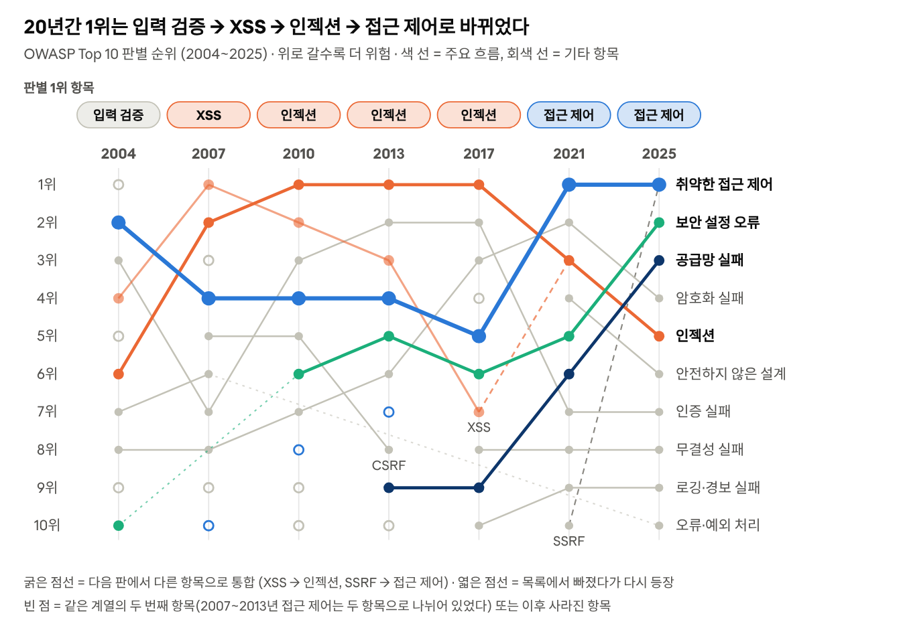
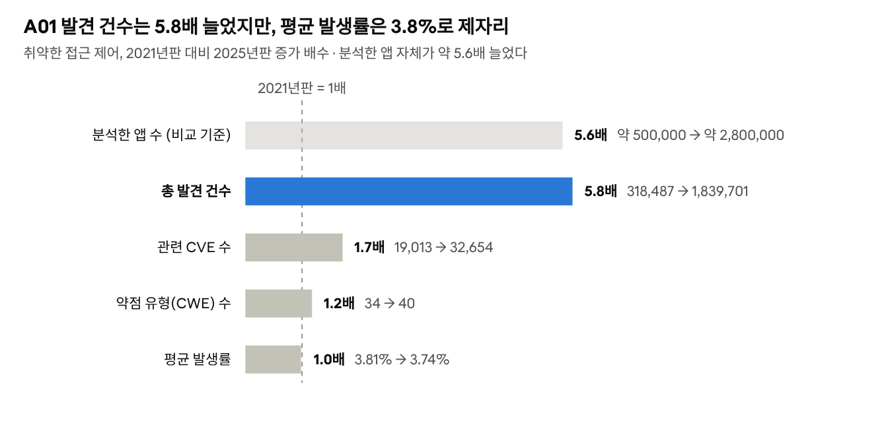

## OWASP Top 10:2025 한눈에 보기

**OWASP**(Open Worldwide Application Security Project)는 웹 보안을 연구하는 비영리 단체다. 이 단체가 몇 년마다 "지금 웹 애플리케이션에서 가장 중요한 보안 위험 10가지"를 뽑아 발표하는데, 이것이 **OWASP Top 10**이다. 데이터 기반으로 이루어진 인식 제고를 위한 문서이며, 표준이나 규정 준수 체크리스트가 아닌, 조직이 보안 위험에 우선순위를 부여하도록 돕는 역할을 한다.

2025년판은 8번째 에디션이다. 어떻게 만들었을까? OWASP는 Accenture, Bugcrowd, Veracode 등 12개 기관과 익명 기여자에게서 280만 개가 넘는 애플리케이션의 점검 데이터를 모았다. 여기서 8개 항목을 데이터로 순위를 매기고, 나머지 2개(A03, A09)는 현업 전문가 설문을 반영해 올렸다.

| 순위    | 항목                                                        | 쉽게 말하면                                                              | 2021년 대비 변화                            |
|---------|-------------------------------------------------------------|--------------------------------------------------------------------------|---------------------------------------------|
| **A01** | **취약한 접근 제어 (Broken Access Control)**                | **로그인한 사용자가 자기 권한 밖의 데이터·기능에 접근한다**              | **1위 유지, SSRF 흡수**                     |
| A02     | 보안 설정 오류 (Security Misconfiguration)                  | 기본 비밀번호를 그대로 두거나, 필요 없는 기능·포트를 켜두는 등 설정 실수 | 5위 → 2위                                   |
| A03     | 소프트웨어 공급망 실패 (Software Supply Chain Failures)     | 가져다 쓰는 라이브러리, 빌드 도구, 배포 과정이 취약하거나 오염된다       | 신규 (기존 '취약하고 오래된 구성요소' 확장) |
| A04     | 암호화 실패 (Cryptographic Failures)                        | 비밀번호·개인정보를 암호화하지 않거나 약한 방식으로 암호화한다           | 2위 → 4위                                   |
| A05     | 인젝션 (Injection)                                          | 입력칸에 SQL 같은 명령어를 섞어 서버가 실행하게 만든다 (XSS 포함)        | 3위 → 5위                                   |
| A06     | 안전하지 않은 설계 (Insecure Design)                        | 코드를 짜기 전, 설계 단계부터 보안 고려가 빠져 있다                      | 4위 → 6위                                   |
| A07     | 인증 실패 (Authentication Failures)                         | 비밀번호 무한 대입 허용, 약한 비밀번호 등 로그인 과정의 허점             | 7위 유지, 이름 변경                         |
| A08     | 소프트웨어 또는 데이터 무결성 실패                          | 업데이트나 데이터가 중간에 변조되지 않았는지 확인하지 않는다             | 8위 유지                                    |
| A09     | 보안 로깅 및 경보 실패                                      | 공격이 일어나도 기록과 알림이 없어 알아채지 못한다                       | 9위 유지, '경보' 강조                       |
| A10     | 예외 상황 처리 미흡 (Mishandling of Exceptional Conditions) | 오류가 났을 때 막히지 않고 '열린 채로' 넘어가거나 내부 정보를 노출한다   | 신규                                        |

아래에서 1위부터 10위까지 하나씩 살펴본다.

출처: [OWASP Top 10:2025 Introduction](https://top10.owasp.org/2025/0x00_2025-Introduction/)

## 2025년 1위~10위 항목 설명

각 항목을 **쉽게 말하면 → 예시 → 막으려면** 순서로 정리했다. 설명은 OWASP의 항목별 공식 문서를 바탕으로 했다.

### A01. 취약한 접근 제어 (1위 유지)

- **쉽게 말하면**: 로그인은 제대로 했는데 내 권한 밖의 데이터나 기능에 접근할 수 있는 상태다. 호텔 카드키 하나로 남의 방까지 열리는 것과 같다.

- **예시**: 주소창의 `orders?id=1001`을 `1002`로 바꾸자 남의 주문이 보인다(IDOR). 2019년 미국 First American은 문서 번호만 바꾸면 다른 사람 문서가 열려 약 8억 8,500만 건이 노출됐다.

- **2025년 변화**: 서버를 속여 내부망에 요청을 보내게 하는 SSRF가 이 항목으로 합쳐졌다. 묶인 약점 유형(CWE)이 40개로 가장 많다.

- **막으려면**: 기본값은 '거부'로 두고, 서버가 매 요청마다 "이 사람이 이 데이터의 주인인가"를 확인한다.

### A02. 보안 설정 오류 (5위 → 2위)

- **쉽게 말하면**: 프로그램은 멀쩡한데 설정을 잘못해서 생기는 구멍이다.

- **예시**: 관리자 계정을 기본 비밀번호 그대로 둠, 테스트용 샘플 페이지를 운영 서버에 남김, 오류 화면에 내부 정보가 그대로 노출됨, 클라우드 저장소를 누구나 읽을 수 있게 열어둠.

- **왜 올랐나**: OWASP는 소프트웨어가 설정할 거리가 많아지면서 잘못 설정될 곳도 늘었다고 설명한다.

- **막으려면**: 모든 환경을 같은 방식으로 잠그는 자동화된 설정 절차를 만들고, 안 쓰는 기능은 지우고, 설정을 자동으로 점검한다.

### A03. 소프트웨어 공급망 실패 (신규, 전신은 6위)

- **쉽게 말하면**: 내가 짠 코드가 아니라, 가져다 쓰는 라이브러리·빌드 도구·업데이트 경로가 뚫리는 것이다. 식당이 아무리 깨끗해도 재료 납품업체가 오염되면 소용없는 것과 같다.

- **예시**: 2020년 SolarWinds는 정상 업데이트에 악성코드가 섞여 약 18,000개 조직에 퍼졌다. 2021년 Log4Shell은 널리 쓰이는 로깅 라이브러리의 취약점이었다. 2025년 Shai-Hulud는 스스로 퍼지는 최초의 npm 웜으로, 500개가 넘는 패키지 버전을 오염시켰다.

- **숫자**: 커뮤니티 설문에서 응답자의 50%가 1위로 꼽았고, 평균 발생률도 10개 항목 중 가장 높다.

- **막으려면**: 사용 중인 부품 목록(SBOM)을 관리하고, 의존성을 계속 스캔하고, 서명된 패키지를 쓰고, 빌드·배포 파이프라인(CI/CD)도 운영 서버만큼 지킨다.

### A04. 암호화 실패 (2위 → 4위)

- **쉽게 말하면**: 지켜야 할 데이터를 암호화하지 않거나, 낡고 약한 방식으로 암호화하는 것이다.

- **예시**: HTTP로 개인정보 전송, 비밀번호를 MD5·SHA1로 저장, 암호 키를 소스코드에 그대로 적어둠, 예측 가능한 난수 사용.

- **막으려면**: 전송·저장 모두 암호화하고(TLS 1.2 이상), 비밀번호는 Argon2·scrypt 같은 느린 해시로 저장한다. OWASP는 양자 컴퓨터 시대를 대비한 암호(PQC) 전환도 권한다. 고위험 시스템은 2030년 말까지가 목표다.

### A05. 인젝션 (3위 → 5위)

- **쉽게 말하면**: 입력칸에 데이터 대신 명령어를 섞어 넣어 서버가 그것을 실행하게 만드는 공격이다.

- **예시**: 입력값에 `' OR '1'='1`을 넣어 모든 계정을 조회한다(SQL 인젝션). 게시글에 스크립트를 심어 다른 사용자의 브라우저에서 실행시킨다(XSS).

- **숫자**: 순위는 내려갔지만 관련 CVE(공개된 취약점)가 62,445개로 10개 항목 중 가장 많다.

- **막으려면**: 데이터와 명령을 분리한다(파라미터화 쿼리, ORM). 입력값 검증은 보조 수단이다.

### A06. 안전하지 않은 설계 (4위 → 6위)

- **쉽게 말하면**: 코드 실수가 아니라 처음 설계부터 보안이 빠진 것이다. 설계가 잘못되면 코드를 완벽하게 짜도 고칠 수 없다.

- **예시**: 어느 영화관의 단체 할인은 15명을 넘으면 보증금을 받는다. 이 규칙의 허점을 찾은 공격자는 몇 번의 요청만으로 전국 좌석 수백 개를 예약해 큰 손해를 줄 수 있다.

- **막으려면**: 설계 단계에서 "어떻게 공격당할까"를 미리 따져보는 위협 모델링을 하고, 안전한 설계 패턴을 쓰고, 오용 사례까지 테스트한다.

### A07. 인증 실패 (7위 유지)

- **쉽게 말하면**: 시스템이 가짜 사용자를 진짜로 착각하는 것이다. A01이 "뭘 할 수 있나"의 문제라면, A07은 "누구냐"의 문제다.

- **예시**: 다른 사이트에서 유출된 아이디·비밀번호를 대입하는 크리덴셜 스터핑, 'Winter2025'를 'Winter2026'으로 바꿔보는 식의 추측, 공용 PC에서 로그아웃하지 않은 세션.

- **막으려면**: 2단계 인증(MFA), 로그인 실패가 반복되면 지연, 유출된 비밀번호 사용 차단, 로그아웃·시간 초과 시 세션 무효화.

### A08. 소프트웨어 또는 데이터 무결성 실패 (8위 유지)

- **쉽게 말하면**: 받은 코드나 데이터가 중간에 바뀌지 않았는지 확인하지 않고 믿는 것이다. A03이 공급망 전체라면, A08은 서명 확인·업데이트 검증 같은 구체적인 장치에 집중한다.

- **예시**: 서명 확인 없이 설치되는 자동 업데이트, 검증되지 않은 외부 서버(CDN)에서 불러오는 스크립트, 사용자가 조작할 수 있는 직렬화 데이터를 서버가 그대로 믿어 원격 코드가 실행되는 경우.

- **막으려면**: 디지털 서명으로 출처와 무결성을 확인하고, 신뢰할 수 있는 저장소만 쓰고, 코드·설정 변경은 리뷰를 거친다.

### A09. 보안 로깅 및 경보 실패 (9위 유지)

- **쉽게 말하면**: 공격을 당해도 기록이 없거나, 기록만 하고 아무도 보지 않아 알아채지 못하는 것이다. 2025년에 이름에 '경보(Alerting)'가 들어간 이유도 기록만으로는 부족하다는 뜻이다.

- **예시**: 한 아동 건강보험 업체는 로그·모니터링이 없어, 350만 명이 넘는 아동의 기록이 침해된 것을 외부 제보로야 알았다. 침해는 7년 넘게 이어졌을 수 있다.

- **특징**: 데이터로 잡기 어려운 항목이라, 커뮤니티 설문으로 세 번째 선정됐다.

- **막으려면**: 보안 이벤트를 기록하고, 로그 위·변조를 막고, 경보가 오면 대응하는 절차를 만든다. 아무도 쓰지 않는 미끼 계정(허니토큰)을 두는 방법도 있다.

### A10. 예외 상황 처리 미흡 (신규)

- **쉽게 말하면**: 예상 못한 오류가 났을 때 제대로 대처하지 못하는 것이다. 특히 오류가 나면 오히려 '허용'해버리는 **fail open**이 위험하다. 정전되면 저절로 열리는 도어락을 떠올리면 된다.

- **예시**: 공격자가 송금 도중(출금 → 입금 → 기록) 네트워크를 끊는다. 시스템이 거래 전체를 되돌리지 않으면 돈이 빠져나가거나 여러 번 송금될 수 있다.

- **막으려면**: 오류는 발생한 곳에서 바로 잡고, 실패하면 '닫힌 채로'(fail closed) 거래 전체를 되돌린다. 오류 메시지에는 내부 정보를 넣지 않는다.

## 지금까지의 Top 10 변화 그래프

OWASP Top 10은 2003년 첫 목록 이후 지금까지 **총 8번** 나왔다(2003·2004·2007·2010·2013·2017·2021·2025). 보통 3~4년마다 개정된다. 2003년판과 2004년판은 내용이 거의 같아서, 아래 첫 번째 그래프는 2004년판부터 2025년판까지 7개 판의 순위를 이었다. 두 번째 그래프는 1위 항목의 수치가 최근 두 판 사이에 어떻게 바뀌었는지 보여준다.

### ① 항목별 순위 변화 (2004 → 2025, 7개 판)

### ② 1위 항목(A01)의 수치 변화 (2021 → 2025)

## 그래프로부터 얻을 수 있는 정보

두 그래프를 함께 보면 다섯 가지를 읽을 수 있다.

**1. 1위의 주인이 세 번 바뀌었고, 지금은 접근 제어다.** 1위는 입력 검증(2004) → XSS(2007) → 인젝션(2010~2017) → 접근 제어(2021~2025) 순으로 바뀌었다. 초기에는 "들어오는 입력을 어떻게 걸러낼까"가 핵심이었다면, 지금은 "누가 무엇을 할 수 있나"가 핵심이다. 접근 제어는 2004년에도 2위였을 만큼 오래된 문제인데, 2025년에는 SSRF까지 흡수해 범위가 더 넓어졌다.

**2. "내가 짠 코드 밖"의 문제가 급상승했다.** 2017년판 이후 보안 설정 오류는 6위 → 5위 → 2위, 공급망은 9위 → 6위 → 3위로 가장 빠르게 올랐다. 그 결과 2025년 상위 3개 중 2개가 코드 자체가 아니라 **설정**과 **가져다 쓰는 부품**의 문제다. 클라우드·오픈소스로 개발 방식이 바뀐 것이 그대로 반영됐다.

**3. 전통적인 강자는 내려갔지만 사라지지 않았다.** 2017년 1·2위였던 인젝션과 인증 실패는 각각 5위, 7위로 내려왔다. 표준 프레임워크가 기본 방어를 제공하게 된 덕이 크다. 하지만 인젝션은 여전히 공개된 취약점(CVE)이 가장 많은 항목이고, OWASP는 프레임워크가 인증 위험을 줄였을 뿐 없애지는 못했다고 본다. 순위가 내려갔다고 안심해도 된다는 뜻은 아니다.

**4. 새 항목은 '증상'보다 '원인'을 가리킨다.** 2021년에 '안전하지 않은 설계', 2025년에 '공급망 실패'와 '예외 상황 처리 미흡'이 새로 들어왔다. OWASP는 2021년부터 항목 이름을 겉으로 나타나는 증상이 아니라 근본 원인 중심으로 바꾸고 있다. "어떤 공격이 있나"에서 "왜 뚫리나"로 관점이 옮겨가는 중이다.

**5. 숫자가 커졌다고 문제가 폭증한 것은 아니다.** 두 번째 그래프를 보면 1위 항목의 발견 건수는 5.8배 늘었다. 하지만 분석한 앱 수도 약 5.6배 늘었고, 앱 하나가 이 약점을 가질 비율(평균 발생률)은 거의 그대로다. 갑자기 늘었다기보다 **줄지 않는 고질병**이라고 보는 것이 정확하다.

> **참고: 순위는 데이터만으로 정해지지 않는다.** 2025년판은 10개 중 8개를 데이터로 뽑고, 2개(A03 공급망, A09 로깅)는 현업 전문가 설문으로 올렸다. 데이터는 이미 발견된 문제만 보여주기 때문에, 새로 떠오르는 위험은 설문으로 보완한다.

## 현재 보안 동향은 어떻게 되어가고 있나

한 줄로 요약하면, **공격 지점이 '내 코드'에서 '내 코드 바깥'으로, 그리고 'AI'까지 넓어지고 있다.** OWASP Top 10의 변화는 실제 침해 통계와도 같은 방향을 가리킨다. 여기서는 매년 수만 건의 사고를 분석하는 Verizon의 데이터 침해 조사 보고서(DBIR) 2026년판을 함께 참고했다.

### 1. 공급망·협력사를 통한 침해가 급증하고 있다

DBIR 2026에 따르면 침해 사고의 **48%에 제3자(협력사·외부 서비스)가 얽혀** 있었다. 바로 전 해 30%에서 1년 만에 60% 늘었다. OWASP가 공급망을 3위 신규 항목으로 올린 것도 같은 흐름이다. 2025년에는 스스로 퍼지는 npm 웜 Shai-Hulud가 등장했다. OWASP는 이 사건이 개발자의 컴퓨터가 이제 핵심 공격 대상임을 보여준다고 평가했다.

### 2. 알려진 취약점을 누가 더 빨리 고치나의 싸움이 됐다

DBIR 2026에서는 보고서 19년 역사상 처음으로, 침해의 첫 진입 경로 1위가 '훔친 비밀번호'에서 **'취약점 악용'(31%)**으로 바뀌었다. 훔친 비밀번호는 13%로 내려갔다. 반면 기업이 취약점을 완전히 패치하는 데 걸리는 시간(중앙값)은 32일에서 43일로 오히려 길어졌다. 공격자는 빨라지는데 방어는 느려지고 있다는 뜻이다. 설정 오류(A02)와 공급망(A03)이 급상승한 것과 맞물린다.

### 3. 서비스가 API·클라우드 중심이 됐다

요즘 앱은 화면보다 API(앱과 서버가 데이터를 주고받는 창구)가 훨씬 많다. API는 `/api/users/123`처럼 ID를 직접 다루기 때문에, ID만 바꿔 남의 데이터를 보는 접근 제어 실수가 생기기 쉽다. Qualys는 이런 API 인가 실패를 현대 애플리케이션에서 가장 많이 악용되는 패턴으로 꼽는다. 클라우드에서는 저장소를 실수로 공개하는 설정 오류가 그대로 대형 유출로 이어진다. 1위(A01)와 2위(A02)가 바로 이 영역이다.

### 4. AI가 새로운 공격 표면이 됐다

AI는 공격자와 방어자 양쪽에서 쓰이고 있다. DBIR 2026에 따르면 직원의 45%가 AI를 정기적으로 쓰고(전년 15%), 67%는 회사 기기에서 개인 계정으로 AI에 접속한다. 공격자도 여러 공격 기법에 AI의 도움을 받는다. OWASP는 이미 별도의 'LLM 애플리케이션 Top 10'을 운영하고 있고, 2025년 12월에는 스스로 도구를 쓰고 행동하는 AI 에이전트를 위한 'Agentic Applications Top 10'을 새로 냈다. 에이전트의 목표를 가로채거나, 도구를 악용하거나, 에이전트의 권한을 남용하는 위험이 대표적이다. 결국 "누가(무엇이) 무엇을 할 수 있는가"라는 접근 제어의 질문이 AI에까지 확장되는 셈이다.

### 정리: 동향별로 무엇을 해야 하나

| 동향                         | 관련 2025 항목            | 기본 대응                                       |
|------------------------------|---------------------------|-------------------------------------------------|
| 공급망·협력사 통한 침해 증가 | A03, A08                  | 사용 부품 목록(SBOM), 서명된 패키지, CI/CD 보호 |
| 알려진 취약점의 빠른 악용    | A02, A03                  | 빠른 패치, 설정 자동 점검                       |
| API·클라우드 중심 서비스     | A01, A02                  | 기본 거부, 데이터 주인 확인, 공개 설정 점검     |
| AI·에이전트 도입             | (별도 LLM·Agentic Top 10) | AI에도 최소 권한, 도구 사용 제한                |
| 느린 탐지·대응               | A09, A10                  | 경보 체계, 오류 시 '닫힌 채로' 실패             |

## 마무리

**2004년부터 2025년까지 OWASP Top 10의 흐름은 "코드 한 줄의 실수"에서 "권한·설정·부품을 어떻게 관리하느냐"로 옮겨가고 있다.**

- 1위는 2021년판부터 두 판 연속 접근 제어다. "누가 무엇을 할 수 있는가"는 여전히 가장 어렵고 가장 많이 틀리는 문제다.

- 가장 빠르게 올라온 것은 설정 오류와 공급망이다. 내가 직접 짠 코드만 안전하다고 끝이 아니다.

- 인젝션·인증 실패처럼 프레임워크가 막아주는 문제는 내려갔지만, 사라지지는 않았다.

- 새 항목들은 공격 기법보다 설계·예외 처리 같은 근본 원인을 가리킨다.

- 다음 변화의 중심에는 AI가 있다. OWASP는 이미 AI 전용 Top 10을 따로 만들기 시작했다.

### 느낀 점

개발 흐름 그리고 오픈 소스의 활용도 정도에 따라 발생하는 취약점의 순위가 바뀌는게 눈에 보였다. 보안을 공부하기 위해서는 보안 공부만 하는 것이 아니라 전 세계적으로 개발 흐름 그리고 발전하는 기술들을 주의 깊게 보아야 할 거 같다. 앞으로 개발을 하거나 코드를 짜게 된다면 취약한 접근 제어를 예방하기 위해 제로 트러스트 그리고 인증에 따른 권한 부여에 신경을 써야 할거 같다. 또한 최근에 급부상하고 있는 공급망 취약점에 관심을 가지고 공부해야 할거 같다.

## 참고 자료

1.  [OWASP Top 10:2025 — Introduction](https://top10.owasp.org/2025/0x00_2025-Introduction/) (2025년판 목록, 선정 방법)

2.  OWASP Top 10:2025 항목별 문서: [A01](https://top10.owasp.org/2025/A01_2025-Broken_Access_Control/) · [A02](https://top10.owasp.org/2025/A02_2025-Security_Misconfiguration/) · [A03](https://top10.owasp.org/2025/A03_2025-Software_Supply_Chain_Failures/) · [A04](https://top10.owasp.org/2025/A04_2025-Cryptographic_Failures/) · [A05](https://top10.owasp.org/2025/A05_2025-Injection/) · [A06](https://top10.owasp.org/2025/A06_2025-Insecure_Design/) · [A07](https://top10.owasp.org/2025/A07_2025-Authentication_Failures/) · [A08](https://top10.owasp.org/2025/A08_2025-Software_or_Data_Integrity_Failures/) · [A09](https://top10.owasp.org/2025/A09_2025-Security_Logging_and_Alerting_Failures/) · [A10](https://top10.owasp.org/2025/A10_2025-Mishandling_of_Exceptional_Conditions/)

3.  [OWASP Top 10:2021 — Introduction](https://top10.owasp.org/2021/A00_2021_Introduction/) (2017→2021 대응표, 2021년판 수치)

4.  [OWASP Top 10 역대 판 비교 (2003~2025)](https://octomblog.pages.dev/docs/concepts_security_owasp_top10_history) (2004~2013년판 목록)

5.  [SC Media — OWASP Global AppSec: the new Top 10 list](https://www.scworld.com/resource/owasp-global-appsec-conference-the-new-top-10-list) (2025년판 = 8번째 판)

6.  [StackHawk — Broken Access Control: Examples, Detection, and Prevention](https://www.stackhawk.com/blog/broken-access-control/) (2021·2025 A01 지표 비교)

7.  [Qualys — What Changed in OWASP Top 10 2025](https://blog.qualys.com/qualys-insights/2026/06/15/what-changed-in-owasp-top-10-2025-and-recommendations-for-each-category) (SSRF 통합, API 인가 실패)

8.  [SecurityWeek — Verizon DBIR 2026: Vulnerability Exploitation Overtakes Credential Theft](https://www.securityweek.com/verizon-dbir-2026-vulnerability-exploitation-overtakes-credential-theft-as-top-breach-vector/) (침해 통계)

9.  [OWASP GenAI Security Project — Top 10 for Agentic Applications 발표](https://genai.owasp.org/2025/12/09/owasp-genai-security-project-releases-top-10-risks-and-mitigations-for-agentic-ai-security/) (AI 에이전트 보안)

10. [SecurityWeek — First American Financial Exposed Millions of Sensitive Documents](https://www.securityweek.com/first-american-financial-exposed-millions-sensitive-documents/) (A01 사례)
