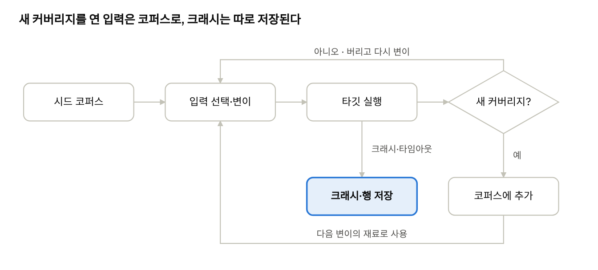

## 퍼징이란?

퍼징(fuzzing, fuzz testing)은 무작위이거나 일부러 망가뜨린 입력을 자동으로 만들어 프로그램에 넣고, 크래시·무한 대기(hang)·메모리 오류 같은 비정상 동작을 관찰해 버그를 찾는 테스트 기법이다. 퍼징을 수행하는 도구를 퍼저(fuzzer)라고 부른다.

### why?

사람이 짠 테스트 케이스는 개발자가 생각한 경우만 검사한다. 퍼저는 초당 수천 번씩 입력을 바꿔 가며 개발자가 예상하지 못한 경계값·잘못된 포맷·길이 조합을 기계적으로 시도한다. 그래서 파서, 디코더, 네트워크 프로토콜처럼 외부 입력을 받는 코드의 메모리 안전 버그(버퍼 오버플로, use-after-free 등)를 찾는 데 특히 강하다.

퍼징은 1988년 위스콘신 대학교 Barton Miller 교수의 수업 과제에서 시작됐다. 유닉스 유틸리티에 랜덤 문자열을 넣었더니 상당수가 크래시했고, 이때의 방식은 지금 기준으로 블랙박스 퍼징에 해당한다. 오늘날에는 Google, Microsoft 같은 회사가 브라우저와 운영체제를 상시 퍼징하고, Google의 OSS-Fuzz는 주요 오픈소스 프로젝트를 지속적으로 퍼징한다.

### how?

현대 퍼저의 기본은 “커버리지 기반(coverage-guided)” 루프다. 입력을 변형해 실행하고, 새 코드 경로를 연 입력만 코퍼스에 남겨 다음 변형의 재료로 쓴다. 이 과정을 수백만~수억 번 반복하면서 프로그램 깊숙한 곳까지 파고든다.



새 커버리지가 없는 입력은 버려지고, 있는 입력은 코퍼스에 들어가 다음 변이의 재료가 된다. 실행 중 크래시나 타임아웃이 나면 그 입력은 재현을 위해 따로 저장된다.

### 꼭 알아야 할 용어

| 용어                       | 뜻                                                                                                                                                                        |
|----------------------------|---------------------------------------------------------------------------------------------------------------------------------------------------------------------------|
| 타깃 (PUT, fuzz target)    | 퍼징할 대상 프로그램 또는 함수. libFuzzer에서는 `LLVMFuzzerTestOneInput(data, size)` 함수가 타깃이다                                                                      |
| 시드 (seed)                | 퍼징을 시작할 때 주는 정상 입력 샘플. 예: PNG 라이브러리를 퍼징할 때 유효한 PNG 파일 몇 개                                                                                |
| 코퍼스 (corpus)            | 퍼저가 갖고 있는 입력 모음. 시드에서 출발해 새 커버리지를 만든 입력이 계속 추가된다                                                                                       |
| 변이 (mutation)            | 기존 입력의 비트 뒤집기, 바이트 삽입·삭제, 두 입력 이어 붙이기(splice) 등으로 새 입력을 만드는 연산                                                                       |
| 커버리지 (coverage)        | 어떤 코드(블록, 분기 엣지)가 실행됐는지에 대한 정보. 퍼저가 “이 입력이 흥미로운가”를 판단하는 기준                                                                        |
| 계측 (instrumentation)     | 커버리지를 수집하려고 타깃에 기록 코드를 심는 것. 컴파일 때 넣거나(소스 기반) 실행 중 바이너리에 넣는다(바이너리 계측)                                                    |
| 새니타이저 (sanitizer)     | 메모리 오류를 즉시 크래시로 바꿔 주는 컴파일러 기능. ASan(메모리 오류), UBSan(정의되지 않은 동작), MSan(초기화 안 된 메모리) 등. 없으면 조용히 지나가는 오버플로를 놓친다 |
| 딕셔너리 (dictionary)      | 포맷의 키워드·매직 넘버 목록(`IHDR`, `<html>` 등). 퍼저가 이 토큰을 끼워 넣어 구조가 있는 입력을 더 빨리 만든다                                                           |
| 크래시 / 행 (crash / hang) | 비정상 종료와 타임아웃. 퍼저는 이를 일으킨 입력을 따로 저장해 재현할 수 있게 한다                                                                                         |
| exec/s                     | 초당 실행 횟수. 퍼징은 확률 게임이라 속도가 곧 성능이다                                                                                                                   |

## 퍼징의 종류

퍼저는 보통 세 가지 기준으로 나눈다. 입력을 어떻게 만드는가(변이 vs 생성), 입력 구조를 아는가(dumb vs smart), 프로그램 내부를 얼마나 보는가(블랙·그레이·화이트박스)다. 세 기준은 서로 독립적이라서, AFL++는 “변이 기반 + dumb + 그레이박스”처럼 조합으로 설명한다.

### 1. 입력 생성 방식: 변이 기반 vs 생성 기반

| 구분                         | 입력을 만드는 법                                            | 장점                                                             | 단점                                                                          |
|------------------------------|-------------------------------------------------------------|------------------------------------------------------------------|-------------------------------------------------------------------------------|
| 변이 기반 (mutation-based)   | 시드 입력의 비트·바이트·블록을 바꾸고, 넣고, 지우고, 섞는다 | 포맷을 몰라도 샘플만 있으면 바로 시작한다                        | 시드 품질에 크게 좌우된다. 체크섬·엄격한 문법이 있으면 대부분 초반에 거부된다 |
| 생성 기반 (generation-based) | 문법·모델·템플릿을 보고 입력을 처음부터 만든다              | 시드가 필요 없고, 문법에 맞는 입력으로 파서 안쪽 깊숙이 들어간다 | 문법·모델을 직접 써야 해서 준비가 많다                                        |

### 2. 입력 구조 인식: dumb vs smart

- **Dumb(비구조적) 퍼저**는 입력을 그냥 바이트 배열로 본다. 단순하고 범용적이다.

- **Smart(구조 인식, structure-aware) 퍼저**는 입력 모델(문법, AST, 프로토콜 명세)을 알고 있어, 예컨대 구문 트리의 서브트리를 통째로 옮기는 식으로 유효한 입력을 더 많이 만든다. SQL, JavaScript, protobuf처럼 구조가 빡빡한 입력에 필요하다.

변이/생성과 smart/dumb는 서로 다른 축이다. “문법을 아는 변이 퍼저”도 가능하며, Jackalope의 문법 변이 엔진과 libFuzzer + libprotobuf-mutator가 그 예다.

### 3. 프로그램 정보 활용: 블랙박스 vs 그레이박스 vs 화이트박스

| 구분       | 프로그램에서 얻는 정보                        | 특징                                                                            | 대표 도구                              |
|------------|-----------------------------------------------|---------------------------------------------------------------------------------|----------------------------------------|
| 블랙박스   | 없음. 크래시 여부만 본다                      | 설정이 가장 쉽지만 깊은 코드 경로에 닿기 어렵다                                 | Radamsa, Peach, Burp Intruder          |
| 그레이박스 | 가벼운 계측으로 얻는 커버리지 피드백          | 속도와 효과의 균형이 좋아 현재 가장 널리 쓰인다                                 | AFL++, libFuzzer, honggfuzz, Jackalope |
| 화이트박스 | 소스·경로 제약을 분석(심볼릭 실행, 제약 해석) | 이론상 모든 경로를 탐색할 수 있지만 계산 비용이 커서 큰 코드베이스에는 부담이다 | Microsoft SAGE, KLEE                   |

참고로 “화이트박스”를 “소스를 사용한다”는 뜻으로 쓰는 글도 있어서 libFuzzer를 화이트박스로 분류하는 자료도 보인다. 학계 분류(Manès et al.)에서는 커버리지만 보는 AFL·libFuzzer를 그레이박스로 본다. 이 두 방식을 섞은 하이브리드 퍼징(그레이박스 퍼저 + 콘콜릭 실행, 예: Driller, QSYM)도 있다.

### 대상에 따른 특화 퍼저

대상에 따라 전용 퍼저가 따로 있다. 리눅스 커널 시스템 콜은 syzkaller, JavaScript 엔진은 Fuzzilli, 웹 애플리케이션 파라미터는 Burp Intruder 같은 도구가 쓰인다. 이 글에서는 범용 파일·라이브러리 퍼저에 집중한다.

## 대표 퍼저 살펴보기

세 퍼저 모두 커버리지 기반 그레이박스 퍼저지만, 커버리지를 어떻게 얻고 타깃을 어떻게 실행하는지가 다르다. AFL++는 별도 프로세스로 실행하는 범용 퍼저, libFuzzer는 타깃과 한 프로세스에 링크되는 라이브러리형 퍼저, Jackalope는 소스 없는 바이너리를 위한 퍼저다.

### AFL++ — 가장 널리 쓰이는 범용 퍼저

[AFL++](https://github.com/AFLplusplus/AFLplusplus)는 Michal Zalewski(lcamtuf)가 만든 Google의 AFL(American Fuzzy Lop)을 커뮤니티가 이어받아 발전시킨 포크다. Marc Heuse, Dominik Maier, Andrea Fioraldi, Heiko Eissfeldt가 관리하며, 원본 AFL보다 더 빠르고 더 많은 변이·계측 방식과 커스텀 모듈을 지원한다. 글 작성 시점 README에 적힌 최신 릴리스는 5.03c다.

**동작 방식.** 타깃을 `afl-cc`로 컴파일해 분기마다 커버리지를 기록하는 코드를 심고, `afl-fuzz`가 포크 서버로 타깃 프로세스를 빠르게 복제하며 입력을 넣는다. 커버리지는 공유 메모리 비트맵으로 퍼저에 전달된다.

**계측 모드.** 소스가 있으면 LTO(`afl-clang-lto`) → LLVM(`afl-clang-fast`) → GCC 플러그인 순으로 권장한다. 소스가 없으면 바이너리 전용 모드를 쓴다.

- QEMU 모드: 에뮬레이션으로 리눅스 바이너리를 계측

- FRIDA 모드: 동적 계측. 리눅스와 macOS(Intel·ARM) 지원

- Unicorn 모드: 다른 아키텍처의 코드 조각(펌웨어 등)을 에뮬레이션

- Nyx 모드: 스냅샷 기반 퍼징(리눅스 x86_64)

- CoreSight 모드: ARM CPU의 하드웨어 트레이스 사용(AArch64 리눅스)

**핵심 기능.**

| 기능                  | 하는 일                                                                                                                            |
|-----------------------|------------------------------------------------------------------------------------------------------------------------------------|
| Persistent mode       | 매번 fork하지 않고 타깃 함수를 루프로 반복 호출해 속도를 크게 올린다. 상태를 남기거나 메모리가 새거나 exit하는 함수에는 쓸 수 없다 |
| CmpLog (Redqueen)     | 비교 연산의 피연산자를 기록해 두었다가 그 값을 입력에 직접 심는다. `if (magic == 0xDEADBEEF)` 같은 매직 넘버를 뚫는 데 효과적이다  |
| LAF-Intel / CompCov   | 여러 바이트 비교를 8비트 비교 여러 개로 쪼개, 한 바이트씩 맞출 때마다 커버리지가 늘게 한다                                         |
| Power schedules       | AFLFast에서 가져온 기법으로, 어떤 시드에 변이를 얼마나 할지 배분한다                                                               |
| MOpt, 커스텀 뮤테이터 | 변이 연산자 선택을 최적화하고, Radamsa·honggfuzz 뮤테이터나 직접 만든 뮤테이터를 붙일 수 있다                                      |
| 충돌 없는 커버리지    | 원본 AFL은 다른 엣지가 같은 비트맵 칸에 겹칠 수 있었다. LTO·PCGUARD 계측은 이 충돌을 없앤다                                        |
| 자동 딕셔너리         | LTO 모드가 컴파일 중 발견한 비교 상수로 딕셔너리를 만든다                                                                          |

**기본 사용법.**

``` bash
# 1) 타깃을 afl-cc로 빌드
CC=/path/to/afl-cc CXX=/path/to/afl-c++ ./configure --disable-shared
make clean all

# 2) 시드 폴더에 작고 유효한 입력을 넣고 퍼징 시작
#    파일로 입력받는 프로그램이면 @@ 가 파일 경로로 바뀐다
./afl-fuzz -i seeds_dir -o output_dir -x my.dict -- /path/to/program @@

# 3) 찾은 크래시 재현
cat output_dir/default/crashes/id:000000,* | /path/to/program
```

크래시와 행은 출력 폴더의 `crashes/`, `hangs/`에 모인다(최근 버전은 인스턴스 이름 폴더인 `default/` 아래).

### libFuzzer — 타깃과 한 몸이 되는 인프로세스 퍼저

[libFuzzer](https://llvm.org/docs/LibFuzzer.html)는 LLVM 프로젝트에 포함된 인프로세스(in-process), 커버리지 기반, 진화형 퍼징 엔진이다. 퍼저가 테스트할 라이브러리와 같은 프로세스에 링크되고, 정해진 진입점 함수에 입력을 넣으며 같은 프로세스 안에서 수백만 번 반복 호출한다. 커버리지는 LLVM의 SanitizerCoverage가 제공한다.

``` cpp
// fuzz_target.cc — 퍼저가 이 함수를 계속 호출한다
extern "C" int LLVMFuzzerTestOneInput(const uint8_t *Data, size_t Size) {
  DoSomethingWithData(Data, Size);  // 테스트할 API
  return 0;
}
```

``` bash
clang++ -g -O1 -fsanitize=fuzzer,address fuzz_target.cc -o my_fuzzer
./my_fuzzer corpus_dir/ -dict=my.dict -max_len=4096
```

- **장점:** fork·exec 비용이 없어 매우 빠르다. ASan·UBSan·MSan과 바로 결합된다. 같은 타깃 함수를 AFL++나 honggfuzz에도 그대로 쓸 수 있어, OSS-Fuzz가 이 인터페이스를 표준처럼 사용한다.

- **주의:** 한 프로세스에서 반복하므로 타깃이 exit하거나 전역 상태를 남기면 안 된다. 소스 코드와 Clang이 필요하다.

- **구조 인식:** libprotobuf-mutator(LPM)나 커스텀 뮤테이터를 붙여 protobuf·SQL 같은 구조화된 입력도 퍼징할 수 있다.

- **현재 상태:** LLVM 문서에 따르면 원 제작자들은 후속 엔진인 Centipede 개발로 옮겨 갔다. libFuzzer는 중요한 버그 수정은 계속되지만 큰 신규 기능은 기대하기 어렵다.

### Jackalope — 소스 없는 바이너리를 위한 퍼저

[Jackalope](https://github.com/googleprojectzero/Jackalope)는 Google Project Zero가 공개한, 소스 코드 없는 블랙박스 바이너리를 대상으로 하는 커버리지 기반 퍼저다. Windows, macOS, Linux, Android를 지원하고, 단독 실행도 되지만 라이브러리로 쓰면서 부품을 갈아끼울 때 더 강력하다.

**커버리지 수집: TinyInst.** Jackalope는 같은 팀이 만든 경량 동적 계측 라이브러리 [TinyInst](https://github.com/googleprojectzero/TinyInst)를 기본으로 쓴다. TinyInst는 프로세스 안에서 지정한 모듈만 계측하고 나머지는 네이티브로 실행해 가볍다. DynamoRIO나 PIN 같은 큰 프레임워크를 대체하려는 것이 아니라, 더 가벼운 도구가 맞는 상황을 위한 것이다. (DynamoRIO 기반인 WinAFL과 비교되는 이유다.) 리눅스에서는 소스가 있을 때 SanitizerCoverage 모드도 쓸 수 있다.

**핵심 기능.**

- **Persistent 퍼징:** `-target_module`, `-target_method`로 지정한 함수를 재시작 없이 반복 호출한다(`-persist -loop -iterations N`).

- **샘플 전달:** 파일(`@@`가 파일 경로로 바뀜) 또는 공유 메모리(`-delivery shmem`).

- **비교 커버리지:** `-cmp_coverage`로 여러 바이트 비교를 뚫는 것을 돕는다(AFL++의 CmpLog·LAF-Intel과 같은 목적).

- **분산 퍼징:** 한 머신에서는 `-nthreads`, 여러 머신에서는 서버(`-start_server`)와 워커(`-server`)로 샘플·크래시·커버리지를 공유한다.

- **문법 기반 변이:** 범용 바이너리 뮤테이터 외에 문법 변이 엔진이 들어 있다.

- **확장성:** `Fuzzer` 클래스를 상속해 `CreateMutator()`, `CreateInstrumentation()` 등을 오버라이드하면 뮤테이터와 계측 방식을 바꿀 수 있다.

- **커버리지 내보내기:** `-dump_coverage`로 IDA 플러그인 Lighthouse에서 볼 수 있는 커버리지 파일을 남긴다.

**사용 예 (README의 macOS 예제).**

``` bash
./fuzzer -in in -out out -t 1000 -delivery shmem \
  -instrument_module test -target_module test -target_method __Z4fuzzPc \
  -nargs 1 -iterations 10000 -persist -loop -cmp_coverage \
  -- ./test -m @@
```

`test` 모듈을 계측하고, 인자 1개짜리 `fuzz(char*)` 함수를 1,000ms 타임아웃으로 최대 10,000번 반복 호출한 뒤 프로세스를 재시작하는 설정이다.

## 퍼저 비교와 선택 가이드

가장 큰 차이는 “소스가 있는가”와 “타깃을 어떻게 실행하는가”다. 소스가 있는 라이브러리는 libFuzzer 타깃을 써서 AFL++와 함께 돌리고, 소스 없는 Windows·macOS 바이너리는 Jackalope가 알맞다.

| 항목           | AFL++                                           | libFuzzer                            | Jackalope                                            |
|----------------|-------------------------------------------------|--------------------------------------|------------------------------------------------------|
| 만든 곳        | 커뮤니티 (원본 AFL은 Google)                    | LLVM 프로젝트 (Google)               | Google Project Zero                                  |
| 소스 코드      | 있으면 컴파일 계측, 없으면 QEMU·FRIDA 등        | 필요 (Clang 빌드)                    | 필요 없음 (리눅스는 소스 있을 때 SanCov 모드도 가능) |
| 커버리지 수집  | 컴파일 타임 계측 / 에뮬레이션·동적 계측         | SanitizerCoverage                    | TinyInst 동적 계측 (지정 모듈만)                     |
| 실행 방식      | 별도 프로세스 + 포크 서버, persistent mode 선택 | 같은 프로세스 안에서 함수 반복 호출  | 별도 프로세스, 대상 함수 persistent 반복             |
| 주 지원 OS     | 리눅스 중심 (FRIDA는 macOS도)                   | Clang이 도는 플랫폼                  | Windows, macOS, Linux, Android                       |
| 매직 넘버 뚫기 | CmpLog, LAF-Intel, 자동 딕셔너리                | 비교 값 추적, 딕셔너리               | `-cmp_coverage`                                      |
| 구조 인식      | 커스텀 뮤테이터                                 | libprotobuf-mutator, 커스텀 뮤테이터 | 내장 문법 변이 엔진                                  |
| 병렬·분산      | 메인/세컨더리 인스턴스 (`-M`/`-S`)              | `-jobs`, `-workers`, `-fork`         | 스레드 + 서버/워커 분산                              |
| 확장 방식      | 커스텀 뮤테이터 API                             | 커스텀 뮤테이터 함수                 | C++ 클래스 상속으로 부품 교체                        |
| 현재 상태      | 활발히 개발 중                                  | 유지보수 (신기능은 Centipede로)      | 공개 저장소에서 개발                                 |

### 상황별로 고르기

- **오픈소스 C/C++ 라이브러리를 퍼징한다:** `LLVMFuzzerTestOneInput` 타깃을 하나 만들고 libFuzzer로 시작한 뒤, 같은 타깃을 AFL++로도 돌린다. OSS-Fuzz가 쓰는 방식이다.

- **소스는 없고 리눅스 바이너리만 있다:** AFL++ QEMU 모드나 FRIDA 모드.

- **Windows·macOS의 닫힌 바이너리(이미지 디코더, 문서 파서 등):** Jackalope. 특정 모듈의 특정 함수를 짚어 persistent로 돌릴 수 있다.

- **펌웨어나 다른 아키텍처 코드 조각:** AFL++ Unicorn 모드.

- **입력이 문법을 따르는 언어·프로토콜(SQL, JS, protobuf):** 구조 인식 퍼징. libFuzzer + LPM, Jackalope 문법 엔진, 또는 Fuzzilli 같은 전용 퍼저를 검토한다.

퍼저마다 잘하는 영역이 달라서, 여러 퍼저를 같은 코퍼스로 번갈아 돌리는 앙상블 퍼징이 흔하다. Google의 FuzzBench는 여러 퍼저를 같은 벤치마크에서 비교하는 서비스다.

## 퍼징을 돌리는 과정

퍼징은 퍼저를 켜 두면 끝나는 일이 아니다. 타깃을 고르고, 하네스를 쓰고, 빌드하고, 돌리고, 나온 크래시를 분석해 고치는 것까지가 한 사이클이다. 아래는 소스가 있는 C/C++ 라이브러리를 AFL++로 퍼징하는 경우를 기준으로 한 단계별 설명이며, libFuzzer에서 대응하는 명령은 마지막 표에 모았다.

### 1단계. 타깃 고르기

외부에서 들어오는 데이터를 해석하는 코드가 첫 번째 후보다. 파일 포맷 파서(이미지, 문서, 압축), 네트워크 패킷 처리, 설정·스크립트 해석기처럼 공격자가 입력을 통제할 수 있는 곳이다. 프로그램 전체보다 `png_read()` 같은 함수 단위로 좁힐수록 빠르고 효과적이다.

### 2단계. 하네스(harness) 작성

하네스는 퍼저가 만든 바이트를 타깃 API에 연결하는 짧은 코드다. libFuzzer 형식(`LLVMFuzzerTestOneInput`)으로 쓰면 AFL++, libFuzzer, honggfuzz 어디서나 그대로 쓸 수 있다.

``` cpp
// harness.cc — 이미지 파서를 퍼징하는 예
extern "C" int LLVMFuzzerTestOneInput(const uint8_t *data, size_t size) {
  Image *img = image_parse(data, size);   // 테스트할 함수
  if (img) image_free(img);               // 메모리를 남기지 않는다
  return 0;
}
```

하네스가 지켜야 할 규칙은 다섯 가지다.

- **어떤 입력도 받는다:** 빈 입력, 거대한 입력, 깨진 입력을 모두 처리한다.

- **exit·abort하지 않는다:** 프로세스 종료는 크래시로 취급돼 진짜 버그를 가린다.

- **결정적이다:** 같은 입력이면 같은 동작을 한다. 시간·난수에 의존하지 않는다.

- **상태를 남기지 않는다:** 호출 사이에 전역 변수나 새는 메모리가 남으면 크래시 재현이 어렵다.

- **빠르다:** 코어당 초당 수천 번 실행을 목표로, 디스크·네트워크·출력은 뺍다.

### 3단계. 계측 + 새니타이저로 빌드

AFL++ 컴파일러로 빌드하면 커버리지 계측이 들어간다. 새니타이저는 크래시까지 가지 않는 메모리 오류도 잡아 주지만 CPU와 메모리를 많이 쓴다. 그래서 보통 용도별로 바이너리를 여러 개 만든다.

``` bash
# (a) 속도용 기본 빌드 — libFuzzer형 하네스도 -fsanitize=fuzzer 로 그대로 빌드된다
afl-clang-fast++ -O2 -fsanitize=fuzzer harness.cc libimage.a -o fuzz

# (b) ASan 빌드 — 메모리 오류 탐지용
AFL_USE_ASAN=1 afl-clang-fast++ -O2 -fsanitize=fuzzer harness.cc libimage.a -o fuzz_asan

# (c) CmpLog 빌드 — 매직 넘버·비교 우회용
AFL_LLVM_CMPLOG=1 afl-clang-fast++ -O2 -fsanitize=fuzzer harness.cc libimage.a -o fuzz_cmplog
```

ASan 인스턴스는 하나면 충분하다. 다른 인스턴스가 찾은 입력을 동기화하면서 ASan 인스턴스가 다시 실행해 보기 때문이다.

### 4단계. 시드 코퍼스와 딕셔너리 준비

- **시드:** 작고 유효한 입력 몇 개~수십 개를 모은다. 크기가 작을수록 변이가 빠르다. 더 많이 모았다면 `afl-cmin`으로 같은 경로만 타는 입력을 걸러낸다.

- **딕셔너리:** 포맷의 매직 넘버와 키워드를 적어 `-x`로 넘긴다. AFL++ 저장소의 `dictionaries/` 폴더에 PNG, JPEG, XML 등 만들어 둔 것이 있다.

``` bash
mkdir seeds && cp samples/*.png seeds/
afl-cmin -i seeds -o seeds_min -- ./fuzz @@
```

### 5단계. 퍼징 실행

한 코어로 시작해 보고, 제대로 돌릴 때는 메인(`-M`) 하나와 세컨더리(`-S`) 여러 개를 코어 수만큼 띄운다. 인스턴스들은 같은 출력 폴더를 쓰면서 찾은 입력을 서로 동기화한다.

``` bash
# 메인: CmpLog 바이너리를 -c 로 함께 준다
afl-fuzz -M main -i seeds_min -o out -x png.dict -c ./fuzz_cmplog -- ./fuzz

# 세컨더리: 하나는 ASan 빌드, 나머지는 기본 빌드
afl-fuzz -S asan -i seeds_min -o out -- ./fuzz_asan
afl-fuzz -S s1   -i seeds_min -o out -- ./fuzz
```

실행하면 출력 폴더가 다음처럼 채워진다.

| 경로                                 | 내용                            |
|--------------------------------------|---------------------------------|
| `out/main/queue/`                    | 새 커버리지를 만든 입력(코퍼스) |
| `out/main/crashes/`                  | 크래시를 일으킨 입력            |
| `out/main/hangs/`                    | 타임아웃을 일으킨 입력          |
| `out/main/fuzzer_stats`, `plot_data` | 통계와 그래프용 데이터          |

### 6단계. 모니터링

afl-fuzz 상태 화면에서 먼저 볼 것은 세 가지다.

- **exec speed:** 너무 느리면(초당 수십 회 수준) 하네스가 무겁거나 디스크 I/O가 있는지 본다. persistent mode로 크게 올릴 수 있다.

- **corpus count / last new find:** 코퍼스가 더 늘지 않고 마지막 발견이 오래됐다면 커버리지 정체(plateau)다. 시드·딕셔너리를 보강하거나 하네스가 다른 코드 경로를 타게 고친다.

- **saved crashes / hangs:** 0보다 커지면 7단계로 넘어간다.

여러 인스턴스를 한눈에 볼 때는 `afl-whatsup out`, 커버리지 추이 그래프는 `afl-plot out/main plot_dir/`를 쓴다. 얼마나 돌릴지는 정답이 없지만, 새 경로가 더 안 나오기 시작한 이후에도 일정 시간 더 돌리는 것이 보통이다.

### 7단계. 크래시 분석(트리아지)

퍼저가 저장한 크래시 수가 곧 버그 수는 아니다. 같은 버그를 다른 입력으로 수십 번 밟는 경우가 많아서 아래 순서로 정리한다.

1.  **재현:** ASan 빌드에 크래시 입력을 넣어 다시 터뜨리고 스택 트레이스를 얻는다.

2.  **중복 제거:** 크래시 위치와 콜 스택이 같으면 같은 버그로 묶는다.

3.  **최소화:** `afl-tmin`으로 같은 크래시를 내는 가장 작은 입력을 만들면 원인 부분이 잘 보인다.

4.  **원인 분석:** ASan 리포트의 종류(heap-buffer-overflow, use-after-free 등)와 스택을 보고, gdb로 따라가 어느 검사가 빠졌는지 찾는다.

5.  **심각도 판단:** 단순 서비스 거부(NULL 역참조, 작은 읽기)인지, 메모리 쓰기처럼 악용 가능성이 있는지 나눈다.

``` bash
# 재현 (ASan 리포트 확인)
./fuzz_asan out/main/crashes/id:000000,*

# 최소화
afl-tmin -i out/main/crashes/id:000000,* -o crash_min -- ./fuzz_asan @@
```

### 8단계. 수정과 지속 퍼징

버그를 고친 뒤에는 최소화한 크래시 입력을 회귀 테스트와 시드 코퍼스에 추가해 같은 버그가 돌아오지 않게 한다. 퍼징 결과 코퍼스는 `afl-cmin -i out/main/queue -o corpus_min -- ./fuzz @@`로 줄여서 다음 퍼징의 시드로 쓴다. 코드가 바뀔 때마다 새 버그가 생기므로 CI에서 짧게 돌리거나 OSS-Fuzz 같은 서비스로 계속 퍼징한다. CI에서는 `AFL_EXIT_ON_TIME`(새 경로가 일정 시간 없으면 종료)처럼 끝낼 조건을 꼭 걸어 둔다.

### AFL++와 libFuzzer 명령 대응표

| 단계          | AFL++                                                     | libFuzzer                              |
|---------------|-----------------------------------------------------------|----------------------------------------|
| 빌드          | `afl-clang-fast++ -fsanitize=fuzzer` (+ `AFL_USE_ASAN=1`) | `clang++ -fsanitize=fuzzer,address`    |
| 실행          | `afl-fuzz -i seeds -o out -- ./fuzz`                      | `./fuzz corpus/ seeds/`                |
| 딕셔너리      | `-x my.dict`                                              | `-dict=my.dict`                        |
| 병렬 실행     | `-M` / `-S` 인스턴스 여러 개                              | `-jobs=N -workers=N` 또는 `-fork=N`    |
| 코퍼스 최소화 | `afl-cmin`                                                | `-merge=1 new_dir old_dir`             |
| 크래시 최소화 | `afl-tmin`                                                | `-minimize_crash=1 -runs=N crash-file` |
| 크래시 재현   | `./fuzz_asan crash-file`                                  | `./fuzz crash-file`                    |

## 마치며

퍼징은 “망가진 입력을 대량으로 넣고 크래시를 관찰한다”는 단순한 아이디어에서 출발해, 오늘날에는 커버리지 피드백·새니타이저·비교 값 추적을 결합한 그레이박스 퍼징이 표준이 됐다. 도구를 고를 때는 소스 유무와 플랫폼을 먼저 보고, 그다음에 좋은 타깃·시드·딕셔너리를 준비하는 데 시간을 쓰는 것이 결과를 가장 크게 바꾼다.


## 참고 자료

- [AFLplusplus/AFLplusplus (GitHub)](https://github.com/AFLplusplus/AFLplusplus)

- [AFL++ — Important features](https://aflplus.plus/docs/features)

- [googleprojectzero/Jackalope (GitHub)](https://github.com/googleprojectzero/Jackalope)

- [googleprojectzero/TinyInst (GitHub)](https://github.com/googleprojectzero/TinyInst)

- [google/fuzzing (GitHub)](https://github.com/google/fuzzing)

- [google/fuzzing — libFuzzer Tutorial](https://github.com/google/fuzzing/blob/master/tutorial/libFuzzerTutorial.md)

- [libFuzzer — LLVM 문서](https://llvm.org/docs/LibFuzzer.html)

- [OSS-Fuzz — Ideal integration](https://google.github.io/oss-fuzz/advanced-topics/ideal-integration)

- [AFL++ — Fuzzing in depth](https://aflplus.plus/docs/fuzzing_in_depth)

- [Trail of Bits — AFL++ 사용 가이드](https://trailofbits.com/skills/aflpp/)

- [Fuzzing — Wikipedia](https://en.wikipedia.org/wiki/Fuzzing)
